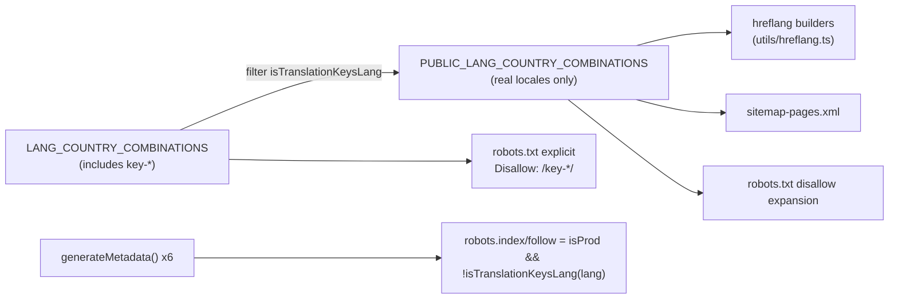

# OD-2333 — Remove `key-*` translation-key pseudo-locale from hreflang, sitemap, and robots

Related docs:

- [`hreflang-refactor.md`](./hreflang-refactor.md) — hreflang builder architecture
- [`od-2310-11-robots.md`](./od-2310-11-robots.md) — robots.txt / noindex conventions used here
- [`show_code_removal.md`](./show_code_removal.md) — background on the `key` translation-key debug mode

---

## 1. Problem statement

The `<head>` of public pages (confirmed on PDP, platform-wide by construction) emitted `hreflang` alternate links for a `key-*` pseudo-locale alongside the real `en/nl/fr/de` variants:

```html
<link
  rel="alternate"
  hreflang="key-LU"
  href="https://ottogusto.com/key-LU/autoteile/toyota/mf9tx58nf57k87"
/>
```

`key` is an internal, staff-only "translation key" debug view (renders raw translation keys instead of copy — intended for `@cp2digital` staff via the language switcher). It is **not** a real language, and the `key-*` URLs return `200` and fully render for anonymous users.

**Impact:**

- `key` is not a valid hreflang language code — dead weight in every affected `<head>` at minimum, with unclear-but-plausible risk of destabilizing the valid hreflang cluster.
- `key-*` pages were publicly reachable, present in the sitemap, and crawlable — internal tooling exposed to search engines (index-bloat / duplicate-content risk).

**Root cause:** a single locale array, `LANG_COUNTRY_COMBINATIONS` (`config/lang-country-combinations-env.ts`), bakes `key-BE`/`key-NL`/`key-FR`/`key-LU` in alongside the real locale combinations. This one array was consumed **unfiltered** by every SEO-facing surface — hreflang builders, sitemap generation, and `robots.txt` — as well as by routing/middleware. There was no separate "public locales" list.

## 2. Decision on scope

Confirmed with reporter: keep `key-*` pages **reachable** (200) for staff/QA convenience — no changes to `middleware.ts` routing or route-level auth gating. Instead, remove `key-*` from every SEO surface and add explicit `noindex` signals.

## 3. What was changed



### 3.1 New derived "public locales" list

`config/lang-country-combinations-env.ts` now exports `PUBLIC_LANG_COUNTRY_COMBINATIONS`, derived by filtering `LANG_COUNTRY_COMBINATIONS` through the existing `isTranslationKeysLang()` helper (`utils/translationDisplayMode.ts`). Re-exported from `config/locale-constants.ts`, `config/robots.ts`, and `constants.tsx` — same pattern already used for `LANG_COUNTRY_COMBINATIONS`.

This is now the single source of truth for "real, indexable locales"; `LANG_COUNTRY_COMBINATIONS` (all locales including `key-*`) is still used unchanged for routing/middleware, which is out of scope for this fix.

### 3.2 hreflang generation

`utils/hreflang.ts` — all four alternate-language builders now loop over `PUBLIC_LANG_COUNTRY_COMBINATIONS` instead of `LANG_COUNTRY_COMBINATIONS`:

- `buildAlternateLanguages` (PDP, car-parts landing)
- `buildCategoryAlternateLanguages` (category L1)
- `buildCategoryL2AlternateLanguages`
- `buildCategoryL3AlternateLanguages`

Since every page type's `generateMetadata()` calls into these shared builders, this single change fixes hreflang platform-wide (PDP, category L1/L2/L3, car-parts landing) without touching each page individually.

### 3.3 Sitemap

`app/sitemap-pages.xml/route.ts` — every locale loop (static routes, L1/L2/L3 category routes, manufacturer routes) switched from `LANG_COUNTRY_COMBINATIONS` to `PUBLIC_LANG_COUNTRY_COMBINATIONS`. `key-*` URLs are no longer listed in the sitemap.

### 3.4 `robots.txt`

`utils/robotsContent.ts`:

- The existing per-locale `ROBOTS_DISALLOW` expansion now uses `PUBLIC_LANG_COUNTRY_COMBINATIONS` (stops silently including `key-*` variants of already-disallowed paths).
- Added an explicit blanket disallow for every `key-*` locale root:
  ```
  Disallow: /key-BE/
  Disallow: /key-NL/
  Disallow: /key-FR/
  Disallow: /key-LU/
  ```

### 3.5 `noindex` metadata (defense in depth)

Each `generateMetadata()` already computed `robots: { index: isProd, follow: isProd, googleBot: {...} }` inline (no shared helper — duplicated by existing convention, not refactored here). Changed the index/follow computation in all six to also require the locale isn't the `key` pseudo-locale:

```ts
const indexable = isProd && !isTranslationKeysLang(lang);
// ...
robots: {
  index: indexable,
  follow: indexable,
  googleBot: { index: indexable, follow: indexable, ... },
}
```

## 4. Files changed

| File                                                                           | Change                                                                            |
| ------------------------------------------------------------------------------ | --------------------------------------------------------------------------------- |
| `config/lang-country-combinations-env.ts`                                      | **New** — `PUBLIC_LANG_COUNTRY_COMBINATIONS` (filters out `key-*`)                |
| `config/locale-constants.ts`                                                   | Re-export `PUBLIC_LANG_COUNTRY_COMBINATIONS`                                      |
| `config/robots.ts`                                                             | Re-export `PUBLIC_LANG_COUNTRY_COMBINATIONS`                                      |
| `constants.tsx`                                                                | Re-export `PUBLIC_LANG_COUNTRY_COMBINATIONS`                                      |
| `utils/hreflang.ts`                                                            | All 4 alternate-language builders use `PUBLIC_LANG_COUNTRY_COMBINATIONS`          |
| `app/sitemap-pages.xml/route.ts`                                               | All locale loops use `PUBLIC_LANG_COUNTRY_COMBINATIONS`                           |
| `utils/robotsContent.ts`                                                       | Disallow expansion uses public list + explicit `Disallow: /key-*/` per key locale |
| `screens/landing/carPartsMetadata.ts`                                          | `robots.index/follow` gated by `!isTranslationKeysLang(lang)`                     |
| `screens/category/categoryL1Metadata.ts`                                       | Same                                                                              |
| `screens/category/categoryL2Metadata.ts`                                       | Same                                                                              |
| `screens/category/categoryL3Metadata.ts`                                       | Same                                                                              |
| `app/(public)/[language-country]/car-parts/[partname]/[partid]/page.tsx` (PDP) | Same                                                                              |
| `app/(public)/[language-country]/page.tsx` (homepage)                          | Same                                                                              |

**Not in scope:** `middleware.ts` — `key-*` remains a technically-valid, renderable locale segment for staff/QA; no auth gating added to the route itself.

## 5. How to test

Run per environment (replace `DOMAIN`):

### 5.1 Sitemap — no `key-*` entries

```bash
curl -s "https://DOMAIN/sitemap-pages.xml" | grep -o 'key-[A-Z]*'
```

**Pass if:** no output.

### 5.2 hreflang — one URL per page type

```bash
curl -s "https://DOMAIN/de-BE/autoteile/toyota/<partid>" | grep -o 'hreflang="[^"]*"'
```

Repeat for a category L1/L2/L3 URL and the homepage.

**Pass if:** output contains only `en-*`, `nl-*`, `fr-*`, `de-*` and a single `x-default` — no `key-*`.

### 5.3 robots.txt — key locales disallowed

```bash
curl -s "https://DOMAIN/robots.txt" | grep -i "key-"
```

**Pass if:** contains `Disallow: /key-BE/`, `/key-NL/`, `/key-FR/`, `/key-LU/`.

### 5.4 `noindex` on `key-*` pages

```bash
curl -s "https://DOMAIN/key-LU/autoteile/toyota/<partid>" | grep -i 'name="robots"'
```

Repeat for a category page and the homepage under a `key-*` locale.

**Pass if:** contains `noindex` (and `nofollow`).

### 5.5 Regression — real locales unaffected

Repeat 5.2–5.4 against a real locale (e.g. `en-BE`) and confirm hreflang sets, sitemap presence, and `index`/`follow` values are unchanged from pre-fix behavior (indexable in prod, as before).

### 5.6 hreflang validator

Run the fixed PDP URL through an hreflang validator (e.g. Merkle/Sistrix) to confirm a valid, reciprocal cluster with a single `x-default` and no invalid codes.

## 6. Pass / fail checklist

| #   | Check                                  | Command                                 | Pass criteria                       |
| --- | -------------------------------------- | --------------------------------------- | ----------------------------------- |
| 1   | Sitemap                                | `curl …/sitemap-pages.xml \| grep key-` | No output                           |
| 2   | hreflang (PDP)                         | `curl …/de-BE/... \| grep hreflang`     | Only real locales + one `x-default` |
| 3   | hreflang (category L1/L2/L3, homepage) | same, per page type                     | Same                                |
| 4   | robots.txt                             | `curl …/robots.txt \| grep key-`        | `Disallow: /key-BE/` etc. present   |
| 5   | noindex on key-\* pages                | `curl …/key-LU/... \| grep robots`      | `noindex` present                   |
| 6   | Real locales unaffected                | Repeat 2–5 against `en-BE`              | No change from pre-fix behavior     |
| 7   | Type-check                             | `npx tsc --noEmit`                      | No errors                           |

## 7. What this does not guarantee

| Item                       | Notes                                                                                         |
| -------------------------- | --------------------------------------------------------------------------------------------- |
| **Instant de-indexing**    | If any `key-*` URLs were already indexed, they need time + optional GSC removals to clear     |
| **Access control**         | `key-*` pages remain publicly reachable (200) by design — this is an SEO fix, not auth gating |
| **Non-compliant crawlers** | `robots.txt`/`noindex` only affect well-behaved bots (Google, Bing)                           |

## 8. Adding a new non-public locale in future

If another internal/debug pseudo-locale is ever added to `LANG_COUNTRY_COMBINATIONS`:

1. Ensure `isTranslationKeysLang`-style detection covers it (or generalize the filter in `PUBLIC_LANG_COUNTRY_COMBINATIONS`).
2. Confirm it's automatically excluded from hreflang, sitemap, and the public robots disallow expansion (all three already read from `PUBLIC_LANG_COUNTRY_COMBINATIONS`).
3. Add an explicit `Disallow:` block in `utils/robotsContent.ts` for it.
4. Add the `noindex` gate to any new `generateMetadata()` implementations.
