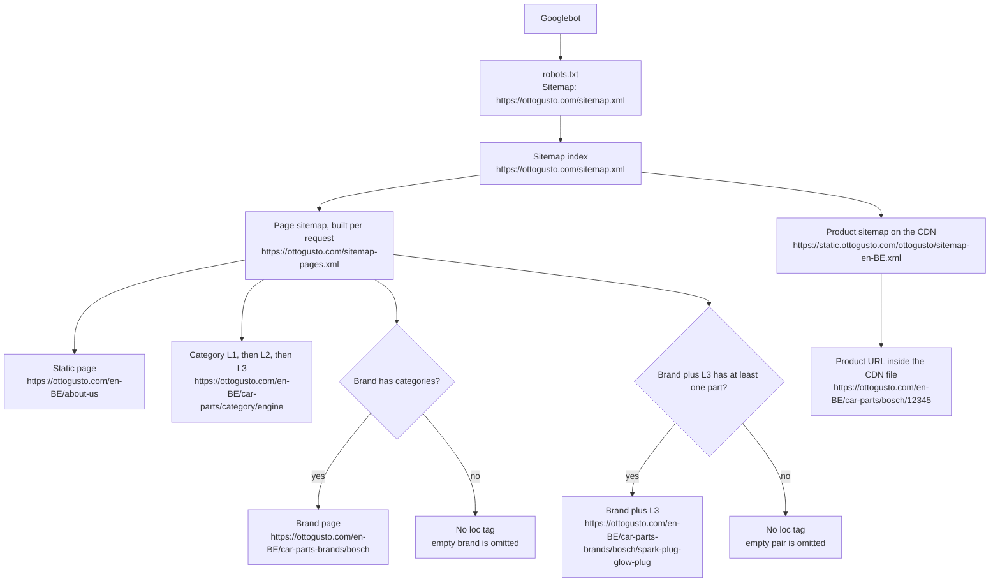
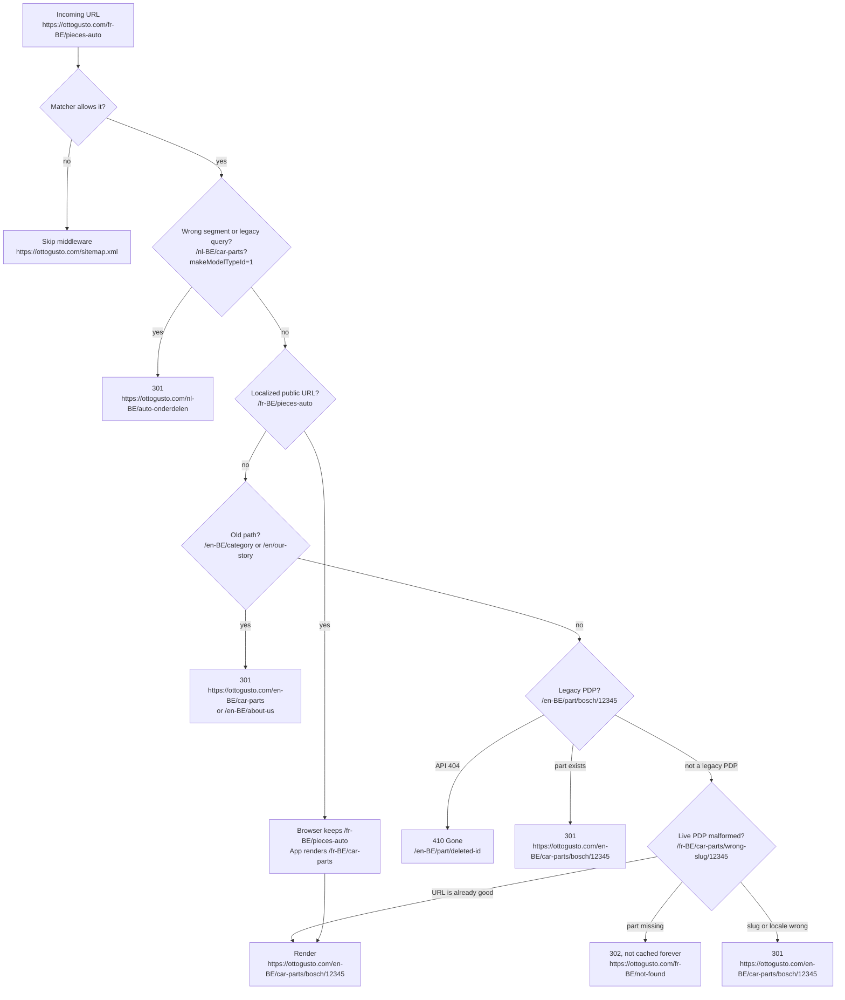
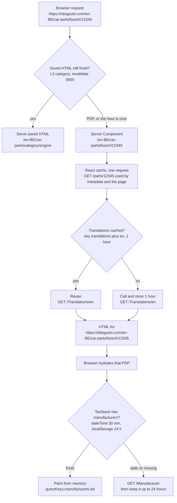
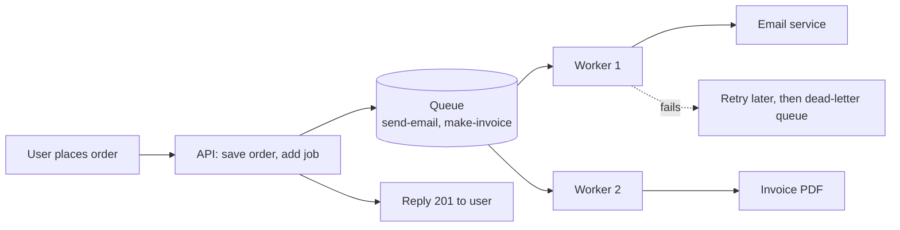
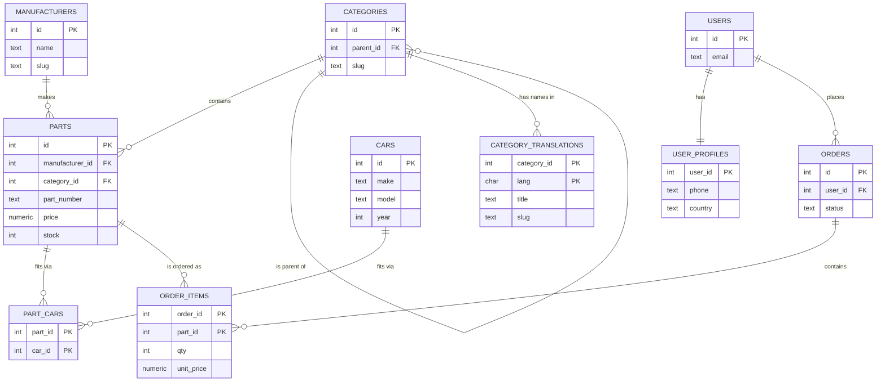
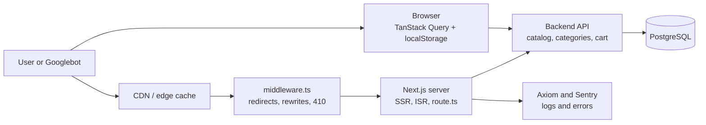
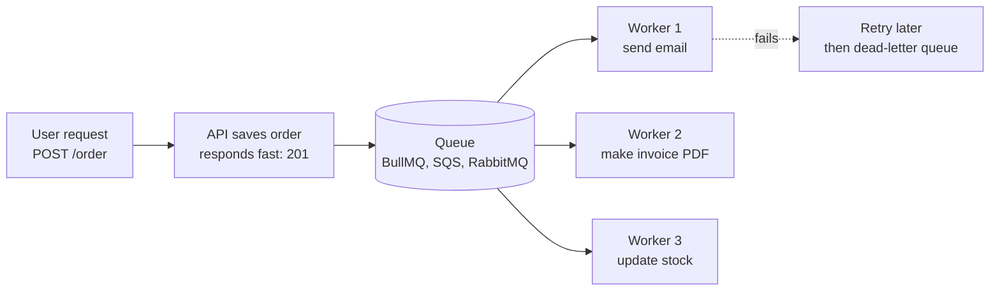

# Learnings

Interview notes from the Next.js app. Each point is what we did, why, and the code that shows it.

Sections 1–22 are about this app (SEO, caching, rendering). Sections 23–28 are general interview topics (JavaScript, TypeScript, React, data structures, PostgreSQL) with simple examples.

## Easy version — read this first

Each line is the same idea as the long section, in everyday words. Use the number to jump to the detail.


| #   | Topic                 | In plain words                                                                                                                                 |
| --- | --------------------- | ---------------------------------------------------------------------------------------------------------------------------------------------- |
| 1–2 | Sitemap               | A menu for Google. The first file lists other menus. We list only pages that have something on them.                                           |
| 3   | `robots.txt`          | A sign on the door. “Public shop floor: come in. Cart and staff rooms: please don’t.” On a test server the sign says “closed to everyone.”     |
| 4   | Hide a page           | We say it three ways (robots file, a tag in the page, a header) because one way is not always read.                                            |
| 5   | Canonical and 301     | One page should have one official address. Old addresses forward to it. A deleted page says “gone” (410).                                      |
| 6   | `hreflang`            | A label that says “this page also exists in French and Dutch,” so Google shows the right one.                                                  |
| 7–8 | Server-rendered       | The server writes the finished page before sending it. Google reads the words straight away.                                                   |
| 9   | Real links            | Every card is a real link (`<a href>`). If it only reacts to a click in JavaScript, Google cannot follow it.                                   |
| 10  | Structured data       | A small label in the page that says “this is a product / FAQ / breadcrumb.”                                                                    |
| 11  | Keeping pages out     | `Disallow` means “don’t visit.” `noindex` means “visit, but don’t list.” `nofollow` means “don’t follow this link.” `410` means “deleted.”     |
| 12  | LCP and CLS           | LCP is how fast the biggest picture appears. CLS is how much the page jumps while loading. Preload the picture and reserve its space.          |
| 13  | TanStack Query        | A notebook in the browser. Ask the server once, remember the answer for a while.                                                               |
| 14  | Next.js cache         | Several shelves: one per request, one for a few hours, one for the whole page for an hour.                                                     |
| 15  | `middleware.ts`       | A receptionist at the door. Before anyone reaches a page, it redirects old addresses and fixes language paths.                                 |
| 16  | Next 14 vs 16         | Next 14 remembered data unless told not to. Next 16 remembers only what you mark with `"use cache"`.                                           |
| 17  | Diagrams              | The same ideas drawn as flows with example URLs.                                                                                               |
| 18  | Hydration             | The server page and the browser’s first draw must match exactly. If they differ, React throws the server page away.                            |
| 19  | SSR, SSG, ISR         | SSG: cooked once at build time. ISR: cooked, then re-cooked every hour. SSR: cooked fresh for each visitor.                                    |
| 20  | Speed                 | Small images, the right size, loaded early. Less JavaScript at the start.                                                                      |
| 21  | Skeleton              | A grey placeholder while the real page loads. The `key` makes it show again when you open a different category.                                |
| 22  | Ranking for a keyword | One clean address per search phrase. The phrase is in the address, title, and heading. Pages link to each other. Then check in Search Console. |


---

## 1. Sitemap index, then a live page sitemap

**What:** `/sitemap.xml` is an index. Category, brand, and static URLs live in `/sitemap-pages.xml`. Product URLs live in per-locale files on the CDN. `robots.txt` points at the index.

**Why:** One file cannot hold every product URL, and Google’s limit is 50,000 URLs per sitemap. Splitting them keeps the index small and lets product sitemaps update on the CDN without rebuilding the app. The pages sitemap is `force-dynamic` so new categories appear without a redeploy.

```64:71:next/app/sitemap.xml/route.ts
  xmlParts.push(`<?xml version="1.0" encoding="UTF-8"?>`);
  xmlParts.push(`<sitemapindex xmlns="http://www.sitemaps.org/schemas/sitemap/0.9">`);
  xmlParts.push(
    `<sitemap><loc>${escapeXml(staticSitemapUrl)}</loc><lastmod>${lastmod}</lastmod></sitemap>`,
  );
```

## 2. Only pages that have content go in the sitemap

**What:** Brand pages are listed only if that brand has categories. Brand + L3 pages are listed only after a product check (`take: 1`) confirms at least one part.

**Why:** An empty URL still costs crawl budget and can look like a thin page. We would rather omit it than ask Google to index a dead end.

```55:61:next/app/sitemap-pages.xml/route.ts
      if ((parts?.data?.parts?.length ?? 0) > 0) {
        populated.add(`${brand.id}::${l3.id}`);
      }
    } catch {
      // API failure → treat as unpopulated; exclude rather than risk indexing an empty page.
    }
```

## 3. `robots.txt` is open only in production

**What:** `NEXT_ALLOW_ROBOTS=true` is the production switch. Everywhere else the file ends with `Disallow: /`. Production still disallows carts, profiles, search, telemetry, and Next.js `?_rsc=` flight URLs, and it always advertises the sitemap.

**Why:** Staging and preview hosts must not enter the index. Private and filter URLs create an infinite URL space, so we keep the crawler on public catalog pages.

```16:36:next/utils/robotsContent.ts
export function buildRobotsContent({ isProd, prodUrl, devUrl }: RobotsContentOptions): string {
  const lines: string[] = ["User-agent: *"];
  const sitemapBaseUrl = isProd ? prodUrl : devUrl;
  lines.push(`Sitemap: ${sitemapBaseUrl}/sitemap.xml`);
  // ...locale Disallow rules...
  if (isProd) {
    lines.push(...ROBOTS_DISALLOW_QUERY_PATTERNS.map((pattern) => `Disallow: ${pattern}`));
  } else {
    lines.push("Disallow: /");
  }
```

## 4. Three signals for pages that must stay out of Google

**What:** Observability routes (`/telemetry`, `/test-axiom`, `/api/axiom`, `/monitoring`) are blocked in `robots.txt`, marked `noindex` in server metadata, and also get an `X-Robots-Tag: noindex, nofollow, noarchive` response header.

**Why:** Some bots ignore `robots.txt`. Metadata covers HTML. The header covers APIs that have no `<head>`. One missed layer is how internal dashboards got indexed before.

```40:54:next/next.config.js
  headers: async () => {
    const noIndexHeaders = [
      { key: "X-Robots-Tag", value: "noindex, nofollow, noarchive" },
    ];
    return [
      { source: "/:locale/telemetry/:path*", headers: noIndexHeaders },
      { source: "/monitoring", headers: noIndexHeaders },
    ];
  },
```

## 5. One canonical URL, and old URLs 301 to it

**What:** Every indexable page sets `alternates.canonical`. Middleware permanently redirects the wrong language segment, legacy `/category`, and old `/part/...` product URLs. `trailingSlash: false` and `en-be` → `en-BE` remove two more duplicate shapes. A deleted product returns **410 Gone**.

**Why:** The same page under several URLs splits ranking. A 301 passes the old URL’s signals to the live one. A 410 tells Google the URL is gone, so it drops it. A 200 “not found” page would keep it in the index.

Localized pretty URLs such as `/fr-BE/pieces-auto` stay in the address bar. Middleware rewrites them internally to the `car-parts` app folder, so the public URL is keyword-rich and the app has one route.

```196:211:next/middleware.ts
  // 301 wrong parts/category segments and/or strip legacy query params.
  if (segmentCanonicalPath !== null || legacyParamsStripped) {
    return NextResponse.redirect(new URL(target.toString(), redirectBaseUrl), { status: 301 });
  }
```

## 6. `hreflang` for every public locale

**What:** `generateMetadata` sets `alternates.languages` for each locale, plus `x-default` on `en-BE`. The helper swaps both the locale and the translated path segment (`car-parts` → `pieces-auto` / `auto-onderdelen` / `autoteile`). Category pages use the slug stored for that language.

**Why:** The same catalog exists in many language–country pairs. Without `hreflang`, Google treats them as duplicates or shows the wrong language. `x-default` is the fallback when the visitor’s locale is not in the list.

```94:109:next/utils/hreflang.ts
export function buildAlternateLanguages(pathname: string): Record<string, string> {
  for (const locale of PUBLIC_LANG_COUNTRY_COMBINATIONS) {
    languages[locale] = `${baseUrl}${translatePath(pathname, locale)}`;
  }
  languages["x-default"] = `${baseUrl}${translatePath(pathname, DEFAULT_LOCALE)}`;
  return languages;
}
```

## 7. Metadata is rendered on the server, per URL

**What:** Pages export `generateMetadata`. A category page loads that category and writes title, description, keywords, canonical, Open Graph, and Twitter from it. A product page does the same from `GET /parts/{id}`. Indexing is on only when production robots are allowed and the locale is a real language, not the translation-key debug locale.

**Why:** Crawlers read the first HTML response. A client-side title change often never gets seen. Unique titles also stop every category sharing one generic `<title>`.

```50:61:next/screens/category/categoryL1Metadata.ts
    const canonical = `${BASE_URL}${Routes.categoryL1(languageCountry, l1Slug)}`;
    return {
      title: `${title}`,
      description,
      alternates: {
        canonical,
        languages: buildCategoryAlternateLanguages(l1, languageCountry),
      },
```

## 8. The page HTML is server-rendered

**What:** Category and product pages are async Server Components. The product fetch is wrapped in `cache()` so metadata and the page share one request. Below-the-fold widgets can be lazy; the title, description, and main content are in the first HTML.

**Why:** If the important text only appears after JavaScript, a crawler can index an empty shell. Server HTML is also what makes the metadata in point 7 reliable.

```39:47:next/screens/category/CategoryL1Page.tsx
export default async function CategoryL1Page({ params }: Props) {
  const resolved = await resolveL1CategoryPage(l1Slug, lang);
  if (!resolved) return <NotFound />;
```

## 9. Every step in the catalog is a real link

**What:** L1, L2, and L3 cards, “view all”, brand tiles, and breadcrumbs use `next/link`, which renders `<a href="...">`. The homepage also has a visually hidden `<h1>`, and breadcrumbs use `<nav>` / `<ol>`.

**Why:** Google follows `href`. A card that only has `onClick` + `router.push` is invisible to a crawler, so that page becomes a dead end. Real links connect Home → parts → L1 → L2 → L3 → product, and breadcrumbs link back up, so nothing is an orphan.

Vehicle filters (`carIds`, `vin`, `makeModelTypeId`) stay on the link for the user, but those hrefs get `rel="nofollow"`, and the breadcrumb JSON-LD is written without those query params. That keeps the crawl on the clean catalog URL.

```215:215:next/screens/category/CategoryL2Section.tsx
                  <Link key={l3.id} href={buildSearchUrl(l3.id)}>
```

## 10. Structured data is in the first HTML

**What:** Home emits `Organization`. Breadcrumbs emit `BreadcrumbList`. Category pages emit `FAQPage`. Product pages emit the product schema from the API. These are plain `<script type="application/ld+json">` tags, not a client script.

**Why:** Rich results (breadcrumbs, FAQs, products) are read from the initial HTML. A client-only JSON-LD tag is easy for a crawler to miss.

```7:21:next/screens/category/CategoryFAQJsonLd.tsx
export default function CategoryFAQJsonLd({ faqs }: Props) {
  const schema = {
    "@context": "https://schema.org",
    "@type": "FAQPage",
    mainEntity: faqs.map((faq) => ({
      "@type": "Question",
      name: faq.question,
      acceptedAnswer: { "@type": "Answer", text: faq.answer },
    })),
  };
```

---

**One-line version:** We server-render unique metadata and HTML, expose one canonical URL per page with `hreflang`, publish only populated URLs in a sitemap index, block private and empty URLs in `robots.txt`, and connect the catalog with real `<a href>` links so the crawler can walk in and back out.

---

## 11. How we keep a URL out of Google — several layers

Google treats “do not crawl” and “do not index” as different instructions. We use both, because a bot that ignores one signal can still honor another.


| Way                                                  | What it does                                              | Where                                         |
| ---------------------------------------------------- | --------------------------------------------------------- | --------------------------------------------- |
| `Disallow` in `robots.txt`                           | Asks Google not to fetch the URL                          | Cart, profile, search, telemetry, `?_rsc=`    |
| `Disallow: /` when `NEXT_ALLOW_ROBOTS` is not `true` | Blocks the whole host                                     | Staging and preview                           |
| `robots: { index: false }` in `generateMetadata`     | Page can be fetched, but must not be indexed              | Telemetry layout, checkout, search-data pages |
| `<meta name="robots" content="noindex">`             | Same signal, written in the root layout HTML              | Internal domains                              |
| `X-Robots-Tag` response header                       | Same signal on routes that have no HTML `<head>`          | `/api/axiom`, `/monitoring`                   |
| `rel="nofollow"`                                     | The page stays indexable; that one link is not followed   | Breadcrumbs with `carIds`, `vin`, `brandId`   |
| Leave it out of the sitemap                          | Does not forbid crawling; just does not advertise the URL | Empty brand + L3 pages                        |
| `410 Gone`                                           | Tells Google the URL is deleted so it drops it            | Old product URLs whose API returns 404        |


**Why more than one:** `robots.txt` is only a hint. If a page is disallowed, Google may never read a `noindex` tag inside it. So public junk (cart, telemetry) is disallowed, and the same routes also send `noindex` in metadata and headers. Filter links use `nofollow` so the clean catalog URL stays the one we want crawled.

```3:15:next/app/(public)/[language-country]/telemetry/layout.tsx
export const metadata: Metadata = {
  robots: {
    index: false,
    follow: false,
    noarchive: true,
  },
};
```

```34:36:next/utils/seoUrlParams.ts
/** True when breadcrumb link should use `rel="nofollow"` (vehicle / brand-manufacturer params). */
export function shouldNofollowBreadcrumbHref(href: string): boolean {
```

Interview line: `Disallow` saves crawl budget. `noindex` keeps a URL out of search results. `nofollow` stops equity flowing into a parameter URL. `410` removes a URL that used to exist.

## 12. LCP and CLS — what we did so the page feels stable and paints fast

Core Web Vitals are a ranking signal. **LCP** is how fast the biggest visible element paints (usually the hero or product image). **CLS** is how much the layout jumps while loading. A good LCP is about 2.5s or less. A good CLS is 0.1 or less.

**LCP — start the image before the rest of the page:**

- The server renders a `<link rel="preload" as="image" fetchPriority="high">` for the homepage hero, category image, and PDP image. Next.js hoists that into `<head>`, so the browser fetches the LCP image immediately.
- The PDP image uses `next/image` with `priority` and `fetchPriority="high"`. Other images stay lazy.
- `next.config.js` serves AVIF and WebP, and caches optimized images for 30 days. Smaller bytes mean a faster LCP.
- Category L3 sets `revalidate = 3600` (ISR). A cached HTML response has a lower TTFB, which is part of LCP.
- The main content is server-rendered, so the LCP element is in the first HTML, not after a client fetch.

**CLS — reserve the box before the content arrives:**

- The PDP image sits in a fixed-height box (`h-[240px]` on mobile, `h-[432px]` on tablet) and `next/image` gets `width` and `height`. The browser knows the size before the file arrives.
- A tiny blur placeholder fills that box so there is no blank jump.
- Category skeletons use the same heights as the real cards (`h-[212px]`, `min-h-[64px]`). When data replaces the skeleton, the page does not grow.
- The breadcrumb has `min-h-[36px]` on small screens. Mobile shows `...` and desktop shows the full label, both always in the DOM, switched with CSS. That avoids a hydration swap that would shift the content below.

```1:7:next/components/lcp/LcpImagePreload.tsx
/**
 * Emits <link rel="preload" as="image"> for LCP candidates.
 * Next.js hoists this into <head> when rendered from a Server Component.
 */
export default function LcpImagePreload({ href }: { href: string | null | undefined }) {
  if (!href) return null;
  return <link rel="preload" as="image" href={href} fetchPriority="high" />;
}
```

```36:48:next/screens/productdetails/ProductMainImage.tsx
      <Image
        width={400}
        height={400}
        sizes={PDP_IMAGE_SIZES}
        placeholder="blur"
        priority
        fetchPriority="high"
      />
```

Interview line: preload and `priority` improve LCP. Fixed width, height, and skeleton boxes improve CLS. Both are in the first HTML, so Lighthouse and Google see them without waiting for JavaScript.

## 13. TanStack Query and its cache

TanStack Query is the **client** cache. It does not replace Next.js server cache. It stops the browser from calling the same API again while the user moves around the app.

The app wraps the tree in `PersistQueryClientProvider` (`providers/index.tsx`):

- Default `staleTime` is 5 minutes. Fresh data is reused; after 5 minutes the next mount may refetch.
- `gcTime` is 24 hours. Unused data stays in memory that long before it is garbage-collected.
- `refetchOnWindowFocus`, `refetchOnMount`, and `refetchOnReconnect` are off by default, so tabbing back does not stampede the API.
- The same cache is written to `localStorage` for 24 hours (`maxAge`). A reload can paint from storage before the network returns.
- `retry: 1` — one retry, then surface the error.

Individual hooks override the default when the data’s lifetime is different:

- Manufacturers: `staleTime` 30 minutes, but `refetchOnMount: true`, because the global `refetchOnMount: false` plus an empty persisted cache was leaving the homepage on a skeleton forever.
- Orders and return policy: `staleTime: 0`, because that data must be current.
- Keys live in `lib/query-keys.ts` (`queryKeys.garage.savedCars()`, and so on). After a save or delete we call `queryClient.invalidateQueries({ queryKey })` so the list refetches instead of showing the old cache.

```16:27:next/providers/index.tsx
const queryClient = new QueryClient({
  defaultOptions: {
    queries: {
      staleTime: 5 * 60 * 1000, // 5 mins before considered stale
      gcTime: CACHE_24H_MS,
      refetchOnWindowFocus: false,
      refetchOnMount: false,
      refetchOnReconnect: false,
    },
  },
});
```

`staleTime` means “how long this answer is still good.” `gcTime` means “how long we keep it in memory after nobody is using it.” They are not the same timer.

## 14. How Next.js caching works here, and when we use `route.ts`

This app is Next.js 14 (`next` `^14.0.4`). Caching is several layers, and each one answers a different question.


| Layer                                    | Lives for                           | Used for                                                                                                       |
| ---------------------------------------- | ----------------------------------- | -------------------------------------------------------------------------------------------------------------- |
| React `cache()`                          | One server request                  | PDP `fetchProduct` is called from `generateMetadata` and the page. `cache()` makes that one API call, not two. |
| `unstable_cache`                         | Across requests, until `revalidate` | Translations, 1 hour, key `["translations", lang]`. A normal refresh does not hit the translations API.        |
| In-memory `Map` + TTL                    | The Node process                    | Category tree in `categoryPageService`. Concurrent calls share one in-flight promise.                          |
| `export const revalidate = 3600`         | The rendered page (ISR)             | L3 category HTML is reused for 1 hour, then regenerated. Better TTFB.                                          |
| `export const dynamic = "force-dynamic"` | Never a static snapshot             | Sitemap and fitment HTML must be built per request.                                                            |
| `Cache-Control` on the response          | CDN / browser                       | Brands API: `s-maxage=86400`. Sitemap index: `s-maxage=3600`.                                                  |


`**page.tsx` vs `route.ts`:**

- `page.tsx` returns React and becomes HTML for a URL a person opens.
- `route.ts` is a Route Handler. It exports `GET` / `POST` and returns `Response` or `NextResponse`. Use it when the URL is not a page: JSON for the client, XML for Google, or plain text.

Examples in this repo:

- `app/robots.txt/route.ts` — `text/plain`
- `app/sitemap.xml/route.ts` and `app/sitemap-pages.xml/route.ts` — XML
- `app/api/brands/route.ts` — JSON, cached 24 hours
- `app/api/fitment-details/route.ts` — `force-dynamic`, proxies a whitelisted CDN file so the browser does not call the CDN directly

```1:14:next/app/api/brands/route.ts
// ISR: Revalidate every 24 hours (86400 seconds)
export const revalidate = 86400;

export async function GET() {
  const response = await getBrands();
  return NextResponse.json(brands, {
    headers: {
      "Cache-Control": "public, s-maxage=86400, stale-while-revalidate=43200",
    },
  });
}
```

`s-maxage` is the CDN lifetime. `stale-while-revalidate` lets the CDN serve the old JSON while it fetches a new one, so the user does not wait.

Next.js 16 adds an opt-in Cache Components model (`"use cache"`, `cacheLife`). This codebase still uses the Next 14 model above: `revalidate`, `dynamic`, `unstable_cache`, and `cache()`.

## 15. `middleware.ts` and `proxy.ts`

**In this repo** the file is `next/middleware.ts` and the export is `middleware`. It runs on the Next.js 14 request path, before the page or route handler, for every URL that matches `config.matcher`. The matcher skips `/api`, static files, `robots.txt`, and `sitemap.xml`, so those are not redirected by mistake.

What it does:

1. **301 redirects** — wrong language segment (`pieces-auto` on an English locale), legacy `/category`, legacy `/manufacturers`, old `/part/{id}` product URLs, Qverde’s old paths (`/en/our-story` → `/en-BE/about-us`).
2. **410** — legacy product URL whose API returns 404. The product is gone.
3. **Rewrite** — `/fr-BE/pieces-auto/...` stays in the address bar, but internally Next renders the `car-parts` folder. One codebase, localized public URLs.
4. **Request headers** — copies the client IP to `x-api-ip`, and on rewrites sets `x-api-locale` and `x-current-path` so server components know the public URL.

```691:694:next/middleware.ts
export const config = {
  matcher: [
    "/((?!api|_next/static|_next/image|_vercel|favicon\\.ico|robots\\.txt|sitemap\\.xml|qverde-|ottogusto-).*)",
  ],
};
```

`**proxy.ts` is the Next.js 16 name for this same file.** Next renamed it because “middleware” sounded like Express middleware and people were overusing it. In Next 16 you rename the file to `proxy.ts` and the function to `proxy`. The logic (redirect, rewrite, headers) stays the same. `proxy` runs on the Node.js runtime only. `middleware.ts` still exists in Next 16 for Edge cases, but it is deprecated. This app has not made that rename; it is still on Next 14, so `middleware.ts` is the correct file.

Next’s own guidance: use this file as a last resort for things that must happen before routing (canonical redirects, rewrites). Data fetching and auth checks belong in the page or route handler, not only here. A redirect in this file is not a security boundary.

## 16. Next.js 14 in this app vs Next.js 16 cache and rendering

This repo is Next.js 14 (`"next": "^14.0.4"`). Next.js 16 did not remove Server Components. A `page.tsx` is still rendered on the server, and the HTML still arrives before client JavaScript. What changed is **when** that work is cached, and that you now say so in code instead of inheriting a hidden default.

### The mindset change


|                                      | Next.js 14 (this app)                                                                            | Next.js 16                                                                                                                                                               |
| ------------------------------------ | ------------------------------------------------------------------------------------------------ | ------------------------------------------------------------------------------------------------------------------------------------------------------------------------ |
| Default for `fetch`                  | Cached (`force-cache`) unless the route touched `cookies()`, `headers()`, or `searchParams`      | Not cached. Next 15 already turned the default off. Next 16 keeps that.                                                                                                  |
| How long a page lives                | `export const revalidate = 3600` on the route (our L3 category page)                             | With Cache Components on, that export errors. You set the lifetime on the function: `cacheLife('hours')`.                                                                |
| Force a fresh response               | `export const dynamic = "force-dynamic"` (sitemap, fitment)                                      | Request-time is already the default. Delete the export.                                                                                                                  |
| Cache a non-fetch function           | `unstable_cache(fn, keyParts, { revalidate })` (our translations, 1 hour)                        | `"use cache"` inside the function. The compiler builds the cache key from the arguments. You do not pass `keyParts`.                                                     |
| Dedup inside one request             | React `cache()` (PDP `fetchProduct` shared by metadata and the page)                             | Same. This is React, not the Next data cache.                                                                                                                            |
| Invalidate after a write             | `revalidateTag(tag)` or `revalidatePath(path)`                                                   | `revalidateTag(tag, 'max')` serves the stale value and refreshes in the background. `updateTag(tag)` is Server Actions only and reads the new value in the same request. |
| One URL is all static or all dynamic | Yes. Our L3 page is ISR for the whole route. A user-specific bit forces the whole route dynamic. | Partial Prerendering: a static shell is sent immediately, and a `<Suspense>` hole fills in the dynamic part (cart count, saved car) on the same URL.                     |
| Request interception                 | `middleware.ts`                                                                                  | `proxy.ts`, Node.js runtime. Same redirect / rewrite / header job.                                                                                                       |


Cache Components are **opt-in**. You turn them on with `cacheComponents: true` in `next.config`. Until that flag is on, a Next 16 app can still use `revalidate`, `dynamic`, and `unstable_cache`. After the flag is on, those three route exports throw, and you replace them.

### What our code would look like

Translations today:

```ts
const getTranslationsServerCached = (validLang: string) =>
  unstable_cache(async () => fetchTranslationsApi(validLang), ["translations", validLang], {
    revalidate: 60 * 60,
  })();
```

The same idea in Next.js 16:

```ts
import { cacheLife, cacheTag } from "next/cache";

async function getTranslations(validLang: string) {
  "use cache";
  cacheLife("hours"); // stale, then revalidate, then expire
  cacheTag("translations", validLang);
  return fetchTranslationsApi(validLang);
}
```

L3 category today is `export const revalidate = 3600` on `page.tsx`. In Next 16 that number moves onto the data function (`cacheLife({ revalidate: 3600 })` or `cacheLife("hours")`). The page stays a Server Component. The sitemap’s `dynamic = "force-dynamic"` goes away, because a route handler that reads live data is already dynamic.

`cacheLife` profiles are named lifetimes: `seconds`, `minutes`, `hours`, `days`, `weeks`, `max`. `max` is the one Next recommends when you want a long cache that still refreshes in the background after `revalidateTag(tag, "max")`.

### SSR, and what is actually new

Server rendering is still the model. Next 16 changes the shape of it:

- **Partial Prerendering is the static/dynamic mix.** Before, Next picked one mode per URL. With Cache Components, the shell (header, category title, JSON-LD) can be cached and the personal block can sit behind `<Suspense>`. Our L3 page already wraps `CategoryL3Page` in `<Suspense fallback={<CategoryPageLoading />}>`. That fallback is the hole PPR would send in the first byte, which is why it also helps LCP: the shell paints before the slow API returns.
- `**params`, `searchParams`, `cookies()`, `headers()`, and `draftMode()` are async.** In Next 14 we read `params["language-country"]` directly. In Next 16 that is `const { "language-country": locale } = await params`. Same for `headers()` in the home `generateMetadata`.
- **Prefetch got cheaper.** Shared layouts are downloaded once, not once per `<Link>`. A category grid of 50 links no longer downloads the layout 50 times. Prefetch also skips chunks already in the cache and cancels when the link leaves the viewport.
- **Turbopack is the default bundler** for `dev` and `build`. Webpack remains available with `next build --webpack`. Our `next.config.js` uses a webpack `DefinePlugin`, so a move to 16 would keep webpack until that plugin is replaced.
- `**next/image` defaults tightened.** `minimumCacheTTL` default went from 60 seconds to 4 hours. `quality` no longer accepts every value from 1 to 100; the default allow-list is `[75]`, which matches the `quality={75}` we already pass on the PDP image. `images.domains` is deprecated in favor of `remotePatterns`, which this app already uses.
- **React 19.2** comes with the App Router: View Transitions, `useEffectEvent`, and `<Activity>` (keep a hidden tree’s state without running its effects).
- **React Compiler** can be turned on with `reactCompiler: true`. It memoizes components for you. It is not on by default, and it adds Babel compile time.
- **Node 20.9+ and TypeScript 5.1+** are required. `next lint` is removed. AMP is removed.

### Interview line

Next 14 cached `fetch` unless we opted out, and a route was either static, ISR, or fully dynamic. Next 16 renders at request time unless we opt in with `"use cache"`. The new part is Partial Prerendering: one URL can send a cached shell and stream the dynamic piece through `Suspense`, which is the same split this app already uses for category loading states. `unstable_cache` and `export const revalidate` are the old spelling of `cacheLife` and `cacheTag`.

## 17. Flow diagrams

### Sitemap — how Google finds a URL

`robots.txt` only advertises the index. The index does not list products itself. It points at two kinds of files: our live page sitemap, and per-locale product files on the CDN.




### Middleware — what happens before the page

This is `middleware.ts` today. In Next.js 16 the same steps live in `proxy.ts`. The matcher never runs this file for `/api`, static assets, `robots.txt`, or `sitemap.xml`.




### Caching — one page view, four layers

A product page hits these in order. Each layer answers a different question, so they stack instead of replacing each other.




Next.js 16 with Cache Components folds the middle two server boxes into one opt-in. The function says `"use cache"` and `cacheLife`. Anything without that directive runs at request time. A `<Suspense>` boundary is the hole in the static shell. The TanStack box at the bottom does not change, because it is the browser cache, not the Next cache.

## 18. Hydration errors — why they happen, and how we avoid them

Hydration is React attaching event handlers to the HTML the server already sent. It walks the server HTML and the first client render and expects the same tree. A hydration error means those two trees differ, so React throws away the server node and renders again on the client. The page flashes, and the server HTML we paid for is wasted.

It happens when the first client render uses something the server did not have:

- `window`, `localStorage`, `sessionStorage`, or `document`
- `Date.now()`, `Math.random()`, or a locale that formats differently on the server
- `useMedia` / window width, so mobile and desktop render different text
- a browser extension injecting attributes onto `<body>`

We do not hide a real mismatch with a blanket ignore. We make the first client render equal the server, and we only opt out of the server for pieces that cannot be equal.

**1. Do not read the browser until after hydrate.** `BrandingContext` starts `isHydrated` at `false`. `sessionStorage` is read only when that flag is true, inside `useEffect`. The server and the first client paint both see “not hydrated,” so the text matches.

```85:86:next/contexts/BrandingContext.tsx
  // sessionStorage is client-only — do not read until after hydration to avoid text mismatches.
  const redirectPending = isHydrated && isPostLogoutRedirectPending(pathname);
```

**2. Render both layouts and let CSS pick.** The manufacturer grid always renders 18 items. Tailwind hides items 12–17 on mobile. A `useMedia` hook would render 12 items on the server and 18 on the client, which is a mismatch. The breadcrumb does the same: `...` and the full label are both in the DOM, and a class shows one of them.

**3. Gate browser-only UI with `isMounted`.** The help modal uses `createPortal` into `document`. The server has no `document`. State starts `false`, the effect sets it `true`, and the portal renders only then. The first paint matches because both sides render nothing.

```228:230:next/components/NewRightSidebarCarSelection.tsx
  useEffect(() => {
    setIsMounted(true);
  }, []);
```

**4. `ssr: false` when the component cannot match.** The footer and bottom nav are loaded with `next/dynamic` and `ssr: false`. They are absent from the server HTML and appear only on the client. Use this for chrome that depends on client stores, not for the product title or category copy, because crawlers and LCP need those in the first HTML.

**5. `suppressHydrationWarning` only on `<body>`.** Extensions add attributes to `<body>` before React hydrates. The prop tells React to ignore attribute differences on that one element. It does not fix a wrong `<div>` in our own tree.

```436:439:next/app/layout.tsx
      <body
        className={`${inter.className} ...`}
        suppressHydrationWarning
      >
```

Interview line: the server HTML and the first client render must be the same string. Read `window` after `useEffect`, hide with CSS instead of `useMedia`, and set `ssr: false` only for widgets that are allowed to be missing from the first HTML.

## 19. When to use SSR, SSG, and ISR

All three still run React on the server. The difference is **when** the HTML is built.


| Mode | When the HTML is built                                           | Use it when                                                           | In this app                                          |
| ---- | ---------------------------------------------------------------- | --------------------------------------------------------------------- | ---------------------------------------------------- |
| SSG  | Once, at `next build`                                            | The URL and the content are known at build time and rarely change     | `generateStaticParams` lists paths to prebuild       |
| SSR  | On every request                                                 | The response depends on live data, the user, or search params         | Product page calls `GET /parts/{id}` while rendering |
| ISR  | At build or first request, then again after `revalidate` seconds | The page is public and shared, but the catalog changes during the day | L3 category: `export const revalidate = 3600`        |


**SSR — product page.** A part can be edited or deleted at any time. The page is an async Server Component. `cache()` only dedupes `generateMetadata` and the page inside that one request. The next visitor still gets a fresh fetch. That is the right choice for a PDP: unique, live, and must be in the first HTML for SEO.

```49:57:next/app/(public)/[language-country]/car-parts/[partname]/[partid]/page.tsx
const fetchProduct = cache(async (partid: string) => {
  const api = createApiClient({ isServer: true });
  const res = await api.get(`/parts/${partid}`);
  return res.data;
});
```

**ISR — category L3.** Thousands of people open the same category. Building it on every request wastes origin time and hurts TTFB. `revalidate = 3600` stores the HTML and rebuilds it in the background after an hour. The visitor gets the saved page immediately.

```27:28:next/app/(public)/[language-country]/car-parts/category/[l1]/[l2]/[l3]/page.tsx
// Optional: cache generated page for 1 hour to improve TTFB
export const revalidate = 3600;
```

**SSG — known paths at build time.** `generateStaticParams` returns the params Next should render during `next build`. A marketing page whose slugs never change belongs here. A saved-car page or a catalog of millions of parts does not: the build would be huge, and a car saved after the build would 404 until the next deploy. Our public catalog therefore uses SSR or ISR, not a full static export.

**Also `force-dynamic`.** The sitemap must include categories added today, so `sitemap-pages.xml` sets `dynamic = "force-dynamic"` and never serves a build-time snapshot.

Interview line: SSG when the HTML is the same for everyone until the next deploy. ISR when it is the same for everyone for a while. SSR when this request’s data must be read now.

## 20. Image and page performance

Lighthouse performance is mostly LCP, CLS, and how much JavaScript runs before the page is usable. We attack those in the first response, not with a client-side loader.

**Images**

- `next/image` on the PDP sets `width`, `height`, `sizes`, `priority`, and `fetchPriority="high"`. `sizes` stops the browser downloading a 1920px file for a 400px slot. `priority` puts that image in the preload scanner.
- `next.config.js` turns on AVIF and WebP and caches optimized images for 30 days (`minimumCacheTTL`).
- Category tiles that are already resized on the CDN (`?width=64&quality=80`) use `unoptimized`, so Next does not decode them a second time.
- The layout preconnects to `https://cdn.ottogusto.group` so DNS and TLS happen before the image request.
- Fonts are `next/font/local`. There is no Google Fonts request and no late font swap.

```422:424:next/app/layout.tsx
        {/* PERF: Preconnect to CDN for product/category images — saves DNS+TLS for LCP */}
        <link rel="preconnect" href="https://cdn.ottogusto.group" crossOrigin="anonymous" />
        <link rel="dns-prefetch" href="https://cdn.ottogusto.group" />
```

**JavaScript and the server**

- Below-the-fold blocks (footer, recently viewed, FAQ) use `next/dynamic`. The category page still server-renders the title and the L2 grid. The extra sections load after.
- `ssr: false` is reserved for the footer and bottom nav. The main content stays in the server HTML.
- L3 ISR (`revalidate = 3600`) cuts TTFB, which is the start of LCP.
- Theme CSS is rendered in the root layout. A `useEffect` that injects colors after hydration would flash and add main-thread work.

Interview line: the LCP image is preloaded, sized, and served as AVIF/WebP. Everything else is either reserved space (CLS) or a later chunk (less JavaScript on the first paint).

## 21. Skeletons on dynamic SSR pages — `Suspense` and `key`

A category URL is dynamic (`[l1]`, `[l2]`, `[l3]`), and the page component is async. If that await blocks the whole route, the user stares at the previous page. Wrapping the async Server Component in `<Suspense>` lets Next send the fallback immediately and stream the real page when the category API returns.

The `key` is the important part. React reuses a `Suspense` boundary when the component type stays the same. Going from `/en-BE/car-parts/category/engine` to `/en-BE/car-parts/category/brakes` would keep showing Engine until Brakes resolves. A key built from the params changes, so React throws away that boundary and shows `CategoryPageLoading` for the new URL at once.

```14:21:next/app/(public)/[language-country]/car-parts/category/[l1]/page.tsx
export default function Page({ params }: Props) {
  return (
    <Suspense
      key={`${params["language-country"]}:${params.l1}`}
      fallback={<CategoryPageLoading level="l1" />}
    >
      <CategoryL1Page params={params} />
    </Suspense>
  );
}
```

L2 and L3 do the same, with the key extended by the extra slugs (`locale:l1:l2` and `locale:l1:l2:l3`). The fallback is a server component too. `CategoryPageLoading` renders fixed-height skeletons (`CategoryHeroSkeleton` is `min-h-[220px]`, the L2 cards are `h-[212px]`), so the swap to real content does not jump the layout.

The manufacturers list uses the same pattern without a route param in the key, because that page has one URL: `<Suspense fallback={<ManufacturerListPageSkeleton />}>` around the async list. The skeleton is on screen while `GET /Manufacturer` runs, and the rest of the layout is already painted.

Interview line: `Suspense` is what lets an async Server Component stream. The `key` is what forces the skeleton to show again when the dynamic params change. The skeleton must reserve the same height as the real section, or the stream fixes LCP and then loses it to CLS.

## 22. Interview plan — get found on Google for a keyword, not only the brand name

Someone searching “Bosch brake pads Belgium” will not type Ottogusto. Google has to match that sentence to one of our URLs. The brand name in the title is not enough. The page URL, the `<title>`, the visible heading, and the links that point at the page all have to say the same thing the user typed.

`meta name="keywords"` is still set in this app (category title plus child names plus “car parts”). Google has said for years that it does not use that tag to rank. We keep it as a fallback list. The words that matter are the ones a person can see, and the words in the URL.

Say this first in the interview: “I do not try to rank the homepage for every part. I give each search its own indexable URL, I make that URL say the keyword, and I make sure Google can walk to it.”

### Step 1 — Decide which URLs are allowed into Google

Before any keyword work, split the site into public pages and private pages.

- Production `robots.txt` allows the site and points at `Sitemap: https://ottogusto.com/sitemap.xml`.
- Staging sets `Disallow: /` because `NEXT_ALLOW_ROBOTS` is not `true`. A staging host in Google is a duplicate of production.
- Cart, profile, search, telemetry, and `?_rsc=` are `Disallow`. They are not answers to a parts search.
- The same private pages also send `noindex`, because `Disallow` only asks the bot not to visit. It does not remove a URL that is already indexed.

Take care: do not `Disallow` a page and also expect `noindex` inside it to be read. If Google never fetches the page, it never sees the tag. Public pages stay allowed. Private pages get both signals.

### Step 2 — One URL per topic

A keyword can only rank on one address. If the same brake category exists as `/en-be/car-parts/category/brakes`, `/en-BE/car-parts/category/brakes/`, and `/en-BE/category/brakes`, Google splits the score across three URLs.

What we do:

- `alternates.canonical` on every indexable page names the one URL we want.
- Middleware 301s the wrong language segment, the old `/category` path, and the old `/part/` product URL onto that canonical.
- `trailingSlash: false`, and `en-be` is 301’d to `en-BE`.
- A deleted product returns 410, so Google drops it instead of keeping a soft 404.

Take care: the canonical, the sitemap `<loc>`, and the `href` in the menu must be the same string. A canonical that no internal link uses is a page Google may never reach.

### Step 3 — Put the keyword in the URL

People search in their own language. The public path is the keyword.


| Search      | URL we want indexed                                     |
| ----------- | ------------------------------------------------------- |
| car parts   | `https://ottogusto.com/en-BE/car-parts`                 |
| pièces auto | `https://ottogusto.com/fr-BE/pieces-auto`               |
| Bosch parts | `https://ottogusto.com/en-BE/car-parts-brands/bosch`    |
| a category  | `https://ottogusto.com/en-BE/car-parts/category/engine` |


Middleware rewrites `/fr-BE/pieces-auto` onto the `car-parts` folder, so the browser and Google keep the French words. `hreflang` then tells Google that the French URL and the Dutch URL are the same catalog in another language, with `x-default` on `en-BE`.

Take care: do not put the keyword only in a query string (`?categoryId=`). Those URLs are `nofollow` in breadcrumbs and are stripped out of the breadcrumb schema. The clean path is the one that should rank.

### Step 4 — Make the title and the visible page match the search

Google builds the blue link mostly from `<title>`, and the grey snippet mostly from the meta description or the visible paragraph. Both are written on the server in `generateMetadata`, per URL, from the category or product API.

A category page does this:

- Title = that category’s name in the current language, not “OttoGusto” on every URL.
- Description = that category’s text, or “Browse {title} car parts…”.
- The same title is the H1 on the page.
- FAQ text is in the HTML and in `FAQPage` JSON-LD.

Home is the one page that can target the broad query: `Find & Order Genuine Spare Parts Online`. A brake category must not reuse that title.

Take care:

- Do not stuff “brake pads” twenty times. Google treats that as spam. One clear title, one H1, and a normal paragraph is enough.
- Do not use one title for every category. Then every URL competes with itself.
- The title has to be in the first HTML. A title set in `useEffect` is often invisible to Google.

### Step 5 — Connect the pages so Google can walk in

A perfect category page still will not rank if nothing links to it. Google finds URLs by following `<a href>`.

The path we give it:

1. Home links to car parts and to brands.
2. Car parts links to L1 categories.
3. L1 links to L2 and L3 with `next/link` (`<a href>`), not `onClick` + `router.push`.
4. Breadcrumbs link back up to the parent.
5. The footer repeats the important public pages on every URL.

Empty brand and empty brand + L3 pages are left out of the sitemap. A page with no products is a dead end and a thin result.

Take care: `rel="nofollow"` is only for filter links (`carIds`, `vin`, `brandId`). The category and brand links stay followable. Nofollow on the whole menu would cut the site off from itself.

### Step 6 — Hand Google the list, then check that it used it

`robots.txt` contains `Sitemap: …/sitemap.xml`. That index points at:

- `sitemap-pages.xml` for categories, brands, and static pages, built live.
- CDN files such as `sitemap-en-BE.xml` for products.

After release, the operational steps are:

1. Open Google Search Console for the production domain and submit `https://ottogusto.com/sitemap.xml`.
2. Use URL Inspection on one category, one brand, and one product. Confirm Google sees 200, the canonical, and the title.
3. Watch coverage for “Crawled – currently not indexed”, soft 404, and duplicate without user-selected canonical. Those mean the page is thin, empty, or fighting another URL.
4. When a product is deleted, keep the 410. When a slug changes, keep the 301.

Take care: a sitemap does not make a page rank. It only helps discovery. A page still needs links, a unique title, and real text.

### Step 7 — Keep the page fast enough to stay in the results

Core Web Vitals are a ranking signal after the page is relevant. We preload the LCP image, give it a fixed size, serve AVIF/WebP, and cache L3 HTML for an hour. A skeleton uses the same height as the real block so the layout does not jump.

Take care: do not lazy-load the image that is the LCP. Do not `ssr: false` the heading or the product name. Speed does not replace the keyword. It keeps a relevant page from being pushed down.

### What I would say if they ask “walk me through a new category”

1. The API gives the category a language slug and a title, for example `engine` and “Engine”.
2. The public URL is `/en-BE/car-parts/category/engine`. French uses `/fr-BE/pieces-auto/categorie/{french-slug}`.
3. `generateMetadata` sets that title, a description, a canonical, and `hreflang`.
4. The page is a Server Component, so the H1 and the child links are in the first HTML.
5. Parent pages link to it with `<a href>`. Breadcrumbs link back.
6. It is added to `sitemap-pages.xml` only if the category exists. Brand + this category is added only if a product exists.
7. `robots.txt` does not disallow it. Cart and search URLs stay disallowed.
8. Search Console should show one indexed URL, the canonical, not the query-string copies.

### Short answer if they only give you one minute

I make one clean URL per keyword, in the user’s language. The title, the H1, and the URL use that keyword. The HTML is server-rendered and linked from the parent page. `robots.txt` blocks junk and points at a sitemap index. Empty and private URLs stay out. Canonical and 301s stop duplicates. Then I confirm in Search Console that Google fetched that exact URL.

---

# Interview section — general concepts

The sections below are not specific to this app. Where this repo has a real example, it is named.

## 23. JavaScript interview concepts

### 23.1 `var`, `let`, `const`, and hoisting

- `var` is function-scoped and is hoisted with the value `undefined`.
- `let` and `const` are block-scoped. They are hoisted too, but you cannot touch them before the line that declares them. That gap is the **temporal dead zone** (TDZ).
- `const` stops you re-assigning the name. It does not freeze the object inside.

```js
console.log(a); // undefined (var is hoisted)
var a = 1;

console.log(b); // ReferenceError (TDZ)
let b = 2;

const car = { make: "Fiat" };
car.make = "VW";   // allowed, the object changed
car = {};          // TypeError, the name was re-assigned
```

### 23.2 Closure

A closure is a function that remembers the variables around the place where it was **created**, even after that outer function has finished. It remembers the variable itself, not a copy of its value.

```js
function makeCounter() {
  let count = 0;            // private, nobody outside can touch it
  return () => ++count;
}
const next = makeCounter();
next(); // 1
next(); // 2
```

Where we use it: a cache variable at the top of a module (`brandL3PopulationCache` in `sitemap-pages.xml/route.ts`) that a function reads and updates on every call; React hooks; debounce.

The classic trap:

```js
for (var i = 0; i < 3; i++) setTimeout(() => console.log(i)); // 3 3 3
for (let i = 0; i < 3; i++) setTimeout(() => console.log(i)); // 0 1 2
```

`var` has one `i` for the whole loop, so every callback sees the final value. `let` makes a new `i` for each turn.

### 23.3 Shallow copy vs deep copy

Objects and arrays are stored by reference. `b = a` does not copy anything. Two names point at one object.


| Way                                                         | Copies                       | Nested objects                                                                              |
| ----------------------------------------------------------- | ---------------------------- | ------------------------------------------------------------------------------------------- |
| `b = a`                                                     | nothing                      | same object                                                                                 |
| `{ ...a }`, `[...a]`, `Object.assign({}, a)`, `arr.slice()` | top level only (**shallow**) | still shared                                                                                |
| `structuredClone(a)`                                        | everything (**deep**)        | independent. Handles `Date`, `Map`, `Set`, and circular references. Cannot clone functions. |
| `JSON.parse(JSON.stringify(a))`                             | everything it can            | drops functions and `undefined`, turns `Date` into a string, throws on circular references  |


```js
const a = { name: "Bosch", tags: ["oil"] };

const shallow = { ...a };
shallow.tags.push("filter");
a.tags;            // ["oil", "filter"]   <- changed the original too

const deep = structuredClone(a);
deep.tags.push("brake");
a.tags;            // ["oil", "filter"]   <- original untouched
```

Where we use it: `CategoryL1Page` does `JSON.parse(JSON.stringify(l1))` to turn a server object into plain data before passing it to a client component. `structuredClone` is the modern way. React state must not be mutated for the same reason: `setItems([...items, x])`, not `items.push(x)`.

### 23.4 `this`

`this` depends on **how** a function is called, not where it is written.


| Call                                           | `this` is                                                        |
| ---------------------------------------------- | ---------------------------------------------------------------- |
| `obj.run()`                                    | `obj`                                                            |
| `run()`                                        | `undefined` in strict mode                                       |
| `new Run()`                                    | the new object                                                   |
| `run.call(x)`, `run.apply(x)`, `run.bind(x)()` | `x`                                                              |
| arrow function                                 | the `this` of the code around it (arrows have none of their own) |


`call` runs now with arguments listed. `apply` runs now with an array. `bind` returns a new function and does not run it.

```js
const user = { name: "Sam", hi() { return this.name; } };
const fn = user.hi;
fn();              // undefined, `this` was lost
fn.bind(user)();   // "Sam"
```

### 23.5 Event loop, in order

JavaScript runs one thing at a time. Slow work (timers, network) waits in a queue.

1. Run all normal code until the stack is empty.
2. Run **all** microtasks (`Promise.then`, `await`, `queueMicrotask`).
3. Run **one** macrotask (`setTimeout`, an event, I/O). Go back to step 2.

```js
console.log("1");
setTimeout(() => console.log("2"), 0);
Promise.resolve().then(() => console.log("3"));
console.log("4");
// 1, 4, 3, 2
```

`3` beats `2` because promises are microtasks and timers are macrotasks.

### 23.6 Promises and `async/await`

`async/await` is a cleaner way to write promises. `await` pauses only that function, not the whole page.


| Method               | Waits for                             | If one fails                     |
| -------------------- | ------------------------------------- | -------------------------------- |
| `Promise.all`        | all of them                           | fails at once                    |
| `Promise.allSettled` | all of them                           | reports each result, never fails |
| `Promise.race`       | the first to finish (success or fail) | the first one decides            |
| `Promise.any`        | the first success                     | fails only if all fail           |


```js
// Two independent calls: start both, then wait
const [product, cars] = await Promise.all([fetchProduct(id), fetchCars(id)]);
```

Where we use it: the product page does exactly this with `Promise.all` for the part and its matching cars. Doing `await a; await b;` one after the other would make the page slower for no reason.

### 23.7 Other questions that come up often

- `==` converts types first (`"1" == 1` is true). `===` does not. Use `===`.
- Falsy values: `false`, `0`, `""`, `null`, `undefined`, `NaN`. Everything else is truthy, including `[]` and `{}`.
- `??` only falls back for `null` and `undefined`. `||` falls back for every falsy value, so `0 || 5` is 5 and `0 ?? 5` is 0.
- `?.` stops at `null` or `undefined` instead of crashing: `user?.address?.city`.
- `map` makes a new array. `filter` keeps some. `reduce` folds an array into one value. `forEach` returns nothing.
- **Debounce** waits until the user stops typing, then runs once. **Throttle** runs at most once per interval.

```js
function debounce(fn, ms) {
  let timer;
  return (...args) => {
    clearTimeout(timer);
    timer = setTimeout(() => fn(...args), ms);
  };
}
const onSearch = debounce((q) => callApi(q), 300);
```

- Prototype: an object that has no property asks its prototype, then that object’s prototype, up the chain. `class` is clean syntax over this.
- A `WeakMap` or `WeakSet` holds objects without stopping them being garbage-collected. Useful for caches keyed by an object.

## 24. TypeScript concepts asked in interviews

TypeScript checks types while you write. It is removed when the code is built, so nothing is checked at runtime.

### 24.1 `any`, `unknown`, `never`


| Type      | Meaning                             | Use                                            |
| --------- | ----------------------------------- | ---------------------------------------------- |
| `any`     | switch the checker off              | avoid. Only while migrating old JS             |
| `unknown` | “could be anything, prove it first” | API responses, `JSON.parse`                    |
| `never`   | “this can’t happen”                 | exhaustive checks, functions that always throw |


```ts
const data: unknown = JSON.parse(text);
if (typeof data === "string") data.toUpperCase(); // allowed after the check
```

### 24.2 `type` vs `interface`

Both describe the shape of an object. `interface` can be extended and merged by declaring it again. `type` can also name unions, tuples, and mapped types. Pick one per codebase and be consistent. This app uses `interface CategoryNode` for an object and `type Props` for component props.

```ts
type Status = "idle" | "loading" | "error";   // only a type can do this
interface Car { make: string; year: number }
interface Car { vin?: string }                // interfaces merge
```

### 24.3 Generics

A generic is a type that is filled in later, so one function works for many types without losing safety.

```ts
function first<T>(items: T[]): T | undefined {
  return items[0];
}
first([1, 2]);        // number | undefined
first(["a", "b"]);    // string | undefined

function pick<T, K extends keyof T>(obj: T, key: K): T[K] {
  return obj[key];     // K must be a real key of T
}
```

### 24.4 Utility types


| Type             | Does                            | Example                                                 |
| ---------------- | ------------------------------- | ------------------------------------------------------- |
| `Partial<T>`     | every field optional            | form that saves bit by bit                              |
| `Required<T>`    | every field required            |                                                         |
| `Pick<T, K>`     | keep only these keys            | `Pick<Part, "id" | "price">`                            |
| `Omit<T, K>`     | drop these keys                 | `Omit<Part, "stock">`                                   |
| `Record<K, V>`   | object with keys K and values V | `Record<string, string>` for `titles` in `CategoryNode` |
| `Readonly<T>`    | cannot be changed               |                                                         |
| `ReturnType<F>`  | what a function returns         |                                                         |
| `Awaited<T>`     | what a promise resolves to      |                                                         |
| `NonNullable<T>` | removes `null` and `undefined`  |                                                         |


### 24.5 Narrowing and discriminated unions

Narrowing means checking a value so TypeScript knows the exact type inside a block. Tools: `typeof`, `instanceof`, `in`, `=== null`, and your own type guard.

A **discriminated union** gives each shape a shared literal field. TypeScript uses it to know which fields exist.

```ts
type Result =
  | { status: "loading" }
  | { status: "success"; data: Part[] }
  | { status: "error"; message: string };

function show(r: Result) {
  switch (r.status) {
    case "loading": return "Loading…";
    case "success": return r.data.length;   // `data` is known to exist here
    case "error":   return r.message;
    default: { const _never: never = r; return _never; } // compile error if a case is missing
  }
}
```

This is better than `{ loading: boolean; data?: Part[]; error?: string }`, which allows impossible combinations such as loading and error at once.

A type guard you write yourself:

```ts
function isPart(x: unknown): x is Part {
  return typeof x === "object" && x !== null && "partNumber" in x;
}
```

### 24.6 `as const`, `satisfies`, `as`

- `as const` makes a value read-only and keeps exact literals. `["brands"] as const` has type `readonly ["brands"]`, not `string[]`. `lib/query-keys.ts` uses it so query keys are exact.
- `satisfies` checks that a value fits a type but keeps the more exact type of the value. A type annotation (`: Palette`) would widen it.
- `as` tells the compiler “trust me.” It does not check anything. Prefer narrowing.

```ts
type Palette = Record<"red" | "green", string | number[]>;
const p = { red: [255, 0, 0], green: "#0f0" } satisfies Palette;
p.red.map((n) => n / 255);   // works, `red` is still number[]
p.green.toUpperCase();       // works, `green` is still string
```

### 24.7 Others worth knowing

- `keyof T` gives the keys as a union. `typeof value` gives the type of a value.
- Mapped type: `{ [K in keyof T]: T[K] }` loops over keys. This is how `Partial` and `Pick` are built.
- Conditional type: `T extends string ? "text" : "other"`. `infer` pulls a type out of another.
- `enum` generates runtime code. A union of string literals (`"en" | "nl"`) does not, and is usually simpler.
- `strict: true` turns on `strictNullChecks`, `noImplicitAny`, and others. Use it.
- Optional `x?: T` means the key may be missing. `x: T | undefined` means the key must be there but may be undefined.
- `!` (non-null assertion) is like `as`: it silences the checker. Avoid it.

## 25. React concepts

### 25.1 Core ideas

- **Component** = a function that returns UI from props and state.
- **Props** come from the parent and are read-only. **State** is owned by the component and changes cause a re-render.
- **Virtual DOM / reconciliation:** React builds a light copy of the UI, compares it to the previous copy, and updates only the real DOM that changed.
- `**key`:** tells React which list item is which. Use a stable id, not the array index when the list can reorder. A changed `key` on a component makes React throw the old one away and build a new one. Section 21 uses this on `Suspense`.
- **Controlled input:** value lives in state (`value` + `onChange`). **Uncontrolled:** the DOM keeps the value, you read it with a ref.
- **Lifting state up:** two siblings need the same data, so move the state to their parent.

### 25.2 Hooks and their rules

Rules: call hooks at the top level of a component or custom hook, never inside `if` or loops. Only call them from React functions.


| Hook          | Use it for                                                       | Common mistake                                   |
| ------------- | ---------------------------------------------------------------- | ------------------------------------------------ |
| `useState`    | data that changes the screen                                     | mutating state: `items.push(x)`                  |
| `useEffect`   | sync with the outside world (fetch, subscribe, timers)           | missing dependency, or no cleanup                |
| `useRef`      | a value that survives renders but does not cause one; a DOM node | reading `ref.current` during render              |
| `useMemo`     | cache an expensive result                                        | memoizing cheap work                             |
| `useCallback` | keep a function’s identity the same                              | pairing it with a child that is not `memo`       |
| `useContext`  | read shared data without passing props down                      | every consumer re-renders when the value changes |
| `useReducer`  | state with several related updates                               |                                                  |
| `useId`       | a stable id for labels, same on server and client                |                                                  |


```jsx
useEffect(() => {
  const id = setInterval(tick, 1000);
  return () => clearInterval(id);   // cleanup runs on unmount or before the next run
}, []);                              // [] = run once after the first render
```

**Stale closure** is the usual interview bug: an effect or timer captures an old value.

```jsx
useEffect(() => {
  const id = setInterval(() => setCount(count + 1), 1000); // always sees the first `count`
  return () => clearInterval(id);
}, []);
// fix: setCount((c) => c + 1)   // use the latest value
```

`useMemo`, `useCallback`, and `React.memo` are performance tools, not a default. `CategoryL2Section` uses `useCallback` for `buildSearchUrl` because it feeds a list. The React Compiler (Next.js 16, opt-in) can do most of this for you.

### 25.3 Server and Client Components

- A **Server Component** runs on the server, can be `async`, can read a database or call an API, and sends no JavaScript for itself. It cannot use `useState`, `useEffect`, or `onClick`. `CategoryL1Page` is one.
- A **Client Component** starts with `"use client"`. It runs in the browser and can use state, effects, and events. `CategoryL2Section` is one.
- A Server Component can render a Client Component and pass it serializable props (strings, numbers, plain objects). A Client Component cannot import a Server Component, but can receive one as `children`.

### 25.4 React 19 (and 19.2) additions


| Feature                         | In one line                                                                      |
| ------------------------------- | -------------------------------------------------------------------------------- |
| `use(promise or context)`       | read a promise (it suspends until done) or context; can be called inside `if`    |
| `useActionState(action, init)`  | returns `[state, formAction, isPending]` for a form without manual loading flags |
| `useFormStatus()`               | a child of a `<form>` reads whether that form is submitting                      |
| `useOptimistic(state, reducer)` | show the expected result at once; React snaps back if the action fails           |
| Server Actions (`"use server"`) | an async function on the server you can pass to `<form action={…}>`              |
| `ref` as a prop                 | function components receive `ref` directly, no `forwardRef`                      |
| Metadata in components          | `<title>` and `<meta>` can be rendered from a component                          |
| `useEffectEvent` (19.2)         | read the latest props/state in an effect without re-running it                   |
| `<Activity>` (19.2)             | hide part of the UI but keep its state                                           |
| React Compiler                  | auto-memoizes; opt-in in Next.js 16                                              |


A Server Action is a public endpoint. Check who is calling and validate the input inside it.

**Be honest in the interview:** this app runs React 18.2 with Next.js 14 (`next/server/package.json`). These are the React 19 features you should know and be able to explain, but they are not in this codebase yet. Say: "We are on React 18, and here is what React 19 would improve."

#### Short example for each feature

**1. `use` — read a promise or context in render**

Before, you needed `useEffect` + `useState` to load data. Now you pass a promise and React waits (shows the nearest `<Suspense>` fallback).

```tsx
import { use, Suspense } from "react";

function Price({ pricePromise }: { pricePromise: Promise<number> }) {
  const price = use(pricePromise); // suspends until resolved
  return <b>€{price}</b>;
}

export default function Page({ pricePromise }: { pricePromise: Promise<number> }) {
  return (
    <Suspense fallback={<p>Loading price…</p>}>
      <Price pricePromise={pricePromise} />
    </Suspense>
  );
}
```

Easy words: `use` means "give me the value, I will wait." Unlike other hooks it can be called inside `if` or a loop. Create the promise in a Server Component (or cache it); a new promise made during render in a Client Component restarts every render.

```tsx
const theme = show ? use(ThemeContext) : null; // allowed, useContext would not be
```

**2. `<form action={fn}>` and Actions — forms without `onSubmit`**

You pass a function to `action`. React runs it as a transition, gives it `FormData`, and resets uncontrolled inputs after success.

```tsx
async function addToCart(formData: FormData) {
  const partId = formData.get("partId") as string;
  await fetch("/api/cart", { method: "POST", body: JSON.stringify({ partId }) });
}

<form action={addToCart}>
  <input name="partId" />
  <button>Add</button>
</form>
```

No `e.preventDefault()`, no `FormData` wiring by hand.

**3. `useActionState` — result and loading of a form action**

Returns `[state, formAction, isPending]`. The action gets the previous state and the form data.

```tsx
"use client";
import { useActionState } from "react";

async function subscribe(prev: { msg: string }, formData: FormData) {
  const email = formData.get("email") as string;
  if (!email.includes("@")) return { msg: "Enter a valid email" };
  await saveEmail(email);
  return { msg: "Thanks, you are subscribed" };
}

export function Newsletter() {
  const [state, formAction, isPending] = useActionState(subscribe, { msg: "" });
  return (
    <form action={formAction}>
      <input name="email" />
      <button disabled={isPending}>{isPending ? "Sending…" : "Subscribe"}</button>
      <p>{state.msg}</p>
    </form>
  );
}
```

It replaces `const [loading, setLoading] = useState(false)` and `const [error, setError] = useState("")`. (In older canary builds it was called `useFormState`.)

**4. `useFormStatus` — a child button knows its form is sending**

Must be used in a component **inside** the `<form>`, not in the component that renders the `<form>`.

```tsx
import { useFormStatus } from "react-dom";

function SubmitButton() {
  const { pending } = useFormStatus();
  return <button disabled={pending}>{pending ? "Saving…" : "Save"}</button>;
}

<form action={save}>
  <input name="name" />
  <SubmitButton />
</form>
```

No need to pass `isSubmitting` down as a prop.

**5. `useOptimistic` — show the result first, confirm later**

Good for likes, add-to-cart, and chat. If the server call fails, React goes back to the real state.

```tsx
"use client";
import { useOptimistic } from "react";

function Wishlist({ items, addItem }: { items: string[]; addItem: (name: string) => Promise<void> }) {
  const [optimisticItems, addOptimistic] = useOptimistic(
    items,
    (current, newItem: string) => [...current, newItem],
  );

  async function action(formData: FormData) {
    const name = formData.get("name") as string;
    addOptimistic(name); // appears instantly
    await addItem(name); // if this throws, the extra item disappears
  }

  return (
    <form action={action}>
      <input name="name" />
      <button>Add</button>
      <ul>{optimisticItems.map((i) => <li key={i}>{i}</li>)}</ul>
    </form>
  );
}
```

**6. Server Actions (`"use server"`) — call server code from a form**

```tsx
// app/actions.ts
"use server";
import { z } from "zod";

export async function createReview(formData: FormData) {
  const data = z.object({ rating: z.coerce.number().min(1).max(5) }).parse({
    rating: formData.get("rating"),
  });
  await db.review.create({ data });
}
```

```tsx
// app/page.tsx (Server Component)
import { createReview } from "./actions";
<form action={createReview}><input name="rating" /><button>Send</button></form>
```

It works even before JavaScript loads (progressive enhancement). Remember: it is a public endpoint, so **validate and check auth inside**.

**7. `ref` as a prop — no more `forwardRef`**

```tsx
// React 18
const Input = forwardRef<HTMLInputElement, Props>((props, ref) => <input ref={ref} {...props} />);

// React 19
function Input({ ref, ...props }: Props & { ref?: React.Ref<HTMLInputElement> }) {
  return <input ref={ref} {...props} />;
}
```

React 19 also lets a ref callback return a **cleanup function**:

```tsx
<div ref={(node) => { observer.observe(node!); return () => observer.disconnect(); }} />
```

**8. Metadata in components — `<title>`, `<meta>`, `<link>`**

React moves them into `<head>` for you, from anywhere in the tree.

```tsx
function ProductPage({ product }: { product: { name: string } }) {
  return (
    <article>
      <title>{product.name} | Ottogusto</title>
      <meta name="description" content={`Buy ${product.name} online`} />
      <h1>{product.name}</h1>
    </article>
  );
}
```

In Next.js App Router you should still use `generateMetadata` (section 7). It is the framework's way and handles canonical and `hreflang` cleanly. The React way is useful in plain React apps, replacing `react-helmet`.

**9. Resource hints — `preload`, `preconnect`**

```tsx
import { preconnect, preload } from "react-dom";

function Hero() {
  preconnect("https://cdn.example.com");
  preload("https://cdn.example.com/hero.avif", { as: "image" });
  return ;
}
```

Same idea as this app's `LcpImagePreload` (section 12), but built in.

**10. `useEffectEvent` (19.2) — read the latest value without re-running the effect**

Problem: the effect should reconnect only when `roomId` changes, but it also needs the latest `theme`.

```tsx
import { useEffect, useEffectEvent } from "react";

function Chat({ roomId, theme }: { roomId: string; theme: string }) {
  const onConnected = useEffectEvent(() => {
    showToast(`Connected (${theme})`); // always sees the latest theme
  });

  useEffect(() => {
    const conn = connect(roomId);
    conn.on("connected", onConnected);
    return () => conn.disconnect();
  }, [roomId]); // theme is not a dependency
}
```

Do not put an Effect Event in the dependency array and do not pass it down to other components. Call it only from inside effects.

**11. `<Activity>` (19.2) — hide a part but keep its state**

```tsx
import { Activity } from "react";

<Activity mode={tab === "reviews" ? "visible" : "hidden"}>
  <ReviewsTab />   {/* keeps scroll position and typed text when hidden */}
</Activity>
```

A normal `{cond && <ReviewsTab />}` destroys the state. In `hidden` mode React keeps the state, pauses effects, and renders at low priority.

**12. React Compiler — auto memoization**

```tsx
// Before: you wrote this by hand
const total = useMemo(() => items.reduce((s, i) => s + i.price, 0), [items]);
const onAdd = useCallback(() => add(items), [items]);

// With the Compiler: write normal code, it adds the caching at build time
const total = items.reduce((s, i) => s + i.price, 0);
function onAdd() { add(items); }
```

It works only if your components follow the rules of React (no mutating props or state, pure render).

#### What else changed in 19 (good for "any breaking changes?")

- `forwardRef` still works but will be deprecated. `element.ref` is deprecated in favour of `element.props.ref`.
- `propTypes` and `defaultProps` on function components are removed. Use TypeScript and default parameters (`function Btn({ size = "md" })`).
- Hydration errors give a **single clear diff** instead of several vague messages (helps section 18).
- Context can be used directly as a provider: `<ThemeContext value="dark">` instead of `<ThemeContext.Provider value="dark">`.
- Custom Elements (Web Components) are now supported properly.
- Unhandled errors go to `onUncaughtError` and `onCaughtError` on `createRoot`.

#### One-minute interview answer

“React 19 makes async UI simpler. `use` reads a promise inside render with Suspense. Actions plus `useActionState`, `useFormStatus`, and `useOptimistic` replace the hand-written loading, error, and rollback state in forms. `ref` is now a normal prop, metadata and preload tags can live in components, and 19.2 adds `useEffectEvent` and `<Activity>`. This app is still on React 18, so I would upgrade with the codemods and then move the form code to Actions.”

### 25.5 Other common questions

- **Error boundary:** a class component that catches render errors in its children and shows a fallback. The app wraps its layout in `ErrorBoundary`.
- **Suspense:** shows a fallback while a child is waiting (lazy code or data).
- `**React.lazy` / `next/dynamic`:** load a component’s code only when needed.
- **Strict Mode** runs effects twice in development to expose missing cleanup. This app has `reactStrictMode: false` in `next.config.js`.
- **Why did my component re-render?** State changed, a parent re-rendered, or a context value changed.
- **State management here:** local state for UI, **Zustand** for shared client state, **TanStack Query** for server data (section 13).

## 26. Data structures — which one, and where

Choose by the question: “What do I do most — look up, add to the end, take from the front, keep sorted, or follow links?”


| Structure                       | Good at                                    | Slow at                                                      | Use it for                                | Example                                                 |
| ------------------------------- | ------------------------------------------ | ------------------------------------------------------------ | ----------------------------------------- | ------------------------------------------------------- |
| **Array**                       | read by index `O(1)`, loop                 | insert/remove in the middle `O(n)`                           | an ordered list                           | list of parts on a page                                 |
| **Object / `Map`**              | find by key `O(1)`                         | no order guarantees in objects (`Map` keeps insertion order) | cache, lookup by id                       | `brandSlugs: Map<id, slug>` in the sitemap route        |
| `**Set**`                       | “have I seen this?” `O(1)`, no duplicates  |                                                              | dedupe, membership test                   | `populated` brand + L3 pairs, `loggedSchemaParseErrors` |
| **Stack** (last in, first out)  | push/pop at one end                        |                                                              | undo, back button, DFS, matching brackets | browser history, call stack                             |
| **Queue** (first in, first out) | add at the back, take from the front       | search inside                                                | jobs, requests, BFS                       | email sending, image resizing                           |
| **Priority queue / heap**       | always give me the smallest or most urgent |                                                              | scheduling, top-K                         | “send VIP orders first”                                 |
| **Linked list**                 | cheap insert/remove at a known spot        | read by index `O(n)`                                         | building a queue without shifting         | LRU cache                                               |
| **Tree**                        | hierarchy, `O(log n)` search when balanced |                                                              | categories, folders, the DOM              | `CategoryNode` → `children` (L1 → L2 → L3)              |
| **Graph**                       | “who is connected to whom”                 |                                                              | routes, recommendations                   | car ↔ part fitment                                      |
| **Trie**                        | search by prefix                           | memory                                                       | autocomplete                              | type `F02` and list part numbers                        |


### 26.1 Queue for background jobs

Some work should not run while the user waits: sending an email, resizing an image, generating a PDF, re-building a sitemap. The web request puts a job in a queue and answers right away. A **worker** takes jobs from the front and does them.




Why a queue helps:

- The user is not waiting for slow work.
- If the email service is down, the job stays in the queue and is retried.
- You control the speed: ten workers, not a thousand calls at once.

In production use a real queue (Redis with BullMQ, RabbitMQ, a cloud queue). A plain array in memory is lost when the server restarts. A simple in-memory version:

```js
const queue = [];
let head = 0;                          // avoid queue.shift(), it is O(n)

const add = (job) => queue.push(job);
const next = () => (head < queue.length ? queue[head++] : undefined);

async function worker() {
  let job;
  while ((job = next())) await job();  // one job at a time
}
```

**A real queue in this repo.** `mapWithConcurrency` in the sitemap route is a small work queue. The array `items` is the list of jobs, `index` is the head, and 20 workers each take the next job until none are left. This stops the sitemap code from sending about 24,000 product checks at once.

```18:31:next/app/sitemap-pages.xml/route.ts
async function mapWithConcurrency<T>(
  items: T[],
  limit: number,
  fn: (item: T) => Promise<void>,
): Promise<void> {
  let index = 0;
  async function worker() {
    while (index < items.length) {
      const current = index++;
      await fn(items[current]!);
    }
  }
  await Promise.all(Array.from({ length: Math.min(limit, items.length) }, worker));
}
```

In Postgres a table can act as a queue too: workers claim a row with `SELECT … FOR UPDATE SKIP LOCKED` so two workers never take the same job.

### 26.2 How to choose, quickly

- “Has this id been handled already?” — `Set`.
- “Look up the brand by its slug.” — `Map` or object.
- “Process in the order it arrived.” — queue.
- “Undo the last action.” — stack.
- “Always do the most urgent next.” — priority queue (heap).
- “Parent and children, any depth.” — tree. Walk it with recursion (depth-first, a stack) or a queue (breadth-first).
- “Suggest words as the user types.” — trie.

Time to know: array index `O(1)`, array search `O(n)`, `Map`/`Set` get/has `O(1)` on average, sorted search `O(log n)`, sort `O(n log n)`. A nested loop over two lists is `O(n²)` — turn the inner list into a `Map` or `Set` to make it `O(n)`.

## 27. PostgreSQL — tables, queries, and relationships

The examples use a small parts catalog, like this app: manufacturers (brands), categories (L1 → L2 → L3), parts, cars, users, and orders.

**How to read this section:** each SQL example has its **Prisma ORM alternative right under it**, marked "Prisma version". Prisma is a TypeScript library that builds the SQL for you. Install and client setup are in 27.14. Run the SQL in `psql`, or run the Prisma code in a Node/Next.js server file.

### 27.1 The model (ER diagram)




Read the lines like this: `MANUFACTURERS ||--o{ PARTS` means one manufacturer has zero or many parts. `||` is “exactly one,” `o{` is “zero or many.”

### 27.2 Relationships


| Type                   | Meaning                                       | How to build it                                        | Here                                                  |
| ---------------------- | --------------------------------------------- | ------------------------------------------------------ | ----------------------------------------------------- |
| **One to many (1–M)**  | one row on the left has many on the right     | foreign key on the “many” side                         | one manufacturer → many parts; one order → many items |
| **One to one (1–1)**   | one row has exactly one partner               | foreign key that is also `UNIQUE` (or the primary key) | one user → one profile                                |
| **Many to many (M–N)** | many on both sides                            | a **junction table** holding both ids                  | many parts fit many cars → `part_cars`                |
| **Self reference**     | a row points to another row in the same table | `parent_id` → same table                               | category tree                                         |


A foreign key makes the database refuse bad links: you cannot add a part for a manufacturer that does not exist.

### 27.3 Create the tables

```sql
CREATE TABLE manufacturers (
  id    SERIAL PRIMARY KEY,
  name  TEXT NOT NULL UNIQUE,
  slug  TEXT NOT NULL UNIQUE
);

CREATE TABLE categories (
  id         SERIAL PRIMARY KEY,
  parent_id  INT REFERENCES categories(id) ON DELETE CASCADE,   -- NULL = top level (L1)
  slug       TEXT NOT NULL UNIQUE
);

CREATE TABLE category_translations (
  category_id INT  NOT NULL REFERENCES categories(id) ON DELETE CASCADE,
  lang        CHAR(2) NOT NULL,
  title       TEXT NOT NULL,
  slug        TEXT NOT NULL,
  PRIMARY KEY (category_id, lang)
);

CREATE TABLE parts (
  id               SERIAL PRIMARY KEY,
  manufacturer_id  INT NOT NULL REFERENCES manufacturers(id),
  category_id      INT NOT NULL REFERENCES categories(id),
  part_number      TEXT NOT NULL,
  price            NUMERIC(10,2) NOT NULL CHECK (price >= 0),
  stock            INT NOT NULL DEFAULT 0,
  created_at       TIMESTAMPTZ NOT NULL DEFAULT now(),
  UNIQUE (manufacturer_id, part_number)
);

CREATE TABLE cars (
  id SERIAL PRIMARY KEY, make TEXT NOT NULL, model TEXT NOT NULL, year INT NOT NULL
);

CREATE TABLE part_cars (                       -- junction table for many-to-many
  part_id INT NOT NULL REFERENCES parts(id) ON DELETE CASCADE,
  car_id  INT NOT NULL REFERENCES cars(id)  ON DELETE CASCADE,
  PRIMARY KEY (part_id, car_id)
);

CREATE TABLE users (
  id SERIAL PRIMARY KEY, email TEXT NOT NULL UNIQUE
);

CREATE TABLE user_profiles (                   -- one to one: the key is also the foreign key
  user_id INT PRIMARY KEY REFERENCES users(id) ON DELETE CASCADE,
  phone   TEXT,
  country TEXT
);

CREATE TABLE orders (
  id SERIAL PRIMARY KEY,
  user_id INT NOT NULL REFERENCES users(id),
  status TEXT NOT NULL DEFAULT 'new',
  created_at TIMESTAMPTZ NOT NULL DEFAULT now()
);

CREATE TABLE order_items (
  order_id   INT NOT NULL REFERENCES orders(id) ON DELETE CASCADE,
  part_id    INT NOT NULL REFERENCES parts(id),
  qty        INT NOT NULL CHECK (qty > 0),
  unit_price NUMERIC(10,2) NOT NULL,          -- price at the time of purchase
  PRIMARY KEY (order_id, part_id)
);
```

Key words: `PRIMARY KEY` = unique and not null, identifies a row. `UNIQUE` = no duplicates. `NOT NULL` = a value is required. `CHECK` = a rule on the value. `DEFAULT` = value when none is given. `REFERENCES` = foreign key. `ON DELETE CASCADE` = delete the children when the parent goes. Without it, the delete is refused if children exist.

**Prisma version** — the same tables as models in `prisma/schema.prisma`. You write this file instead of the `CREATE TABLE` statements, and Prisma generates the SQL for you (`npx prisma migrate dev`).

```prisma
generator client {
  provider = "prisma-client"
  output   = "../generated/prisma"
}

datasource db {
  provider = "postgresql"
}

model Manufacturer {
  id    Int    @id @default(autoincrement())
  name  String @unique
  slug  String @unique
  parts Part[]                       // 1–M: one manufacturer, many parts

  @@map("manufacturers")
}

model Category {
  id           Int                   @id @default(autoincrement())
  parentId     Int?                  @map("parent_id")
  slug         String                @unique
  parent       Category?             @relation("CategoryTree", fields: [parentId], references: [id], onDelete: Cascade)
  children     Category[]            @relation("CategoryTree")   // self reference
  translations CategoryTranslation[]
  parts        Part[]

  @@map("categories")
}

model CategoryTranslation {
  categoryId Int      @map("category_id")
  lang       String   @db.Char(2)
  title      String
  slug       String
  category   Category @relation(fields: [categoryId], references: [id], onDelete: Cascade)

  @@id([categoryId, lang])           // composite primary key
  @@map("category_translations")
}

model Part {
  id             Int          @id @default(autoincrement())
  manufacturerId Int          @map("manufacturer_id")
  categoryId     Int          @map("category_id")
  partNumber     String       @map("part_number")
  price          Decimal      @db.Decimal(10, 2)
  stock          Int          @default(0)
  createdAt      DateTime     @default(now()) @map("created_at") @db.Timestamptz(6)
  manufacturer   Manufacturer @relation(fields: [manufacturerId], references: [id])
  category       Category     @relation(fields: [categoryId], references: [id])
  cars           PartCar[]
  orderItems     OrderItem[]

  @@unique([manufacturerId, partNumber])
  @@index([categoryId])
  @@index([manufacturerId, categoryId])
  @@map("parts")
}

model Car {
  id    Int       @id @default(autoincrement())
  make  String
  model String
  year  Int
  parts PartCar[]

  @@map("cars")
}

model PartCar {                      // junction table for many-to-many
  partId Int  @map("part_id")
  carId  Int  @map("car_id")
  part   Part @relation(fields: [partId], references: [id], onDelete: Cascade)
  car    Car  @relation(fields: [carId], references: [id], onDelete: Cascade)

  @@id([partId, carId])
  @@map("part_cars")
}

model User {
  id      Int          @id @default(autoincrement())
  email   String       @unique
  profile UserProfile?               // 1–1: the "?" means a user may not have one yet
  orders  Order[]

  @@map("users")
}

model UserProfile {
  userId  Int     @id @map("user_id")  // primary key AND foreign key = 1–1
  phone   String?
  country String?
  user    User    @relation(fields: [userId], references: [id], onDelete: Cascade)

  @@map("user_profiles")
}

model Order {
  id        Int         @id @default(autoincrement())
  userId    Int         @map("user_id")
  status    String      @default("new")
  createdAt DateTime    @default(now()) @map("created_at") @db.Timestamptz(6)
  user      User        @relation(fields: [userId], references: [id])
  items     OrderItem[]

  @@map("orders")
}

model OrderItem {
  orderId   Int     @map("order_id")
  partId    Int     @map("part_id")
  qty       Int
  unitPrice Decimal @map("unit_price") @db.Decimal(10, 2)   // price frozen at purchase time
  order     Order   @relation(fields: [orderId], references: [id], onDelete: Cascade)
  part      Part    @relation(fields: [partId], references: [id])

  @@id([orderId, partId])
  @@map("order_items")
}
```

How to match SQL words to Prisma words:

| SQL | Prisma schema |
| --- | --- |
| `PRIMARY KEY` | `@id` (one column) or `@@id([a, b])` (composite) |
| `SERIAL` | `@default(autoincrement())` |
| `UNIQUE` | `@unique` or `@@unique([a, b])` |
| `NOT NULL` | the field has no `?` (`String`); `String?` means nullable |
| `DEFAULT now()` | `@default(now())` |
| `REFERENCES … ON DELETE CASCADE` | `@relation(fields, references, onDelete: Cascade)` |
| `CREATE INDEX` | `@@index([…])` |
| table or column name | `@@map("table")` / `@map("column")` keep the snake_case names in the database |
| `NUMERIC(10,2)`, `CHAR(2)`, `TIMESTAMPTZ` | `@db.Decimal(10, 2)`, `@db.Char(2)`, `@db.Timestamptz(6)` |

How to read the relations:

- **The line with `@relation(fields, references)` holds the foreign key.** The other side (`Part[]`, `UserProfile?`) is only a virtual field that lets you query in both directions. It creates no column.
- **1–M:** the "many" model has `manufacturerId` and `manufacturer`. The "one" model has `parts Part[]`.
- **1–1:** the foreign key is also the `@id` (or `@unique`), and the other side is optional (`profile UserProfile?`).
- **M–N:** an explicit junction model (`PartCar`) with a composite `@@id`. Prisma can also do an **implicit** M–N (`parts Part[]` on `Car` and `cars Car[]` on `Part`, no junction model), but then you cannot add extra columns to the link table. Use the explicit one when the link may carry data.
- `CHECK (price >= 0)` and `CHECK (qty > 0)` cannot be written in `schema.prisma`. Add them by editing the generated migration SQL, or validate in code (for example with Zod).

### 27.4 Sample data

**manufacturers**


| id  | name   | slug   |
| --- | ------ | ------ |
| 1   | Bosch  | bosch  |
| 2   | Brembo | brembo |
| 3   | Mann   | mann   |
| 4   | Valeo  | valeo  |


**categories**


| id  | parent_id | slug       |
| --- | --------- | ---------- |
| 1   | NULL      | engine     |
| 2   | 1         | filters    |
| 3   | 2         | oil-filter |
| 4   | NULL      | brakes     |
| 5   | 4         | brake-pads |


**category_translations** (only category 3 shown)


| category_id | lang | title          | slug           |
| ----------- | ---- | -------------- | -------------- |
| 3           | en   | Oil filter     | oil-filter     |
| 3           | nl   | Oliefilter     | oliefilter     |
| 3           | fr   | Filtre à huile | filtre-a-huile |


**parts**


| id  | manufacturer_id | category_id | part_number | price | stock |
| --- | --------------- | ----------- | ----------- | ----- | ----- |
| 1   | 1               | 3           | F026407006  | 12.50 | 40    |
| 2   | 3               | 3           | W7058       | 9.90  | 0     |
| 3   | 2               | 5           | P85020      | 54.00 | 15    |
| 4   | 1               | 5           | 0986494     | 39.00 | 8     |


**cars**


| id  | make | model | year |
| --- | ---- | ----- | ---- |
| 1   | Fiat | 500   | 2019 |
| 2   | VW   | Golf  | 2018 |


**part_cars** (which part fits which car)


| part_id | car_id |
| ------- | ------ |
| 1       | 1      |
| 1       | 2      |
| 2       | 2      |
| 3       | 2      |
| 4       | 1      |


### 27.5 Create, update, delete

```sql
-- INSERT
INSERT INTO manufacturers (name, slug) VALUES ('Bosch', 'bosch');

-- INSERT and read the new row back
INSERT INTO parts (manufacturer_id, category_id, part_number, price, stock)
VALUES (1, 3, 'F026407007', 13.00, 20)
RETURNING id, part_number;

-- UPSERT: insert, or update if the unique key already exists
INSERT INTO parts (manufacturer_id, category_id, part_number, price)
VALUES (1, 3, 'F026407006', 12.90)
ON CONFLICT (manufacturer_id, part_number)
DO UPDATE SET price = EXCLUDED.price;

-- UPDATE (always with WHERE, or every row changes)
UPDATE parts SET price = price * 1.10 WHERE manufacturer_id = 1;

-- DELETE (always with WHERE)
DELETE FROM parts WHERE stock = 0 AND created_at < now() - INTERVAL '1 year';
```

**Prisma version**

```ts
// INSERT
await prisma.manufacturer.create({ data: { name: "Bosch", slug: "bosch" } });

// INSERT and read the new row back (select = RETURNING id, part_number)
const part = await prisma.part.create({
  data: { manufacturerId: 1, categoryId: 3, partNumber: "F026407007", price: 13.0, stock: 20 },
  select: { id: true, partNumber: true },
});

// INSERT many rows in one query
await prisma.part.createMany({
  data: [
    { manufacturerId: 1, categoryId: 5, partNumber: "A1", price: 10 },
    { manufacturerId: 1, categoryId: 5, partNumber: "A2", price: 11 },
  ],
  skipDuplicates: true, // like ON CONFLICT DO NOTHING
});

// UPSERT: insert, or update if the unique key already exists
await prisma.part.upsert({
  where: { manufacturerId_partNumber: { manufacturerId: 1, partNumber: "F026407006" } },
  update: { price: 12.9 },
  create: { manufacturerId: 1, categoryId: 3, partNumber: "F026407006", price: 12.9 },
});

// UPDATE many rows (always with where). price * 1.10 → multiply
await prisma.part.updateMany({
  where: { manufacturerId: 1 },
  data: { price: { multiply: 1.1 } },
});

// UPDATE one row by its unique key
await prisma.part.update({ where: { id: 1 }, data: { stock: { decrement: 2 } } });

// DELETE (always with where)
await prisma.part.deleteMany({
  where: { stock: 0, createdAt: { lt: new Date(Date.now() - 365 * 24 * 3600 * 1000) } },
});
```

- `manufacturerId_partNumber` is the name Prisma gives to the composite unique key `@@unique([manufacturerId, partNumber])`.
- `{ multiply: 1.1 }`, `{ increment: 1 }`, and `{ decrement: 2 }` run **inside the database** (`SET stock = stock - 2`), so two requests at the same time do not overwrite each other. Reading the value, changing it in JavaScript, and saving it would lose updates.
- `update` and `delete` need a unique field in `where` and throw an error if the row does not exist. `updateMany` and `deleteMany` accept any filter and return `{ count }`.

**Soft delete:** instead of removing the row, set `deleted_at = now()` and filter it out in queries. You keep history, and the app can answer `410 Gone` for it (like our legacy product URLs).

Prisma version: add `deletedAt DateTime? @map("deleted_at")` to the model, then:

```ts
await prisma.part.update({ where: { id: 1 }, data: { deletedAt: new Date() } });   // "delete"
await prisma.part.findMany({ where: { deletedAt: null } });                         // normal reads skip deleted rows
```

### 27.6 Select, filter, and operators

```sql
SELECT part_number, price
FROM parts
WHERE price < 40
  AND stock > 0
ORDER BY price DESC
LIMIT 10 OFFSET 0;
```

Result:


| part_number | price |
| ----------- | ----- |
| 0986494     | 39.00 |
| F026407006  | 12.50 |

**Prisma version**

```ts
const parts = await prisma.part.findMany({
  where: { price: { lt: 40 }, stock: { gt: 0 } },   // several keys are combined with AND
  select: { partNumber: true, price: true },        // SELECT part_number, price
  orderBy: { price: "desc" },
  take: 10,                                         // LIMIT 10
  skip: 0,                                          // OFFSET 0
});
// [{ partNumber: "0986494", price: 39 }, { partNumber: "F026407006", price: 12.5 }]
```

One row by id or unique field: `prisma.part.findUnique({ where: { id: 1 } })` returns the row or `null`. `findUniqueOrThrow` throws instead (handy before calling `notFound()` in Next.js).


| Operator                                  | Meaning                                      | Example                     |
| ----------------------------------------- | -------------------------------------------- | --------------------------- |
| `=`, `<>` (or `!=`), `<`, `>`, `<=`, `>=` | compare                                      | `price >= 10`               |
| `AND`, `OR`, `NOT`                        | combine                                      | `stock > 0 AND price < 20`  |
| `BETWEEN a AND b`                         | inclusive range                              | `price BETWEEN 10 AND 40`   |
| `IN (…)`                                  | one of a list                                | `manufacturer_id IN (1, 2)` |
| `IS NULL` / `IS NOT NULL`                 | missing value (`= NULL` never works)         | `parent_id IS NULL`         |
| `LIKE`                                    | pattern. `%` = any text, `_` = one character | `part_number LIKE 'F02%'`   |
| `ILIKE`                                   | same, ignoring upper/lower case (Postgres)   | `title ILIKE '%filter%'`    |


**Prisma version** of the same operators (they go inside `where`):

| SQL | Prisma `where` |
| --- | --- |
| `price >= 10` | `price: { gte: 10 }` |
| `<>` | `status: { not: "new" }` |
| `stock > 0 AND price < 20` | `{ stock: { gt: 0 }, price: { lt: 20 } }` or `AND: [ … ]` |
| `OR` | `OR: [{ stock: 0 }, { price: { gt: 50 } }]` |
| `NOT` | `NOT: { stock: 0 }` |
| `BETWEEN 10 AND 40` | `price: { gte: 10, lte: 40 }` |
| `IN (1, 2)` | `manufacturerId: { in: [1, 2] }` |
| `IS NULL` | `parentId: null` |
| `IS NOT NULL` | `parentId: { not: null }` |
| `LIKE 'F02%'` | `partNumber: { startsWith: "F02" }` |
| `LIKE '%02'` | `partNumber: { endsWith: "02" }` |
| `LIKE '%02%'` | `partNumber: { contains: "02" }` |
| `ILIKE '%filter%'` | `title: { contains: "filter", mode: "insensitive" }` |

```sql
SELECT category_id, lang, title
FROM category_translations
WHERE title ILIKE '%filter%';
```


| category_id | lang | title      |
| ----------- | ---- | ---------- |
| 3           | en   | Oil filter |
| 3           | nl   | Oliefilter |


**Prisma version**

```ts
await prisma.categoryTranslation.findMany({
  where: { title: { contains: "filter", mode: "insensitive" } },   // ILIKE '%filter%'
  select: { categoryId: true, lang: true, title: true },
});
// [{ categoryId: 3, lang: "en", title: "Oil filter" }, { categoryId: 3, lang: "nl", title: "Oliefilter" }]
```

Pagination: `take` and `skip` are `LIMIT` and `OFFSET`. On big tables, **cursor pagination** is faster, because `OFFSET 100000` still has to walk past 100,000 rows:

```ts
await prisma.part.findMany({ take: 20, skip: 1, cursor: { id: lastSeenId }, orderBy: { id: "asc" } });
```

`LIKE '%word%'` cannot use a normal index, so it is slow on big tables. For real search use full-text search (`tsvector`) or `pg_trgm`.

### 27.7 Aggregation

Aggregates squash many rows into one value: `COUNT`, `SUM`, `AVG`, `MIN`, `MAX`. `GROUP BY` does it once per group. `WHERE` filters rows **before** grouping. `HAVING` filters groups **after**.

```sql
SELECT m.name,
       COUNT(p.id)            AS parts,
       ROUND(AVG(p.price), 2) AS avg_price,
       SUM(p.stock)           AS total_stock
FROM manufacturers m
LEFT JOIN parts p ON p.manufacturer_id = m.id
GROUP BY m.name
ORDER BY parts DESC;
```


| name   | parts | avg_price | total_stock |
| ------ | ----- | --------- | ----------- |
| Bosch  | 2     | 25.75     | 48          |
| Brembo | 1     | 54.00     | 15          |
| Mann   | 1     | 9.90      | 0           |
| Valeo  | 0     | NULL      | NULL        |


**Prisma version**

```ts
// whole table: COUNT, AVG, SUM, MIN, MAX
const stats = await prisma.part.aggregate({
  _count: { id: true },
  _avg: { price: true },
  _sum: { stock: true },
  _min: { price: true },
  _max: { price: true },
});
// stats._avg.price → 28.85 (a Decimal object — use .toNumber() or .toString())

// GROUP BY manufacturer_id
const perBrand = await prisma.part.groupBy({
  by: ["manufacturerId"],
  _count: { id: true },
  _avg: { price: true },
  _sum: { stock: true },
  orderBy: { _count: { id: "desc" } },
});
// [{ manufacturerId: 1, _count: { id: 2 }, _avg: { price: 25.75 }, _sum: { stock: 48 } }, …]
```

- `groupBy` returns only the group keys, so you get `manufacturerId`, not the brand name. Fetch the names with a second query (`manufacturer.findMany({ where: { id: { in: ids } } })`).
- A shortcut when you only want "how many children": `prisma.manufacturer.findMany({ select: { name: true, _count: { select: { parts: true } } } })`. Valeo comes back with `parts: 0`, like the `LEFT JOIN` result above.

Keep only brands with more than one part:

```sql
... GROUP BY m.name HAVING COUNT(p.id) > 1;   -- only Bosch
```

**Prisma version**

```ts
const busyBrands = await prisma.part.groupBy({
  by: ["manufacturerId"],
  _count: { id: true },
  having: { id: { _count: { gt: 1 } } },    // HAVING COUNT(id) > 1
});
// [{ manufacturerId: 1, _count: { id: 2 } }]   → Bosch
```

**`where` filters rows before grouping, `having` filters groups after.** It is the same rule as in SQL.

### 27.8 Joins

A join puts rows from two tables side by side where a condition matches.


| Join         | Keeps                                                |
| ------------ | ---------------------------------------------------- |
| `INNER JOIN` | only rows that match on both sides                   |
| `LEFT JOIN`  | every row on the left, plus matches (NULL when none) |
| `RIGHT JOIN` | every row on the right                               |
| `FULL JOIN`  | every row from both                                  |
| `CROSS JOIN` | every left row paired with every right row           |
| self join    | a table joined to itself                             |


Prisma has no `JOIN` keyword. You ask for the related data with `select` or `include` on a relation, and Prisma fetches it for you (with a join or an extra query, depending on version and settings). The model must have the relation defined, as in the schema in 27.3.

```sql
-- INNER: parts with their brand
SELECT p.part_number, m.name AS brand, p.price
FROM parts p
JOIN manufacturers m ON m.id = p.manufacturer_id
ORDER BY p.price;
```


| part_number | brand  | price |
| ----------- | ------ | ----- |
| W7058       | Mann   | 9.90  |
| F026407006  | Bosch  | 12.50 |
| 0986494     | Bosch  | 39.00 |
| P85020      | Brembo | 54.00 |

**Prisma version**

```ts
const rows = await prisma.part.findMany({
  select: { partNumber: true, price: true, manufacturer: { select: { name: true } } },
  orderBy: { price: "asc" },
});
// [{ partNumber: "W7058", price: 9.9, manufacturer: { name: "Mann" } }, …]
```

`select` picks columns, and a nested `select` on `manufacturer` is the `JOIN`. Use `include: { manufacturer: true }` if you want all columns of the parent as well.


```sql
-- LEFT: brands, including ones with no parts (Valeo)
SELECT m.name, p.part_number
FROM manufacturers m
LEFT JOIN parts p ON p.manufacturer_id = m.id;
```


| name   | part_number |
| ------ | ----------- |
| Bosch  | F026407006  |
| Bosch  | 0986494     |
| Brembo | P85020      |
| Mann   | W7058       |
| Valeo  | NULL        |


**Prisma version**

```ts
// LEFT: every brand, even those with no parts (Valeo gets parts: [])
const brands = await prisma.manufacturer.findMany({
  select: { name: true, parts: { select: { partNumber: true } } },
});
// [{ name: "Bosch", parts: [{ partNumber: "F026407006" }, { partNumber: "0986494" }] }, …, { name: "Valeo", parts: [] }]
```

A relation always comes back as a list (`parts: []` when empty) instead of a row with `NULL`, so the shape is already grouped for you.

This is the same check as the sitemap rule “only list a brand page if it has something”: `WHERE p.id IS NOT NULL`, or `EXISTS`.

Prisma version of that check:

```ts
const brandsWithParts = await prisma.manufacturer.findMany({
  where: { parts: { some: {} } },   // EXISTS (SELECT 1 FROM parts WHERE manufacturer_id = m.id)
});
```

`some`, `none`, and `every` are the relation filters. `some: {}` means "at least one related row exists."

```sql
-- many to many: parts that fit the VW Golf
SELECT p.part_number
FROM parts p
JOIN part_cars pc ON pc.part_id = p.id
JOIN cars c       ON c.id = pc.car_id
WHERE c.make = 'VW' AND c.model = 'Golf';
```


| part_number |
| ----------- |
| F026407006  |
| W7058       |
| P85020      |

**Prisma version**

```ts
const golfParts = await prisma.part.findMany({
  where: { cars: { some: { car: { make: "VW", model: "Golf" } } } },   // goes through the PartCar junction model
  select: { partNumber: true },
});
// [{ partNumber: "F026407006" }, { partNumber: "W7058" }, { partNumber: "P85020" }]

// the other direction: cars that fit one part
await prisma.car.findMany({ where: { parts: { some: { partId: 1 } } } });
```

Read it as: "parts that have some PartCar link whose car is a VW Golf."


```sql
-- self join: a category and its parent
SELECT c.slug AS category, parent.slug AS parent
FROM categories c
LEFT JOIN categories parent ON parent.id = c.parent_id;
```


| category   | parent  |
| ---------- | ------- |
| engine     | NULL    |
| filters    | engine  |
| oil-filter | filters |
| brakes     | NULL    |
| brake-pads | brakes  |

**Prisma version**

```ts
const cats = await prisma.category.findMany({
  select: { slug: true, parent: { select: { slug: true } } },
});
// [{ slug: "engine", parent: null }, { slug: "filters", parent: { slug: "engine" } }, …]
```

The same relation trick covers the other joins from 27.2:

```ts
// 1–1: a user with the profile
await prisma.user.findUnique({ where: { email: "a@x.com" }, include: { profile: true } });

// 1–M, several levels deep: an order, its items, each item's part and its brand
await prisma.order.findUnique({
  where: { id: 10 },
  include: { items: { include: { part: { include: { manufacturer: true } } } } },
});
```


A **recursive CTE** walks the whole chain. This builds the breadcrumb for `oil-filter`:

```sql
WITH RECURSIVE path AS (
  SELECT id, parent_id, slug, slug::text AS trail
  FROM categories WHERE slug = 'oil-filter'
  UNION ALL
  SELECT c.id, c.parent_id, c.slug, c.slug || ' > ' || path.trail
  FROM categories c
  JOIN path ON path.parent_id = c.id
)
SELECT trail FROM path WHERE parent_id IS NULL;
-- engine > filters > oil-filter
```

**Prisma version:** the Prisma client cannot do a recursive query. Use `$queryRaw` and keep the same SQL:

```ts
const trail = await prisma.$queryRaw<{ trail: string }[]>`
  WITH RECURSIVE path AS (
    SELECT id, parent_id, slug, slug::text AS trail FROM categories WHERE slug = ${"oil-filter"}
    UNION ALL
    SELECT c.id, c.parent_id, c.slug, c.slug || ' > ' || path.trail
    FROM categories c JOIN path ON path.parent_id = c.id
  )
  SELECT trail FROM path WHERE parent_id IS NULL`;
// [{ trail: "engine > filters > oil-filter" }]
```

Values written as `${…}` inside the tagged template are sent as **parameters**, so this is safe from SQL injection. Do not build the string with `+` and pass it to `$queryRawUnsafe`. For a tree only 3 levels deep, you can also just load the category with `include: { parent: { include: { parent: true } } }`.

**The N+1 problem** is the most common ORM mistake and a common interview question:

```ts
// BAD: 1 query for brands + 1 query per brand = N+1 queries
const brands = await prisma.manufacturer.findMany();
for (const b of brands) {
  const parts = await prisma.part.findMany({ where: { manufacturerId: b.id } });
}

// GOOD: ask for the relation in the same call
const brands = await prisma.manufacturer.findMany({ include: { parts: true } });
```

Also use `select` to fetch only the columns you need, because `include: { parts: true }` on a big table returns every column of every part.

### 27.9 Subqueries

A subquery is a query inside a query.

```sql
-- parts more expensive than average (average is 28.85)
SELECT part_number, price
FROM parts
WHERE price > (SELECT AVG(price) FROM parts);
```


| part_number | price |
| ----------- | ----- |
| P85020      | 54.00 |
| 0986494     | 39.00 |

**Prisma version** — Prisma has no subquery syntax. Run two small queries, or use raw SQL if it must be one trip:

```ts
const { _avg } = await prisma.part.aggregate({ _avg: { price: true } });

const expensive = await prisma.part.findMany({
  where: { price: { gt: _avg.price! } },
  select: { partNumber: true, price: true },
  orderBy: { price: "desc" },
});
// [{ partNumber: "P85020", price: 54 }, { partNumber: "0986494", price: 39 }]

// one query version, same SQL as above
await prisma.$queryRaw`SELECT part_number, price FROM parts WHERE price > (SELECT AVG(price) FROM parts)`;
```


```sql
-- brands that have at least one out-of-stock part
SELECT name FROM manufacturers
WHERE id IN (SELECT manufacturer_id FROM parts WHERE stock = 0);   -- Mann

-- same idea with EXISTS, usually faster for "is there any?"
SELECT name FROM manufacturers m
WHERE EXISTS (SELECT 1 FROM parts p WHERE p.manufacturer_id = m.id AND p.stock = 0);
```

**Prisma version** — relation filters cover most `IN (subquery)` and `EXISTS` cases:

```ts
// brands that have at least one out-of-stock part
await prisma.manufacturer.findMany({
  where: { parts: { some: { stock: 0 } } },
  select: { name: true },
});   // [{ name: "Mann" }]

// brands that have NO out-of-stock part  (NOT EXISTS)
await prisma.manufacturer.findMany({ where: { parts: { none: { stock: 0 } } } });
```

`EXISTS` stops at the first match, which is what our sitemap check does with `take: 1`: “does this brand + category have at least one part?”

### 27.10 Window functions (a short one)

A window function adds a calculation to each row **without** collapsing rows like `GROUP BY` does.

```sql
SELECT part_number, manufacturer_id, price,
       RANK() OVER (PARTITION BY manufacturer_id ORDER BY price DESC) AS price_rank
FROM parts;
```

Each brand’s parts are ranked by price, and all four rows are still returned.

**Prisma version** — window functions are not in the Prisma client, so use `$queryRaw`:

```ts
const ranked = await prisma.$queryRaw<
  { part_number: string; manufacturer_id: number; price: string; price_rank: bigint }[]
>`
  SELECT part_number, manufacturer_id, price,
         RANK() OVER (PARTITION BY manufacturer_id ORDER BY price DESC) AS price_rank
  FROM parts`;
```

Raw results are not converted for you: `RANK()` comes back as a `bigint` and `numeric` as a string or `Decimal`, so convert them before sending to the browser (JSON cannot hold a `bigint`).

### 27.11 Normalization

Normalization removes repeated data so one fact is stored in one place. That prevents update mistakes.

A bad, flat table:


| order_id | customer_email            | part_ids | part_name  | manufacturer_name | qty |
| -------- | ------------------------- | -------- | ---------- | ----------------- | --- |
| 10       | [a@x.com](mailto:a@x.com) | 1, 2     | Oil filter | Bosch             | 2   |
| 11       | [a@x.com](mailto:a@x.com) | 1        | Oil filter | Bosch             | 1   |


- **1NF:** each cell holds one value. `part_ids = "1, 2"` breaks it. Make one row per order line.
- **2NF:** no column may depend on only part of the key. In (order_id, part_id), `part_name` depends on `part_id` alone. Move it to `parts`.
- **3NF:** a non-key column must not depend on another non-key column. `manufacturer_name` depends on the manufacturer, not the part. Move it to `manufacturers`.

After normalizing you get the `orders`, `order_items`, `parts`, and `manufacturers` tables from the ER diagram. Rename Bosch once and every row is right.

**Prisma version:** the ORM does not normalize for you. **The schema in 27.3 is the normalized design**: parts are stored once, brands once, and order lines in `OrderItem`. If you copy the same text into many rows (a brand name into every part), make a model and a relation instead. Reading the normalized data back is a nested `include`:

```ts
await prisma.order.findMany({
  where: { id: { in: [10, 11] } },
  select: {
    id: true,
    user: { select: { email: true } },
    items: { select: { qty: true, part: { select: { partNumber: true, manufacturer: { select: { name: true } } } } } },
  },
});
```

The cost is more joins. **Denormalizing** on purpose (for example, copying `unit_price` into `order_items`) is fine when you need a fact frozen in time: the part’s price today must not rewrite last year’s invoice.

### 27.12 Translations — how to store text in many languages


| Way                      | How                                                      | Good                                                                     | Bad                                        |
| ------------------------ | -------------------------------------------------------- | ------------------------------------------------------------------------ | ------------------------------------------ |
| A column per language    | `title_en`, `title_nl`, `title_fr`                       | simple                                                                   | a new language means a schema change       |
| **A translations table** | `category_translations (category_id, lang, title, slug)` | add languages with no schema change; each language can have its own slug | one more join                              |
| A `JSONB` column         | `titles = {"en": "Oil filter", "nl": "Oliefilter"}`      | one row, flexible                                                        | harder to constrain or index each language |


Fetch the Dutch title with a fallback to English:

```sql
SELECT c.slug, COALESCE(nl.title, en.title) AS title
FROM categories c
LEFT JOIN category_translations nl ON nl.category_id = c.id AND nl.lang = 'nl'
LEFT JOIN category_translations en ON en.category_id = c.id AND en.lang = 'en'
WHERE c.id = 3;     -- Oliefilter
```

**Prisma version**

Prisma has no `COALESCE` of two joined rows. You load the translations you need (`nl` and `en`) in one query, then pick with `??` in TypeScript, which is the same fallback:

```ts
const category = await prisma.category.findUnique({
  where: { id: 3 },
  select: {
    slug: true,
    translations: {
      where: { lang: { in: ["nl", "en"] } },       // the two LEFT JOINs
      select: { lang: true, title: true },
    },
  },
});

const title =
  category?.translations.find((t) => t.lang === "nl")?.title ??   // COALESCE(nl.title, ...
  category?.translations.find((t) => t.lang === "en")?.title ??   //            en.title)
  category?.slug;
// "Oliefilter"
```

`category.translations` is only a list of at most two small rows, so this is still one database query.

Find a category from a localized URL segment (the `/nl-BE/auto-onderdelen/categorie/oliefilter` case):

```ts
const hit = await prisma.categoryTranslation.findFirst({
  where: { lang: "nl", slug: "oliefilter" },
  select: { categoryId: true },
});
```

A `JSONB` column is available in Prisma as `Json` (`titles Json`), but you lose typed filters and per-language indexes. A translations table is the better default.

In this app’s API, `CategoryNode` has `titles: Record<string, string>` and `slugs: Record<string, string>`, so the page does `l1.titles?.[lang] || l1.name`. That is the same idea as the translations table or a `JSONB` column. A per-language **slug** is what makes `/nl-BE/auto-onderdelen/categorie/oliefilter` possible for SEO.

### 27.13 Indexes, speed, and safety

An index is like a book’s index: Postgres jumps to the rows instead of reading the whole table.

```sql
CREATE INDEX idx_parts_category ON parts (category_id);
CREATE INDEX idx_parts_brand_cat ON parts (manufacturer_id, category_id);   -- order matters
CREATE INDEX idx_titles_en ON category_translations (lang, title);
```

**Prisma version** — declared in the model, created by the next `migrate dev`:

```prisma
model Part {
  // … fields …
  @@index([categoryId])                   // CREATE INDEX idx_parts_category
  @@index([manufacturerId, categoryId])   // two columns, order matters, same as SQL
  @@unique([manufacturerId, partNumber])  // a unique index
}

model CategoryTranslation {
  // … fields …
  @@index([lang, title])
}
```

Prisma does **not** add an index for foreign keys on PostgreSQL, so add `@@index` for the ones you filter or join on. Log the queries (`log: ["query"]`) and run `EXPLAIN ANALYZE` on slow ones.

- Index the columns you filter, join, and sort on. Foreign keys are **not** indexed automatically in Postgres.
- Every index slows `INSERT`/`UPDATE` a little and uses disk, so do not index everything.
- Index types: **B-tree** (default; `=`, `<`, `>`, `ORDER BY`), **GIN** (`JSONB`, arrays, full-text), **GiST** (ranges, geometry), **BRIN** (huge tables sorted by time).
- Put a function around an indexed column and the index is skipped. Instead of `WHERE date(created_at) = '2026-10-02'`, write `WHERE created_at >= '2026-10-02' AND created_at < '2026-10-03'`.
- `EXPLAIN ANALYZE SELECT …` shows the plan and the real time. `Seq Scan` on a big table is the sign to add an index; `Index Scan` is the sign it worked.

**Transactions** make several statements succeed or fail together (ACID: atomic, consistent, isolated, durable).

```sql
BEGIN;
UPDATE parts SET stock = stock - 2 WHERE id = 1 AND stock >= 2;
INSERT INTO order_items (order_id, part_id, qty, unit_price) VALUES (10, 1, 2, 12.50);
COMMIT;      -- or ROLLBACK; if anything went wrong
```

**Prisma version**

```ts
// A. Several operations, all or nothing (array form)
await prisma.$transaction([
  prisma.part.update({ where: { id: 1 }, data: { stock: { decrement: 2 } } }),
  prisma.orderItem.create({ data: { orderId: 10, partId: 1, qty: 2, unitPrice: 12.5 } }),
]);

// B. Interactive: you need to check something in the middle
await prisma.$transaction(async (tx) => {
  const { count } = await tx.part.updateMany({
    where: { id: 1, stock: { gte: 2 } },            // same guard as "AND stock >= 2"
    data: { stock: { decrement: 2 } },
  });
  if (count === 0) throw new Error("Not enough stock");   // throwing = ROLLBACK

  await tx.orderItem.create({ data: { orderId: 10, partId: 1, qty: 2, unitPrice: 12.5 } });
});                                                         // returning normally = COMMIT
```

Inside the callback, use `tx`, not `prisma`. Otherwise the query runs outside the transaction. Keep the callback short, because it holds a database connection while it runs.

Interview line for modeling: put each fact in one table, connect with foreign keys, use a junction table for many-to-many, index the keys you join on, and freeze money values at purchase time.

### 27.14 Prisma ORM — setup, cheat sheet, and tips

**Prisma** is a TypeScript ORM. You describe the tables once in `schema.prisma`. Prisma then generates a fully typed client, so a wrong column name is a compile error instead of a runtime crash. The Prisma versions of every SQL example are in 27.3–27.13, right under the SQL. This part has the setup and the extra tips.

Honest note: this app does **not** use Prisma. Its Next.js code calls a REST API, and the database sits behind that API. Prisma is what you would use in a Next.js route handler, Server Action, or Node backend that talks to PostgreSQL directly.

Why use an ORM, and when not to:

| Good | Not so good |
| --- | --- |
| Types for every query and result | Complex reports are awkward (use `$queryRaw`) |
| One schema file is the single source of truth | One more tool and a generate step |
| Migrations are generated from the schema | Easy to write slow queries without noticing (N+1) |
| Safe from SQL injection by default (values are parameters) | Some SQL features have no Prisma syntax (window functions, recursive CTEs) |

#### SQL to Prisma at a glance

| SQL | Prisma |
| --- | --- |
| `INSERT` | `create`, `createMany` |
| `UPDATE … WHERE` | `update` (one row by unique key), `updateMany` |
| `DELETE … WHERE` | `delete`, `deleteMany` |
| `INSERT … ON CONFLICT DO UPDATE` | `upsert` |
| `SELECT … WHERE … ORDER BY … LIMIT OFFSET` | `findMany({ where, orderBy, take, skip })` |
| `SELECT` one row | `findUnique` (by id or unique), `findFirst` |
| `SELECT col1, col2` | `select: { col1: true }` |
| `LIKE 'F02%'` / `ILIKE '%x%'` | `startsWith` / `contains` with `mode: "insensitive"` |
| `IN (…)`, `BETWEEN`, `IS NULL` | `in`, `gte` + `lte`, `null` |
| `COUNT/SUM/AVG` | `aggregate`, `count` |
| `GROUP BY … HAVING` | `groupBy({ by, _count, having })` |
| `JOIN` | `include` or `select` on a relation |
| `EXISTS` | relation filter `some`, `none`, `every` |
| Subquery | nested relation filter, or two queries |
| `BEGIN … COMMIT` | `$transaction` |
| Anything else | `$queryRaw` |

#### Setup (Prisma 7)

```bash
npm i @prisma/client @prisma/adapter-pg pg dotenv
npm i -D prisma
npx prisma init
```

```ts
// prisma.config.ts — where the CLI finds your schema and database URL
import "dotenv/config";
import { defineConfig, env } from "prisma/config";

export default defineConfig({
  schema: "prisma/schema.prisma",
  migrations: { path: "prisma/migrations" },
  datasource: { url: env("DATABASE_URL") },
});
```

```ts
// lib/prisma.ts — one shared client (the Singleton pattern from section 30.3)
import { PrismaClient } from "../generated/prisma/client";
import { PrismaPg } from "@prisma/adapter-pg";

const globalForPrisma = globalThis as unknown as { prisma?: PrismaClient };

export const prisma =
  globalForPrisma.prisma ??
  new PrismaClient({ adapter: new PrismaPg({ connectionString: process.env.DATABASE_URL }) });

if (process.env.NODE_ENV !== "production") globalForPrisma.prisma = prisma;
```

Why the `globalThis` line: Next.js hot reload in development would otherwise create a new client (and a new set of database connections) on every file change.

Older versions (Prisma 5 and 6) use `provider = "prisma-client-js"`, put the URL in `schema.prisma`, and need no adapter. The queries are the same.

Every Prisma example in 27.3–27.13 starts from this one import:

```ts
import { prisma } from "@/lib/prisma";
```

Useful commands (the schema itself is in 27.3):

```bash
npx prisma migrate dev --name init     # writes SQL in prisma/migrations and applies it (development)
npx prisma migrate deploy              # applies saved migrations (production / CI)
npx prisma generate                    # regenerates the typed client after a schema change
npx prisma db pull                     # opposite direction: read an existing database into schema.prisma
npx prisma studio                      # a small web UI to browse the data
```

Log the SQL that Prisma really runs: `new PrismaClient({ adapter, log: ["query"] })`.

#### Prisma in Next.js (where it fits)

```ts
// app/[language-country]/car-parts/[partid]/page.tsx — a Server Component can query directly
import { notFound } from "next/navigation";
import { prisma } from "@/lib/prisma";

export default async function PartPage({ params }: { params: Promise<{ partid: string }> }) {
  const { partid } = await params;
  const part = await prisma.part.findUnique({
    where: { id: Number(partid) },
    select: { partNumber: true, price: true, manufacturer: { select: { name: true } } },
  });
  if (!part) notFound();                       // real 404 for SEO (section 5)
  return <h1>{part.manufacturer.name} {part.partNumber}</h1>;
}
```

- Run Prisma only on the **server** (Server Components, Server Actions, `route.ts`). Never import it in a `"use client"` file.
- Cache read-heavy queries with `unstable_cache` (Next 14) or `"use cache"` (Next 16), as in section 14. Prisma itself does not cache results.
- A Server Action is a public endpoint, so validate input and check the user before writing (section 25.4).
- Serverless gives you many short-lived instances, and each one opens connections. Use a pooled connection string (PgBouncer or the provider's pooler) so the database is not flooded.
- `Decimal` fields come back as `Prisma.Decimal` objects, not numbers. Call `.toNumber()` or `.toString()` before sending them to a Client Component, because a plain Server → Client props object must be serializable.

#### Prisma vs the others (one-line answers)

| Tool | One line |
| --- | --- |
| **Raw SQL** (`pg`) | Full control, no abstraction, no types by default |
| **Prisma** | Best developer experience: schema file, migrations, generated types |
| **Drizzle** | Schema in TypeScript, queries look like SQL, very light |
| **TypeORM** | Decorator-based classes (`@Entity`), older style |
| **Knex** | Query builder only, no model layer |

Interview line: “I describe the tables in `schema.prisma`, run a migration, and get a typed client. A relation filter like `some` replaces `EXISTS`, `include` replaces `JOIN`, `groupBy` with `having` replaces `GROUP BY`, and `$transaction` keeps stock and order lines consistent. I avoid N+1 by including the relation, I add `@@index` for the keys I join on, and I fall back to `$queryRaw` for window functions and recursive queries.”

## 28. Last-minute checklist

- JavaScript: closure keeps the variable, spread is shallow, `structuredClone` is deep, microtasks run before timers, `this` depends on the call.
- TypeScript: `unknown` over `any`, generics keep types connected, discriminated unions make bad states impossible, `satisfies` checks without widening.
- React: state is not mutated, keys are stable, effects need cleanup, Server Components fetch and Client Components react to clicks, React 19 adds `use`, `useActionState`, and `useOptimistic`.
- Data structures: `Set` for “seen,” `Map` for lookup, queue for background work, tree for categories, stack for undo.
- PostgreSQL: 1–M uses a foreign key, 1–1 uses a unique foreign key, M–N uses a junction table, `LEFT JOIN` keeps the left side, `WHERE` filters rows and `HAVING` filters groups, index the join keys.
- Prisma: `schema.prisma` is the source of truth, `include` is a join, `some` is `EXISTS`, `groupBy` + `having` is `GROUP BY`, `$transaction` is `BEGIN/COMMIT`, avoid N+1 by including the relation, use `$queryRaw` for window functions and recursive CTEs, one shared client on the server only.

## 29. "Why should we hire you?" — short answers

Say only what you really did on this project. Change the wording to your own, and swap in your real numbers (Lighthouse score, pages indexed, traffic) if you have them.

### 30-second answer

“I build web pages that are fast and that Google can find. On the Ottogusto car-parts site I worked on the Next.js side: server-rendered pages, a sitemap and `robots.txt`, one clean URL per page with redirects for old ones, translated URLs for four languages, and faster loading with image preloading and skeletons. I also understand the data underneath: caching, React, TypeScript, and PostgreSQL. I explain my choices, I fix the cause instead of hiding the symptom, and I like owning a feature from the database to the browser.”

### 3 points to remember

1. **I think about the user and the crawler.** A page is useful only if it loads quickly and can be found. I worked on both: LCP and CLS, canonical URLs, `hreflang`, sitemaps, and links Google can follow.
2. **I know why, not only how.** I can say why a page is SSR, ISR, or static, why `Disallow` and `noindex` are different, why a deleted page returns 410, and why a `Suspense` boundary needs a `key`.
3. **I work across the stack.** Next.js and React on the front, TypeScript for safety, caching with TanStack Query and Next.js, and SQL with joins, indexes, and clean relationships.

### Proof from this project


| Claim                               | Where it shows                                                                                                 |
| ----------------------------------- | -------------------------------------------------------------------------------------------------------------- |
| I can scale a catalog for search    | sitemap index, a sitemap that skips empty brand pages, and a limited-concurrency job runner (section 1, 2, 26) |
| I protect what should not be public | `robots.txt`, `noindex`, and `X-Robots-Tag` together (section 4, 11)                                           |
| I handle many languages             | `hreflang`, translated URL paths rewritten in middleware (section 5, 6)                                        |
| I care about speed                  | preloaded LCP image, fixed sizes, skeletons that match the real layout (section 12, 20, 21)                    |
| I avoid hydration bugs              | read `sessionStorage` only after hydrate, CSS instead of `useMedia` (section 18)                               |
| I can explain trade-offs            | Next 14 vs 16 caching, SSR vs SSG vs ISR (section 16, 19)                                                      |


### If they ask “what is your weakness?”

Pick something real and say what you are doing about it. For example: “I used to open a fix before I fully understood the cause. Now I write down the cause first. This app’s hydration and redirect-loop bugs taught me that.”

### If they ask “what do you want to learn here?”

“I want to go deeper on [pick one: system design, testing, performance, databases], and work with people who review my code and push back.”

### Closing line

“I’m a good fit because I have already worked on the parts of a site that decide whether anyone finds it and whether it feels fast, and I can explain every decision. I would bring the same habits to your team: check the cause, measure the result, and write it down.”

## 30. System design, design patterns, Redis, and queues

Easy idea first:

- **HLD (High-Level Design)** = the big map. Which boxes exist (browser, CDN, Next.js, API, database, cache) and how they talk.
- **LLD (Low-Level Design)** = the details inside one box. Which files, functions, types, and patterns you use.
- **Design pattern** = a name for a solution people reuse, so you can say "Adapter" instead of explaining for five minutes.

Honest note for the interview: this repo does **not** use Redis or a job queue. The nearest things are the in-memory `Map` cache, `unstable_cache`, CDN caching, and `mapWithConcurrency`. Say that, then explain when you **would** add them.

### 30.1 HLD — the big picture of this app



How to explain an HLD in 5 steps (use this order in any "design X" question):

1. **Requirements.** What must it do? How many users? Read-heavy or write-heavy? (A catalog is read-heavy.)
2. **Main boxes.** Client, CDN, app server, API, database.
3. **Data and APIs.** Main tables and main endpoints.
4. **Make it fast and safe.** Cache, index, pagination, rate limit.
5. **Trade-offs.** Say what you gave up (for example: "ISR is fast but can show 1-hour-old data").

Words you should be able to explain in one line:

| Word | Easy meaning | In this app |
| --- | --- | --- |
| Scalability | Works when traffic grows | CDN and cached pages absorb most traffic |
| Latency | How long one request takes | LCP image preload, caching |
| Throughput | How many requests per second | ISR and CDN serve repeat visits |
| Availability | Stays up | Stale-while-revalidate keeps serving during a refresh |
| Consistency | Everyone sees the same data | Short TTL, `invalidateQueries`, `revalidateTag` |
| Horizontal scaling | Add more servers | Stateless Next.js pods behind a load balancer |
| Idempotent | Doing it twice gives the same result | Safe retries, `PUT`, `DELETE` |

### 30.2 LLD — the details inside one box

LLD questions are things like "design a cart", "design a parking lot", "design a rate limiter". Steps:

1. List the **objects** (nouns): `Cart`, `CartItem`, `Product`.
2. List the **actions** (verbs): `addItem`, `removeItem`, `getTotal`.
3. Give each class or module **one job**.
4. Choose a **pattern** only if it fixes a real problem.
5. Add **types** so wrong use fails at compile time.

Tiny LLD example — a cart in TypeScript:

```ts
type CartItem = { productId: string; price: number; qty: number };

class Cart {
  private items = new Map<string, CartItem>();

  add(item: CartItem) {
    const existing = this.items.get(item.productId);
    this.items.set(item.productId, existing ? { ...existing, qty: existing.qty + item.qty } : item);
  }

  remove(productId: string) {
    this.items.delete(productId);
  }

  total() {
    return [...this.items.values()].reduce((sum, i) => sum + i.price * i.qty, 0);
  }
}
```

Why it is good: `Map` gives O(1) lookup by product, one class has one job, and the state is private.

**SOLID in plain words** (interviewers love this):

| Letter | Rule | Simple example |
| --- | --- | --- |
| S | One reason to change | A `formatPrice` function only formats; it does not fetch |
| O | Add features without editing old code | Add a new payment method as a new class, not a new `if` |
| L | A child can replace its parent | Any `Logger` can be swapped in without breaking callers |
| I | Small interfaces | A component gets only the props it uses |
| D | Depend on an interface, not a concrete thing | Code calls `Storage`, not `localStorage` directly, so tests can fake it |

Other short rules: **DRY** (do not repeat yourself), **KISS** (keep it simple), **YAGNI** (do not build it until you need it), **composition over inheritance** (build from small parts instead of deep class trees; this is how React works).

### 30.3 Design patterns that matter (with examples)

Three families: **Creational** (how objects are made), **Structural** (how objects fit together), **Behavioral** (how objects talk).

#### Singleton — exactly one instance

- **Use when:** you need one shared thing, like one logging client, one DB pool, or one config.
- **Risk:** hidden global state makes tests harder. In serverless, each instance has its own copy.

This repo does it for the Axiom logging client: it is created once, on first use, then reused.

```9:32:next/lib/axiom/axiom.ts
let axiomClient: Axiom | null = null;

/**
 * Edge ingest base URL. Must be passed as `edgeUrl` (not `url`) in the SDK:
 * - edgeUrl → /v1/ingest/{dataset}
 * - url     → /v1/datasets/{dataset}/ingest (legacy api.axiom.co only)
 */
export function getAxiomEdgeUrl(): string {
  return process.env.AXIOM_EDGE_URL?.trim() || process.env.AXIOM_URL?.trim() || AXIOM_EU_EDGE_URL;
}

export function getAxiomClient(): Axiom | null {
  const token = process.env.AXIOM_TOKEN;
  if (!token) return null;

  if (!axiomClient) {
    axiomClient = new Axiom({
      token,
      edgeUrl: getAxiomEdgeUrl(),
    });
  }

  return axiomClient;
}
```

Easy words: "Ask for the client. If it does not exist yet, build it. Otherwise give back the same one." Also called **lazy singleton**, because it is created only when first needed. In JavaScript, a module-level variable is already a singleton, because a module is loaded once.

In Next.js dev mode, hot reload can create many copies. The usual fix is to store the instance on `globalThis`:

```ts
const g = globalThis as unknown as { prisma?: PrismaClient };
export const prisma = g.prisma ?? new PrismaClient();
if (process.env.NODE_ENV !== "production") g.prisma = prisma;
```

#### Adapter — make a different shape fit the shape you want

- **Use when:** an outside API (or old code) returns data in a shape your app does not expect.
- **Why:** the ugly conversion lives in **one place**. The rest of the app stays clean.

This repo does it for the category API, which can return a raw array or `{ data: [...] }`:

```29:41:next/lib/category-api-normalize.ts
/** Unwrap list payloads whether API returns a raw array or `{ data: [...] }`. */
export function normalizeCategoryListResponse(body: unknown): CategoryNode[] {
  if (Array.isArray(body)) {
    return (body as CategoryNode[]).map(stripListSeoFields);
  }
  if (body && typeof body === "object") {
    const nested = (body as { data?: unknown }).data;
    if (nested !== undefined) {
      return normalizeCategoryListResponse(nested);
    }
  }
  return [];
}
```

Pages call `normalizeCategoryListResponse(body)` and always get `CategoryNode[]`. If the backend changes tomorrow, you fix one function.

Another adapter in a web app: turning an API item into a UI model (`toProductCardProps(apiProduct)`).

#### Facade — one simple door to a messy area

- **Use when:** many steps hide behind one call.
- **Example here:** `lib/db.ts` gives client code safe types and one `getTelemetryDB()` call. The server-only database code stays behind a dynamic import, so it never reaches the browser bundle.

```ts
export async function getTelemetryDB() {
  if (typeof window !== "undefined") throw new Error("Server only");
  const { telemetryDB } = await import("./db-server");
  return telemetryDB;
}
```

#### Factory — a function decides which object to build

- **Use when:** the type you need depends on input.

```ts
function createPaymentProvider(type: "card" | "paypal" | "ideal") {
  switch (type) {
    case "card":   return new CardProvider();
    case "paypal": return new PayPalProvider();
    case "ideal":  return new IdealProvider();
  }
}
```

#### Strategy — swap the rule at run time

- **Use when:** you have several ways to do the same job and want to choose one without a giant `if`.
- **Example idea:** sorting products by price, by popularity, or by newest.

```ts
const sorters = {
  price: (a: P, b: P) => a.price - b.price,
  newest: (a: P, b: P) => b.createdAt - a.createdAt,
};
products.sort(sorters[selected]);
```

#### Observer / Pub-Sub — "tell me when it changes"

- **Use when:** many parts need to react to one change.
- **Example here:** Zustand stores (`useCartStore`) and TanStack Query. A component subscribes, and when the cart changes it re-renders. React state, DOM events, and `addEventListener` are the same idea.

#### Decorator / Middleware (chain) — wrap extra behaviour around something

- **Use when:** you want to add logging, auth, or retry without touching the core code.
- **Example here:** `middleware.ts` runs before every page and can redirect, rewrite, or add headers. In React, a Higher-Order Component or a Provider wraps children.

```ts
const withLogging = <A extends unknown[], R>(fn: (...a: A) => R) =>
  (...args: A) => { console.log("call", args); return fn(...args); };
```

#### Proxy — a stand-in that controls access

- **Use when:** you want caching, lazy loading, or access checks in front of the real object.
- **Example here:** the CDN and `unstable_cache` act as proxies in front of the backend API. Do not confuse this with Next 16's `proxy.ts` file name (that is the renamed middleware).

#### Repository — hide where data comes from

- **Use when:** the app asks for "products" and should not know if they come from SQL, REST, or a mock.

```ts
interface ProductRepo { getById(id: string): Promise<Product | null> }
class ApiProductRepo implements ProductRepo { /* fetch from API */ }
class FakeProductRepo implements ProductRepo { /* test data */ }
```

#### Builder — build a complex object step by step

- **Use when:** many optional settings. Example: `buildRobotsContent` builds the robots.txt text line by line; a query builder builds SQL.

#### Module / Custom hook — the React-style pattern

- **Use when:** you want to reuse logic. Custom hooks like `useManufacturers` hide fetching and caching, so components stay small.

#### Quick chooser

| Problem | Pattern |
| --- | --- |
| Need exactly one shared instance | Singleton |
| Outside data has the wrong shape | Adapter |
| Many steps behind one call | Facade |
| Which class to create depends on input | Factory |
| Many ways to do one job | Strategy |
| Many listeners for one change | Observer |
| Add logging, auth, retry around something | Decorator / middleware |
| Hide the data source | Repository |
| Control or cache access | Proxy |
| Many optional settings | Builder |

Interview line: “I use a pattern when it removes real pain, not to look clever. In this app the Axiom client is a lazy singleton, and the category response normalizer is an adapter.”

### 30.4 When to use Redis

**Redis** is a very fast key-value store that keeps data in memory and is shared by all servers. It is not your main database. It is a fast helper next to it.

Why not just use a JavaScript `Map`? In production you run **many server instances**. Each has its own `Map`, so caches differ and are lost on restart. Redis is one cache all instances share.

**Use Redis for:**

| Use case | Why Redis fits | Example |
| --- | --- | --- |
| Shared cache | Many servers read the same cached value | Cache the category tree for 10 minutes |
| Sessions | Fast lookup, expiry built in | `session:abc123` expires in 24 h |
| Rate limiting | Atomic counters with a time limit | Max 100 requests per minute per IP |
| Locks | Only one worker does a job | Stop two servers sending the same email |
| Queue backend | BullMQ stores jobs in Redis | Resize images in the background |
| Counters and leaderboards | `INCR`, sorted sets | Page views, most viewed parts |
| Pub/Sub | Real-time messages | Tell all servers "cache changed" |

**Do not use Redis when:**

- The data must never be lost and is the source of truth (use PostgreSQL).
- Data is large and rarely read.
- A CDN, ISR, or `unstable_cache` already solves it. Do not add moving parts you do not need.
- You have one small server. A plain in-memory cache is enough.

Cache-aside pattern (the most common way to use Redis):

```ts
async function getCategories() {
  const cached = await redis.get("categories:en-BE");
  if (cached) return JSON.parse(cached);

  const fresh = await fetchCategoriesFromApi();
  await redis.set("categories:en-BE", JSON.stringify(fresh), "EX", 600);
  return fresh;
}
```

Flow: look in cache, on miss ask the API, store the result with a 10-minute expiry, return it.

Rate-limit example:

```ts
const key = `rate:${ip}`;
const count = await redis.incr(key);
if (count === 1) await redis.expire(key, 60);
if (count > 100) return new Response("Too many requests", { status: 429 });
```

Things to mention:

- **TTL** (time to live) is the expiry. Always set one so stale data goes away.
- **Cache invalidation** is the hard part. Delete or update the key when the source changes.
- **Cache stampede**: when a hot key expires, many requests hit the database at once. Fix with a lock, a slightly random TTL, or stale-while-revalidate.
- **Eviction**: when memory is full, Redis removes keys by a rule (for example least recently used).

In this repo, Redis would be the next step if the in-memory TTL `Map` needed to be shared across several server instances, or if we added API rate limiting.

### 30.5 When to use background jobs or queues

**Rule:** if the user does not need the result **right now**, or the work is slow or can fail, do it in the background.



**Use a queue or background job when:**

| Situation | Example |
| --- | --- |
| Work takes long | Generate a 5,000-product report, resize images, build sitemaps |
| Work can fail and must retry | Call a payment or shipping API that sometimes times out |
| Traffic comes in bursts | Black Friday orders; the queue smooths the load |
| Many things must happen after one action | Order placed → email, invoice, stock, analytics |
| Work should run on a schedule | Nightly price sync, cache warm-up (a cron job) |
| Calling a rate-limited outside API | Process 10 per second, not 1,000 at once |
| You want to isolate failure | Email provider down must not break checkout |

**Do not use a queue when:**

- The user needs the answer in the same request (a product search).
- The work is tiny and fast.
- You cannot handle duplicates yet (queues often deliver a job **at least once**, so make jobs idempotent).

Words to know:

| Word | Easy meaning |
| --- | --- |
| Producer | Code that adds a job |
| Consumer / worker | Code that takes a job and does it |
| Retry with backoff | Try again after 1 s, 5 s, 30 s... |
| Dead-letter queue (DLQ) | Where jobs go after too many failures, so you can inspect them |
| Idempotent job | Running it twice gives the same result (no double email) |
| At-least-once delivery | A job may arrive twice; plan for it |
| Cron / scheduled job | Runs at a set time |
| Concurrency | How many jobs run at the same time |

Tool chooser:

| Tool | Good for |
| --- | --- |
| **BullMQ** (Redis) | Node apps; retries, delays, schedules, concurrency |
| **AWS SQS** | Managed queue; very reliable, no server to run |
| **RabbitMQ** | Complex routing between services |
| **Kafka** | Huge event streams, replaying history |
| **Cron / Cloud Scheduler** | Simple timed tasks |
| **Vercel/Next `after()`** | Small tasks after the response is sent (log, analytics), not durable |

BullMQ example:

```ts
// producer (inside the API route)
await emailQueue.add("order-confirmation", { orderId }, { attempts: 5, backoff: { type: "exponential", delay: 2000 } });

// worker (separate process)
new Worker("email", async (job) => {
  await sendOrderEmail(job.data.orderId);
}, { concurrency: 5 });
```

What this repo has instead: `mapWithConcurrency` in `sitemap-pages.xml/route.ts` is a **small in-process work queue**. It runs only N tasks at once so the backend is not flooded. It is not durable: if the server restarts, the work is lost. That is fine for a sitemap that rebuilds on the next request. It is **not** fine for sending order emails, where you would use a real queue.

Interview line: “I answer the user fast and push slow or unreliable work to a queue. I make the job idempotent, add retries with backoff, and keep a dead-letter queue to inspect failures.”

### 30.6 Redis vs queue vs in-memory vs database (cheat sheet)

| Need | Pick |
| --- | --- |
| Remember data for a few seconds in one process | In-memory `Map` with TTL |
| Share cached data across servers | Redis |
| Cache a whole page or API response near the user | CDN / ISR |
| Cache per user in the browser | TanStack Query + localStorage |
| Store data that must not be lost | PostgreSQL |
| Slow or unreliable work after the response | Queue + worker |
| Run something every night | Cron job |
| Limit how many requests per user | Redis counter |

### 30.7 Quick interview answers

- **HLD vs LLD?** HLD is the boxes and arrows between services. LLD is the classes, functions, and patterns inside one box.
- **Singleton?** One shared instance, created once. Good for loggers and DB pools. Watch out for hidden global state and for serverless, where every instance has its own copy.
- **Adapter?** A translator between a shape you receive and the shape you want. In this app, `normalizeCategoryListResponse` hides two API response shapes.
- **Why not use inheritance everywhere?** It couples code tightly. I prefer small pieces combined together (composition).
- **Redis or in-memory cache?** In-memory for one instance and tiny data. Redis when several instances must share the cache, or for rate limits, sessions, and locks.
- **Queue or direct call?** Direct call if the user waits for the result. Queue if the work is slow, can fail, or can happen later.
- **What if a queue job runs twice?** Make it idempotent: check "already sent?" or use a unique key before acting.
- **What if the cache is wrong?** Set a short TTL, delete the key on update, and serve stale data while refreshing.