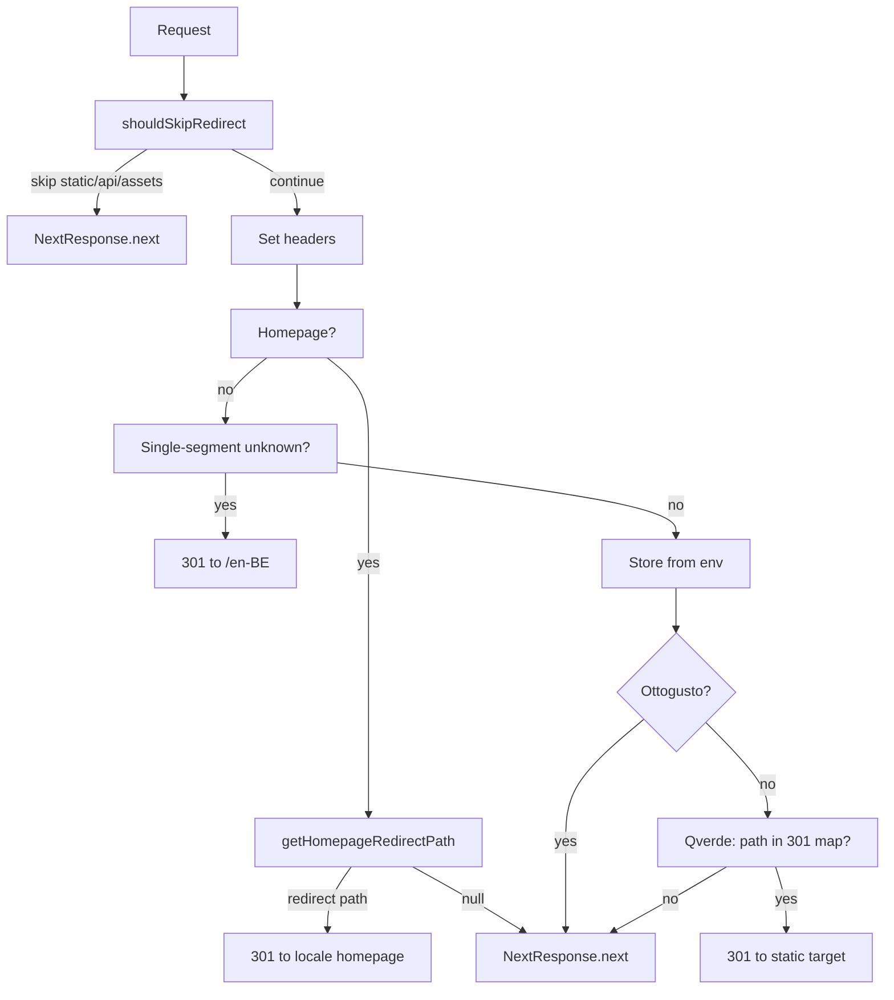

# Middleware: language, store, and proxy behaviour

## Overview

The Next.js middleware in `next/middleware.ts` handles redirects and request headers. It does **not** call any proxy API. Store is determined only from environment variables. Homepage and locale behaviour is the same for all stores; Qverde has an extra static 301 map for specific legacy paths.

## Store source of truth

- **Server / middleware:** `process.env.STORE`
- **Client:** `process.env.NEXT_PUBLIC_STORE`
- **Fallback:** `STORE_IDS.OTTOGUSTO` (ottogusto)

Domain or host is not used to detect store; only env is.

## Homepage definition

A path is treated as a **homepage** (no proxy, optional redirect to locale) if:

- Root: `/` or ``
- Language-only: `/en`, `/nl`, `/fr`
- Locale (lang-country): `/en-BE`, `/nl-BE`, `/fr-BE`, etc., with or without trailing slash

Locale list is from `next/config/locale-constants.ts` (`LANG_COUNTRY_COMBINATIONS`), kept edge-safe for middleware.

## Homepage redirects

- `/` → redirect to `/en-BE` (or `DEFAULT_HOMEPAGE_LOCALE`)
- `/en`, `/nl`, `/fr` → redirect to `/en-BE`, `/nl-BE`, `/fr-BE` respectively (`LANG_TO_DEFAULT_LOCALE`)
- Already valid locale homepage (e.g. `/en-BE`, `/en-BE/`) → no redirect, continue

Same for Ottogusto and Qverde.

## Single-segment unknown path

- Path like `/foo` or `/random` (one segment, not a valid locale and not `en`/`nl`/`fr`) → redirect to `/en-BE` (with query preserved).

## Ottogusto

- After homepage and single-segment checks, if store is Ottogusto → no further redirects, no proxy. Request continues to the app.

## Qverde: static 301 map only

- No proxy API is called.
- If path matches one of the known legacy patterns, middleware redirects with a **static** target (so targets are correct regardless of any API):

| Incoming path (pattern)                    | en →               | nl →                     |
| ------------------------------------------ | ------------------ | ------------------------ |
| `/(en\|nl)/our-story`                      | `/en-BE/about-us`  | `/nl-BE/about-us`        |
| `/(en\|nl)/ons-verhaal`                    | `/en-BE/car-parts` | `/nl-BE/auto-onderdelen` |
| `/(en\|nl)/catalog/motor/brandstofsysteem` | `/en-BE/car-parts` | `/nl-BE/auto-onderdelen` |

- All other Qverde paths → no redirect, request continues to the app.

## Key files

- **`next/middleware.ts`** – Main middleware; skip logic, headers, homepage, single-segment, store, Qverde 301.
- **`next/config/locale-constants.ts`** – Edge-safe `LANG_COUNTRY_COMBINATIONS`, `DEFAULT_HOMEPAGE_LOCALE`, `LANG_TO_DEFAULT_LOCALE`.
- **`next/utils/redirect-helper.ts`** – `shouldSkipRedirect`, `handleQueryStringPreservation`, `isRedirectLoop`.

## Flow diagram

## Flow summary

1. **Skip** – Static files, API routes, favicons, etc. → `NextResponse.next()`.
2. **Headers** – Set `x-api-locale`, `x-current-path`, `x-current-path-with-search`, `x-domain` on the response.
3. **Homepage** – If path is homepage, redirect to locale homepage when needed (e.g. `/` → `/en-BE`, `/en` → `/en-BE`); otherwise continue.
4. **Single-segment unknown** – Paths like `/foo` → 301 to `/en-BE`.
5. **Store** – Read from `STORE` or `NEXT_PUBLIC_STORE`; if Ottogusto, return response (no proxy, no extra redirects).
6. **Qverde** – If path matches the static 301 map, 301 to the mapped target; otherwise return response. No proxy call in any case.
