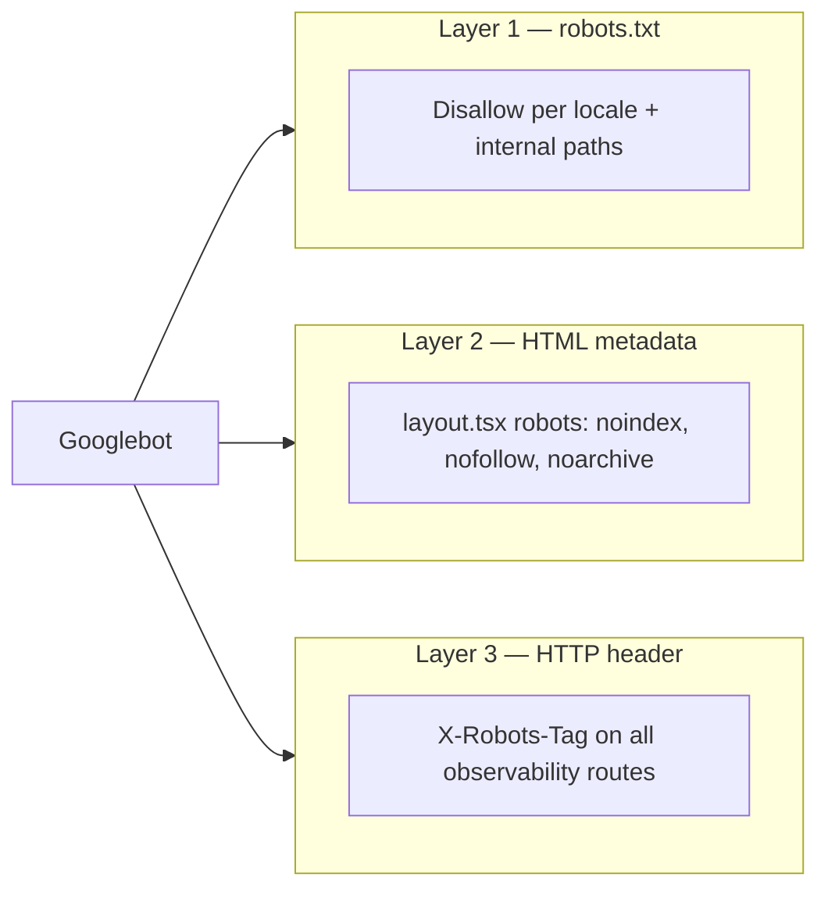

# OD-2310-11 — Block Google from crawling observability surfaces

Related docs:

- [`AXIOM.md`](./AXIOM.md) — logging architecture and crawler policy summary
- [`od-2310-11.md`](./od-2310-11.md) — PDP VIN check (same sprint branch)

---

## 1. Problem statement

Google Search indexed internal observability URLs on **Ottogusto** and **Qverde**, including:

| Surface             | Example URL                   | Risk                        |
| ------------------- | ----------------------------- | --------------------------- |
| Telemetry dashboard | `/{locale}/telemetry`         | Internal API performance UI |
| Axiom test pages    | `/{locale}/test-axiom/**`     | Dev-only error injection UI |
| Telemetry API       | `/api/telemetry/**`           | Log/session data endpoints  |
| Axiom proxies       | `/api/axiom`, `/api/axiom-ui` | Log ingest proxies          |
| Sentry tunnel       | `/monitoring`                 | Error reporting tunnel      |

These routes were reachable on the public domain but were **not** in `robots.txt` disallow lists, and HTML responses did not consistently emit `noindex` signals.

**Out of scope:** dashboards hosted on **axiom.co** (`app.axiom.co`) — those are protected by Axiom authentication, not by this site’s `robots.txt`.

---

## 2. What was solved

Defense in depth — three independent layers so crawlers that ignore one signal still get others:



### 2.1 `robots.txt` disallow rules

**Localized paths** — expanded for **every** entry in `LANG_COUNTRY_COMBINATIONS` (default: 20 locales — 5 languages × 4 countries BE, NL, FR, LU):

```
Disallow: /en-BE/telemetry
Disallow: /nl-NL/telemetry
Disallow: /fr-FR/telemetry
… (all configured locales)
Disallow: /en-BE/test-axiom
… (all configured locales)
```

**Non-localized internal paths** — listed once (no locale prefix):

```
Disallow: /api/telemetry
Disallow: /api/axiom
Disallow: /api/axiom-ui
Disallow: /monitoring
```

Locale list comes from `NEXT_PUBLIC_LANG_COUNTRY_COMBINATIONS` or the defaults in `config/lang-country-combinations-env.ts`.

Production `robots.txt` is only “open” when `NEXT_ALLOW_ROBOTS=true`. Non-production environments emit `Disallow: /` (block entire site).

### 2.2 Server-rendered page metadata

| Route                     | File                                                    | Signal                                                                    |
| ------------------------- | ------------------------------------------------------- | ------------------------------------------------------------------------- |
| `/{locale}/telemetry`     | `app/(public)/[language-country]/telemetry/layout.tsx`  | `robots.index: false`, `follow: false`, `noarchive: true` (+ `googleBot`) |
| `/{locale}/test-axiom/**` | `app/(public)/[language-country]/test-axiom/layout.tsx` | Same (page still 404s when Axiom test flag is off)                        |

Metadata is server-rendered in `<head>` — not client-only `next/head`.

### 2.3 `X-Robots-Tag` response headers

Added in `next.config.js` `headers()` for:

| Pattern                      | Routes                      |
| ---------------------------- | --------------------------- |
| `/:locale/telemetry/:path*`  | All locale telemetry pages  |
| `/:locale/test-axiom/:path*` | All locale test-axiom pages |
| `/api/telemetry/:path*`      | Telemetry API               |
| `/api/axiom`                 | Axiom backend proxy         |
| `/api/axiom-ui`              | Axiom UI error proxy        |
| `/monitoring`                | Sentry tunnel               |

Header value: `noindex, nofollow, noarchive`

> **Deploy note:** `next.config.js` header changes require a **full rebuild and app restart**. Hot reload during `next dev` does not apply them.

---

## 3. Files changed

| File                                                    | Change                                                                                                        |
| ------------------------------------------------------- | ------------------------------------------------------------------------------------------------------------- |
| `config/robots.ts`                                      | **New** — `ROBOTS_DISALLOW` (+ `/telemetry`, `/test-axiom`), `ROBOTS_DISALLOW_INTERNAL_PATHS`, query patterns |
| `utils/robotsContent.ts`                                | **New** — shared `buildRobotsContent()` used by route + tests                                                 |
| `app/robots.txt/route.ts`                               | Refactored to use `buildRobotsContent()`                                                                      |
| `constants.tsx`                                         | Re-exports robots constants from `config/robots.ts`                                                           |
| `next.config.js`                                        | `headers()` with `X-Robots-Tag` for observability routes                                                      |
| `app/(public)/[language-country]/telemetry/layout.tsx`  | **New** — `metadata.robots` noindex                                                                           |
| `app/(public)/[language-country]/test-axiom/layout.tsx` | Added `metadata.robots` noindex                                                                               |
| `utils/robots-route.test.ts`                            | **New** — unit test for robots content                                                                        |
| `docs/AXIOM.md`                                         | Crawler policy section                                                                                        |

---

## 4. How to test after production merge

Run checks on **both** production domains after deploy:

- `https://www.ottogusto.com` (or your canonical OG URL)
- `https://qverde.com`

Replace `DOMAIN` and `LOCALE` below (`en-BE`, `nl-NL`, etc.).

### 4.1 Automated unit test (CI / local)

```bash
cd next
npx vitest run utils/robots-route.test.ts --project unit
```

Expected: 1 passed test asserting disallow lines for telemetry, test-axiom, and internal API paths.

### 4.2 `robots.txt` — localized + internal disallows

```bash
curl -sS "https://DOMAIN/robots.txt" | grep -E "telemetry|test-axiom|api/telemetry|api/axiom|monitoring"
```

**Pass if output includes** (examples):

```
Disallow: /LOCALE/telemetry
Disallow: /LOCALE/test-axiom
Disallow: /api/telemetry
Disallow: /api/axiom
Disallow: /api/axiom-ui
Disallow: /monitoring
```

Repeat `grep` for several locales (`en-BE`, `nl-NL`, `fr-FR`) — every configured locale should have its own lines.

**Fail if:** no `telemetry` / `test-axiom` lines, or internal API paths missing (means old build still running).

### 4.3 `X-Robots-Tag` response header

```bash
curl -sSI "https://DOMAIN/LOCALE/telemetry" | grep -i x-robots
curl -sSI "https://DOMAIN/LOCALE/test-axiom" | grep -i x-robots
curl -sSI "https://DOMAIN/api/telemetry" | grep -i x-robots
curl -sSI "https://DOMAIN/api/axiom" | grep -i x-robots
curl -sSI "https://DOMAIN/monitoring" | grep -i x-robots
```

**Pass if each returns:**

```
X-Robots-Tag: noindex, nofollow, noarchive
```

### 4.4 HTML `<meta name="robots">` (dashboard pages)

```bash
curl -sS "https://DOMAIN/LOCALE/telemetry" | grep -i 'name="robots"'
```

**Pass if** HTML contains `noindex` (and ideally `nofollow`, `noarchive`).

`test-axiom` only renders when `NEXT_PUBLIC_AXIOM_TEST_ERRORS=true` in that environment; production usually returns 404 — header check (4.3) still applies if the route is hit.

### 4.5 Browser manual check

1. Open `https://DOMAIN/LOCALE/telemetry`
2. DevTools → **Network** → reload → select the document request
3. **Response headers** → confirm `X-Robots-Tag: noindex, nofollow, noarchive`
4. **Elements** → `<head>` → confirm `<meta name="robots" content="noindex, nofollow, noarchive"/>`

### 4.6 Google Search Console (already-indexed URLs)

Crawl signals prevent **new** indexing; they do **not** instantly remove existing search results.

After deploy:

1. [Google Search Console](https://search.google.com/search-console) → **Removals** → temporarily remove URLs such as `https://qverde.com/*/telemetry`
2. **URL Inspection** → paste a telemetry URL → **Test live URL** → confirm Google sees `noindex` or robots disallow
3. After a few days, spot-check: `site:qverde.com telemetry` / `site:ottogusto.com telemetry`

---

## 5. Pass / fail checklist

| #   | Check              | Command / action                                       | Pass criteria                                                  |
| --- | ------------------ | ------------------------------------------------------ | -------------------------------------------------------------- |
| 1   | Unit test          | `vitest run utils/robots-route.test.ts --project unit` | Green                                                          |
| 2   | robots.txt locales | `curl …/robots.txt \| grep telemetry`                  | Line per locale (e.g. `/nl-NL/telemetry`, `/en-BE/telemetry`)  |
| 3   | robots.txt APIs    | same grep                                              | `/api/telemetry`, `/api/axiom`, `/api/axiom-ui`, `/monitoring` |
| 4   | Header telemetry   | `curl -I …/LOCALE/telemetry`                           | `X-Robots-Tag: noindex, nofollow, noarchive`                   |
| 5   | Header APIs        | `curl -I …/api/telemetry`                              | Same header                                                    |
| 6   | Meta tag           | `curl …/LOCALE/telemetry \| grep robots`               | `noindex` in `<meta name="robots">`                            |
| 7   | GSC                | URL Inspection on live URL                             | noindex / blocked reported                                     |
| 8   | Both brands        | Repeat 2–6 on Ottogusto **and** Qverde                 | Both pass                                                      |

---

## 6. What this does not guarantee

| Item                    | Notes                                                                                      |
| ----------------------- | ------------------------------------------------------------------------------------------ |
| **Instant de-indexing** | Existing URLs need time + optional GSC removals                                            |
| **Security**            | `robots.txt` and `noindex` are not access control — sensitive data must still require auth |
| **axiom.co monitors**   | Hosted on Axiom’s domain; rely on Axiom login, not site `robots.txt`                       |
| **Other crawlers**      | Policy targets well-behaved bots (Google, Bing). Malicious scanners ignore robots          |
| **Sitemaps / nav**      | Do not add telemetry or test routes to sitemaps or public navigation                       |

---

## 7. Adding a new internal report route

When introducing another logging or monitor page on the public domain, apply all three layers:

1. Add path to `ROBOTS_DISALLOW` (locale-prefixed) or `ROBOTS_DISALLOW_INTERNAL_PATHS` (API / root paths) in `config/robots.ts`
2. Add `metadata.robots` in the route’s `layout.tsx` (if HTML)
3. Add matching `source` + `X-Robots-Tag` in `next.config.js` `headers()`
4. Extend `utils/robots-route.test.ts`
5. Re-run the post-deploy checklist above
