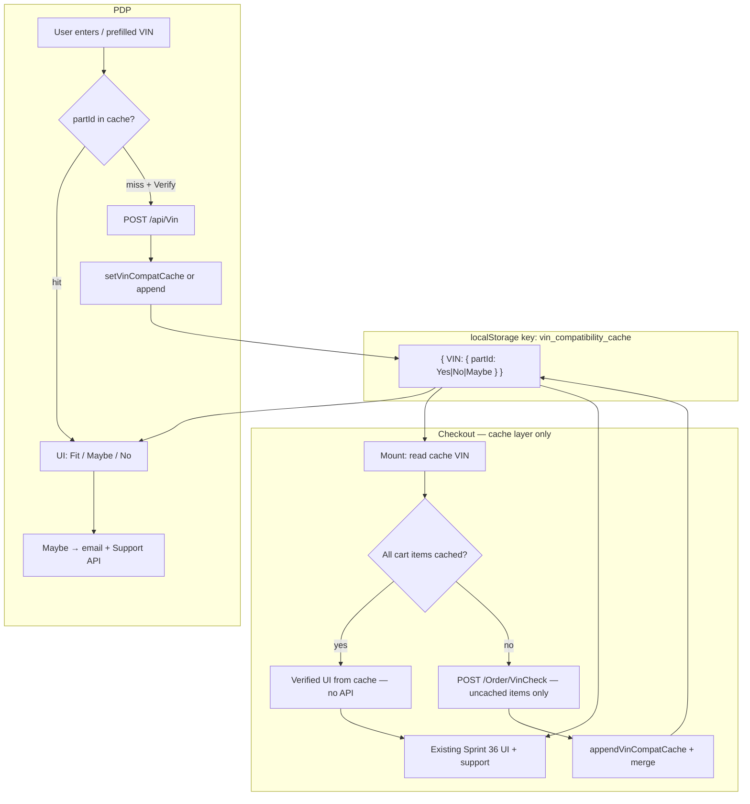

# OD-2310-11 — Part-level VIN check (PDP) + cross-page cache persistence

Sprint 37 integration: new part-level VIN API on Product Details Page (PDP), shared `localStorage` cache, and checkout reuse without changing checkout core behaviour (UI labels, support decision tree, Order and Pay always enabled).

Related docs:

- [`sprint36-vin-checkout.md`](./sprint36-vin-checkout.md) — checkout VIN cases 1–7, VinCheck API, support on pay
- [`new-checkoutui-connecting-old-logic.md`](./new-checkoutui-connecting-old-logic.md)

---

## 1. Problem statement

| Before                                                             | After                                                        |
| ------------------------------------------------------------------ | ------------------------------------------------------------ |
| PDP: VIN + email → direct Support API (`PartQuery`), no fit status | PDP: Verify VIN → part-level API → Yes / No / Maybe UI       |
| No shared VIN state PDP ↔ checkout                                 | Single `localStorage` cache bridges PDP and checkout         |
| Checkout always calls VinCheck for all items                       | Checkout reads cache first; API only for uncached cart lines |

**Hard rules (unchanged for checkout):**

- Do **not** change checkout UI translation keys or component labels
- Order and Pay stays **always enabled**
- Checkout support branching (`useCheckoutPayment`) unchanged — only consumes verified state from `useCheckoutVinCheck`
- Only **one VIN** stored in cache at a time; new verify with different VIN **replaces** entire cache

---

## 2. Architecture overview



---

## 3. Cache data structure

### 3.1 Storage key

| Key                                 | Notes                                                 |
| ----------------------------------- | ----------------------------------------------------- |
| `vin_compatibility_cache`           | **Current** — brand-neutral (Ottogusto + Qverde)      |
| `ottogusto_vin_compatibility_cache` | **Legacy** — auto-migrated once on read, then deleted |

### 3.2 Shape

```json
{
  "UU1DBG001NU059092": {
    "m7o3ba8zhlugj0": "Yes",
    "m3honzfkogdlnw": "No"
  }
}
```

- **Top-level:** exactly **one** VIN key (normalized uppercase trimmed)
- **Nested:** `partId` (cart line id / URL `partid`) → API status `"Yes"` \| `"No"` \| `"Maybe"`
- Internal UI uses `FIT` \| `MAY_FIT` \| `NO_FIT` via `normalizeVinMatchStatus()` in `utils/vinCheck.ts`

### 3.3 Cache operations (`utils/vinCompatibilityCache.ts`)

| Function                           | Behaviour                                    |
| ---------------------------------- | -------------------------------------------- |
| `getCachedVin()`                   | Returns single VIN key or `null`             |
| `getCachedPartStatus(vin, partId)` | `"Yes"` / `"No"` / `"Maybe"` or `null`       |
| `getCachedPartsForVin(vin)`        | All part statuses for VIN                    |
| `areAllPartsCached(vin, partIds)`  | Every id has cache entry                     |
| `getUncachedPartIds(vin, partIds)` | ids missing from cache                       |
| `setVinCompatCache(vin, parts)`    | **Replace entire cache** (new/different VIN) |
| `appendVinCompatCache(vin, parts)` | Merge parts under same VIN                   |
| `clearVinCompatCache()`            | Remove key                                   |

### 3.4 Cache write rules

| Event                                    | Action                                                        |
| ---------------------------------------- | ------------------------------------------------------------- |
| PDP verify, new VIN (≠ cached VIN)       | `setVinCompatCache`                                           |
| PDP verify, same VIN                     | `appendVinCompatCache`                                        |
| Checkout verify, new VIN                 | `setVinCompatCache` (via `persistCacheFromApiResponse`)       |
| Checkout verify, same VIN, partial items | `appendVinCompatCache`                                        |
| User clicks **Change VIN**               | UI resets; cache **not** cleared until next successful verify |
| New verify with **different** VIN        | Old VIN entry wiped (`setVinCompatCache`)                     |

---

## 4. APIs

### 4.1 PDP — part-level VIN check (NEW)

**Endpoint:** `POST /api/Vin`  
**Service:** `services/vin.ts` → `checkPartVin`  
**Hook:** `hooks/vin.ts` → `usePartVinCheckMutation`

**Request:**

```json
{
  "vinNumber": "49444444444444444",
  "partIds": ["m7o3ba8zhlugj0"]
}
```

**Response:**

```json
{
  "vinNumber": "UU1DBG001NU059092",
  "parts": {
    "m7o3ba8zhlugj0": "Yes"
  }
}
```

**Formatter:** `formatPdpVinResponseToCache()` → cache map

### 4.2 Checkout — order VIN check (EXISTING, usage changed)

**Endpoint:** `POST /api/Order/VinCheck`  
**Service:** `services/cart.ts` → `vinCheckOrder`  
**Hook:** `hooks/cart.ts` → `useVinCheckMutation`

**Change:** `items` array may be a **subset** of cart — only uncached part ids. Backend returns `isMatch` per requested line only.

**Formatter:** `formatCheckoutVinResponseToCache(apiItems, requestedIds)` → cache map

### 4.3 Support API — PDP Maybe only

**Endpoint:** `POST /api/Support`  
**When:** User clicks **Request Compatibility Check** on PDP (Maybe case only)  
**Category:** `GuaranteedVinCheck`  
**orderId:** `null`  
**source:** `"PDP page"`  
**Message builder:** `buildPdpGuaranteedVinCheckSupportMessage()` in `utils/vinCheck.ts`

Checkout support on pay is **unchanged** — see Sprint 36 doc.

---

## 5. Status mapping

### 5.1 API → cache (stored as-is)

| API (`isMatch` / `parts` value) | Cache value |
| ------------------------------- | ----------- |
| `"Yes"`                         | `"Yes"`     |
| `"No"`                          | `"No"`      |
| `"Maybe"`                       | `"Maybe"`   |
| `null` / missing / empty        | `"Maybe"`   |

### 5.2 Cache → internal (`VinCheckResult`)

| Cache     | Internal `isMatch` | PDP `uiCase` | Checkout `uiCase` |
| --------- | ------------------ | ------------ | ----------------- |
| `"Yes"`   | `FIT`              | 3            | 3                 |
| `"Maybe"` | `MAY_FIT`          | 4            | 4                 |
| `"No"`    | `NO_FIT`           | 5            | 5                 |

PDP single-part never produces checkout Case 6 (mix No + Maybe on multiple lines). Checkout Case 6 still applies for multi-item carts.

### 5.3 Case 7 (API failure)

| Surface                               | Behaviour                                                     |
| ------------------------------------- | ------------------------------------------------------------- |
| PDP `POST /Vin` error (not 401)       | Treat part as `Maybe` → cache `"Maybe"` → Maybe UI            |
| Checkout `POST /Order/VinCheck` error | Sprint 36 Case 7a — uncached lines → `Maybe`, green Case 4 UI |

---

## 6. PDP implementation

### 6.1 Files

| File                                                           | Role                           |
| -------------------------------------------------------------- | ------------------------------ |
| `screens/productdetails/hooks/usePdpVinCheck.ts`               | State, verify, cache, support  |
| `screens/productdetails/productcompatibilityverifyinput.tsx`   | UI                             |
| `screens/productdetails/components/PdpVinCheckResultBoxes.tsx` | Fit / No-fit result boxes      |
| `screens/productdetails/productcompatibilityverify.tsx`        | Passes `partId`, `oeReference` |
| `screens/productdetails/productmatchingcars-client.tsx`        | Passes `partId` from URL       |

`partId` source: `params.partid` from route or `data.id` from product.

### 6.2 UI layout (Figma)

| Row                                 | Max width | Gap              |
| ----------------------------------- | --------- | ---------------- |
| VIN input + Verify / Change VIN     | `308px`   | `12px` (`gap-3`) |
| Email + Request Compatibility Check | `360px`   | `12px` (`gap-3`) |

Rows do **not** span full page width.

### 6.3 Labels (PDP-specific — checkout keys untouched)

| Key                                                  | Copy / use                                                                        |
| ---------------------------------------------------- | --------------------------------------------------------------------------------- |
| `vin_verification_title`                             | PDP title (shared key; client-managed copy)                                       |
| `vin_verification_subtitle`                          | PDP subtitle (shared key; client-managed copy; shown on all states including Fit) |
| `pdp_vin_compatibility_part_compatible`              | Fit message (green box)                                                           |
| `pdp_vin_compatibility_part_not_compatible`          | No-fit message (warning box)                                                      |
| `pdp_vin_compatibility_expert_verification_required` | Maybe — before support sent                                                       |
| `pdp_vin_compatibility_message_sent`                 | Maybe — after support success                                                     |
| `pdp_vin_request_compatibility_check`                | Maybe email CTA button                                                            |
| `vin_verify`                                         | Verify button (shared with checkout)                                              |
| `checkout_change_vin`                                | Change VIN button (shared with checkout)                                          |
| `enter_email`                                        | Email placeholder                                                                 |
| `VIN_information_message`                            | 17-char helper                                                                    |

**Important:** Maybe flow never shows fit or no-fit result boxes.

### 6.4 PDP phases

`PdpVinCheckPhase`: `"idle"` \| `"verified"`

### 6.5 PDP UI states

#### Idle

- Title + subtitle
- Empty or prefilled VIN (editable)
- **Verify VIN** enabled when valid 17-char VIN
- No result boxes, no email row

#### Verified — Fit (`Yes` → uiCase 3)

- VIN locked, green tick icon, **Change VIN**
- Green box: `pdp_vin_compatibility_part_compatible`
- No email row

#### Verified — Maybe (`Maybe` → uiCase 4)

- VIN locked, info icon, **Change VIN**
- Email row visible (prefill from logged-in user email if available)
- Blue info alert: `pdp_vin_compatibility_expert_verification_required`
- **No** fit / no-fit boxes
- On support **success**: replace expert message with `pdp_vin_compatibility_message_sent`; disable request button
- On support **error**: `vin_verification_error_title`

#### Verified — No (`No` → uiCase 5)

- VIN locked, warning icon, **Change VIN**
- Warning box: `pdp_vin_compatibility_part_not_compatible` (message only — no item list, no Remove)
- No email row

### 6.6 PDP verify flow (`handleVerifyVin`)

```
1. Trim + uppercase VIN; validate VALID_VIN_REGEX
2. If getCachedPartStatus(vin, partId) exists → build result from cache, verified, NO API
3. Else POST /Vin { vinNumber, partIds: [partId] }
4. onSuccess:
   - formatPdpVinResponseToCache
   - same cached VIN → appendVinCompatCache; else setVinCompatCache
   - applyVerifiedResult
5. onError (except 401):
   - buildMayFitCacheForPartIds([partId])
   - append or set cache
   - Maybe UI (Case 7)
```

### 6.7 PDP cache hydrate on mount (`useEffect`)

Runs once per `partId` (tracked via `hydratedPartIdRef`):

| Condition                                | Behaviour                                                     |
| ---------------------------------------- | ------------------------------------------------------------- |
| No cache / invalid cached VIN            | Empty VIN, idle                                               |
| Cached VIN exists, **part not in cache** | **Prefill VIN only**, idle, editable — user may Verify or not |
| Cached VIN exists, **part in cache**     | Prefill VIN, verified UI from cache, no API                   |

### 6.8 Change VIN

- Resets `phase` to idle, clears `result`
- Does **not** clear `localStorage` cache
- Resets support mutation state in UI

### 6.9 Legacy email field

Original always-visible email `Controller` in `productcompatibilityverifyinput.tsx` is **removed/commented**. Email only appears in Maybe (uiCase 4).

---

## 7. Checkout implementation (cache layer only)

### 7.1 Files changed

| File                                                          | Change                                        |
| ------------------------------------------------------------- | --------------------------------------------- |
| `screens/shoppingcart/checkout/hooks/useCheckoutVinCheck.tsx` | Cache hydrate, partial API, cart-growth merge |

**Unchanged:** `Vincompatibilitycheck.tsx`, `VinCheckResultBoxes.tsx`, `useCheckoutPayment.tsx`, checkout label keys.

### 7.2 Mount hydrate (`hasHydratedFromCacheRef`)

```
1. If cart empty → skip
2. cachedVin = getCachedVin()
3. If no cachedVin → skip
4. setVinNumber(cachedVin)
5. uncached = getUncachedPartIds(cachedVin, cartIds)
6. If uncached empty → buildMergedResultFromCache → verified (NO API, NO Verify click)
7. If uncached non-empty → runVinCheckForPartIds(cachedVin, uncached) automatically
```

### 7.3 Manual verify (`handleVerifyVin`)

```
1. Validate VIN + cart has items
2. uncached = getUncachedPartIds(vin, allCartIds)
3. If uncached empty → result from cache only, no API
4. Else runVinCheckForPartIds(vin, uncached) — payload items = uncached only
5. onSuccess: persistCacheFromApiResponse → merge all cart lines → verified
6. onError: Case 7a for requested ids only, merge with existing cache
```

### 7.4 Cart change while verified

Compare `cartItemIdsKey` snapshots (`id:qty` joined):

| Change                   | Behaviour                                                                       |
| ------------------------ | ------------------------------------------------------------------------------- |
| Cart empty               | `resetVinCheck`                                                                 |
| New line or qty increase | If VIN valid: fetch uncached ids only; if all cached after merge, update result |
| Line removal only        | Prune `result.items` to remaining cart ids                                      |
| Qty decrease only        | Prune result (no reset)                                                         |

### 7.5 Remove No-fit item

Unchanged Sprint 36 behaviour: `removeItem`, recalc cart, prune result; empty cart → redirect to shopping cart.

---

## 8. Shared utilities

### 8.1 `utils/vinCompatibilityCache.ts`

SSR-safe (`typeof window`). Legacy key migration on first read.

### 8.2 `utils/vinCheck.ts` (extensions)

| Function                                   | Purpose                        |
| ------------------------------------------ | ------------------------------ |
| `formatPdpVinResponseToCache`              | PDP API → cache map            |
| `formatCheckoutVinResponseToCache`         | Checkout API items → cache map |
| `buildVinCheckResultFromCache`             | Cache → `VinCheckResult`       |
| `buildMayFitCacheForPartIds`               | Case 7 fallback entries        |
| `buildPdpGuaranteedVinCheckSupportMessage` | PDP Maybe support body         |

Existing: `normalizeVinMatchStatus`, `deriveVinCheckUiCase`, `parseVinCheckResponseItems`, `getMayFitItems`, `getNoFitItems`.

### 8.3 Types (`type.d.ts`)

```ts
interface PartVinCheckPayload {
  vinNumber: string;
  partIds: string[];
}
interface PartVinCheckResponse {
  vinNumber: string;
  parts: Record<string, "Yes" | "No" | "Maybe">;
}
```

---

## 9. End-to-end flow examples

### Example A — PDP Fit → checkout same item

1. PDP: verify `UU1...` for `m7o3...` → API `Yes` → cache `{ "UU1...": { "m7o3...": "Yes" } }`
2. Add to cart → checkout
3. Hydrate: all items cached → VIN prefilled, verified Case 3, **no VinCheck API**
4. Order and Pay → no GuaranteedVinCheck support (Case 3)

### Example B — PDP Fit + second unchecked part

1. Cache: `{ "UU1...": { "m7o3...": "Yes" } }`
2. Cart: `m7o3...` + `m3hon...`
3. Checkout hydrate: `m7o3` from cache; `m3hon` uncached
4. Auto `POST /Order/VinCheck` with `items: [{ id: "m3hon...", qty: 1 }]` only
5. Response `m3hon: "No"` → append cache
6. UI: Case 6 if mix; warning lists No lines only

### Example C — Visit another PDP (part not in cache)

1. Cache has `UU1...` with other parts
2. Open PDP for `newPart` not in cache
3. VIN **prefilled** `UU1...`, input **editable**, idle — user chooses whether to Verify

### Example D — Revisit PDP (part already in cache)

1. Open same part PDP
2. VIN prefilled, **locked**, verified UI from cache — **no API**

### Example E — New VIN verify

1. Cache has `VIN_A`
2. User verifies `VIN_B` on PDP or checkout
3. `setVinCompatCache("VIN_B", ...)` — `VIN_A` entry removed

### Example F — PDP Maybe full flow

1. Verify → API `Maybe`
2. Show expert verification alert + email row
3. User submits support → success alert `pdp_vin_compatibility_message_sent`
4. Never show fit/no-fit boxes during Maybe flow

---

## 10. Edge cases & handling

### 10.1 Cache

| Edge case                                     | Handling                                    |
| --------------------------------------------- | ------------------------------------------- |
| Empty localStorage                            | PDP idle; checkout idle                     |
| Corrupt JSON in localStorage                  | `getVinCompatCache` returns `{}`            |
| localStorage quota / private mode errors      | Swallowed; cache ops no-op                  |
| Legacy `ottogusto_vin_compatibility_cache`    | Migrated once to `vin_compatibility_cache`  |
| Multiple top-level VIN keys (data corruption) | `getCachedVin` uses `Object.keys()[0]` only |
| Orphan part ids in cache after cart changes   | Harmless; only active cart/part ids read    |
| Same part, same VIN re-verify                 | Cache hit → no API                          |
| Different VIN verify                          | Full cache replace                          |
| Change VIN click                              | UI reset only; stale cache until new verify |

### 10.2 PDP

| Edge case                        | Handling                                                                                             |
| -------------------------------- | ---------------------------------------------------------------------------------------------------- |
| Missing `partId`                 | Verify no-ops; hydrate skips                                                                         |
| Invalid cached VIN string        | Treat as no cache                                                                                    |
| API 401                          | No Case 7 fallback; auth flow                                                                        |
| API network/400 error            | Maybe + cache `"Maybe"`                                                                              |
| Logged-in user                   | Email prefilled + read-only                                                                          |
| Guest user                       | Email editable, validated on submit                                                                  |
| Support submit while pending     | Button loading state                                                                                 |
| Support success                  | Second message only; button disabled                                                                 |
| Navigate away and back same part | Re-hydrate from cache if `partId` changes ref resets on remount — `hydratedPartIdRef` runs per mount |
| User edits VIN while verified    | `handleVinChange` resets verify state                                                                |

### 10.3 Checkout

| Edge case                  | Handling                                                     |
| -------------------------- | ------------------------------------------------------------ |
| Cache full match on load   | Auto verified without Verify click                           |
| Partial cache on load      | Auto partial VinCheck for uncached                           |
| Verify with all cached     | No API                                                       |
| Verify with mix            | API subset only                                              |
| Cart grows after verify    | Auto-check new uncached lines                                |
| Cart qty increases         | Treated as cart change → may fetch or merge                  |
| All No removed             | Case may collapse to 3/4 per Sprint 36                       |
| `cartid` empty on VinCheck | Payload still built with `cartid: null` per existing builder |
| VinCheck 401               | No Case 7 fallback                                           |

### 10.4 Cross-page consistency

| Edge case                       | Handling                                                       |
| ------------------------------- | -------------------------------------------------------------- |
| PDP Yes → checkout              | Cache hit, Case 3                                              |
| PDP Maybe → checkout same part  | Cache `"Maybe"` → checkout Case 4 + support on pay (Sprint 36) |
| PDP No → checkout same part     | Cache `"No"` → checkout Case 5                                 |
| Checkout adds results           | Appends to same VIN in cache for future PDP visits             |
| Brand switch Ottogusto ↔ Qverde | Same key `vin_compatibility_cache`                             |

### 10.5 VIN validation

Regex: `/^[A-HJ-NPR-Z0-9]{17}$/` (`VALID_VIN_REGEX`)  
Stored uppercase trimmed everywhere.

---

## 11. What was explicitly NOT changed

| Area                                        | Reason                               |
| ------------------------------------------- | ------------------------------------ |
| Checkout `Vincompatibilitycheck.tsx` labels | Sprint rule                          |
| `useCheckoutPayment` support tree           | Sprint rule                          |
| Order and Pay disabled state                | Always enabled                       |
| Checkout Cases 1–7 semantics                | Only data source may be cache vs API |
| `vinVerification_*` checkout message keys   | PDP uses `pdp_vin_*` keys            |

---

## 12. Test checklist

### PDP

- [ ] Idle: Verify disabled until valid VIN
- [ ] Fit: green tick, compatible message, subtitle still visible
- [ ] Maybe: info icon, email row, expert message, no fit/no-fit boxes
- [ ] Maybe: support success → message sent alert only
- [ ] No: warning message only, no remove/list
- [ ] Cache hit on verify → no API
- [ ] Revisit cached part → auto verified UI
- [ ] Visit uncached part with cached VIN → VIN prefilled, editable, idle
- [ ] API error → Maybe UI
- [ ] Change VIN → unlock, clear result
- [ ] Row widths: VIN row ≤308px, email row ≤360px

### Checkout (regression)

- [ ] Cases 1–7 from sprint36 still pass
- [ ] Full cache → auto verified, no API
- [ ] Partial cache → API for uncached only
- [ ] PDP-verified item alone in cart → no API on checkout load
- [ ] Support on pay unchanged
- [ ] Order and Pay never disabled
- [ ] Remove No-fit item still works

### Cache

- [ ] Key is `vin_compatibility_cache`
- [ ] Legacy key migrates
- [ ] New VIN replaces old VIN entry
- [ ] Same VIN appends new parts

---

## 13. File index (implementation)

```
next/
├── docs/
│   ├── od-2310-11.md                    ← this doc
│   └── sprint36-vin-checkout.md
├── data/branding/labels.ts              ← pdp_vin_* keys
├── hooks/vin.ts                         ← usePartVinCheckMutation
├── lib/query-keys.ts                    ← mutationKeys.vin.partCheck()
├── services/vin.ts                      ← POST /Vin
├── type.d.ts                            ← PartVinCheckPayload/Response
├── utils/
│   ├── vinCompatibilityCache.ts
│   ├── vinCompatibilityCache.test.ts
│   └── vinCheck.ts                      ← formatters + PDP support message
└── screens/
    ├── productdetails/
    │   ├── hooks/usePdpVinCheck.ts
    │   ├── productcompatibilityverifyinput.tsx
    │   ├── productcompatibilityverify.tsx
    │   ├── productmatchingcars-client.tsx
    │   └── components/PdpVinCheckResultBoxes.tsx
    └── shoppingcart/checkout/hooks/
        └── useCheckoutVinCheck.tsx      ← cache integration only
```

---

## 14. AI context quick reference

When modifying this feature:

1. **Always normalize VIN** uppercase trimmed for cache keys and comparisons.
2. **Check cache before API** on both PDP and checkout verify paths.
3. **Checkout VinCheck `items`** may be a subset — merge with cache for full cart `VinCheckResult`.
4. **PDP Maybe** never uses fit/no-fit components; messaging is separate alert flow + support CTA.
5. **Do not rename** `vin_compatibility_cache` with brand prefixes.
6. **Single VIN rule:** `setVinCompatCache` wipes previous VIN; `appendVinCompatCache` only for same VIN new parts.
7. For checkout behaviour details (Cases 1–7, support on pay), read `sprint36-vin-checkout.md` first.

---

## 15. Revision history

| Date       | Change                                                                                                |
| ---------- | ----------------------------------------------------------------------------------------------------- |
| 2026-07-15 | Initial implementation: PDP VIN API, cache, checkout hydrate, PDP UI polish (widths, Maybe messaging) |
