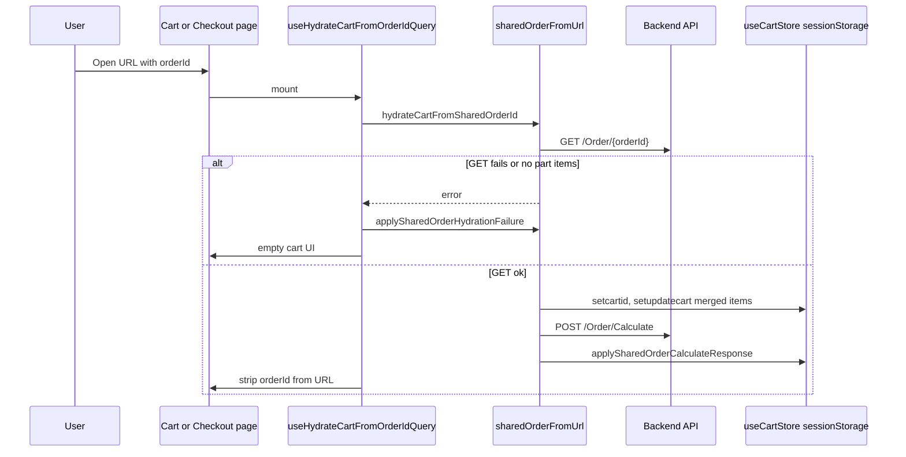

# Shareable cart & checkout links

This document describes how `?orderId=` URLs load a server order into the client cart, how cart and checkout pages integrate with that flow, and how the **cart session expiry** clears persisted cart data after a fixed TTL.

## Supported URLs

| Route         | Example                                            |
| ------------- | -------------------------------------------------- |
| Shopping cart | `/{locale}/shoppingcart?orderId=QV000869`          |
| Checkout      | `/{locale}/shoppingcart/checkout?orderId=QV000869` |

Query parameter names (case-insensitive):

- `orderId`
- `orderid`

After a **successful** hydrate, the query param is removed with `router.replace` so a refresh does not re-run hydration.

---

## Goals

1. **URL intent wins** — `orderId` in the query string means “load this order into the cart.”
2. **Narrow override** — Only line items, `cartid`, and price-related fields from Calculate are replaced. Addresses, guest form state, contact info, checkout UI flags, etc. stay as they are in `cart-storage` (unless other flows change them).
3. **Checkout unchanged for totals** — Checkout overview still uses store `totalprice` from Calculate; cart page shows subtotal + deposit only (no shipping in the Total row).
4. **Failed load → empty cart** — If the order cannot be loaded, show the normal empty cart UI (not the site 404 page).

---

## File map

| File                                                               | Role                                                                                                 |
| ------------------------------------------------------------------ | ---------------------------------------------------------------------------------------------------- |
| `next/hooks/useHydrateCartFromOrderIdQuery.ts`                     | Reads `orderId` from URL; runs hydrate; strips query on success; handles errors                      |
| `next/utils/sharedOrderFromUrl.ts`                                 | GET order, Calculate payload, apply success/failure to store                                         |
| `next/screens/shoppingcart/shoppingcartpage.tsx`                   | Uses hook; guards normal Calculate / focus sync while hydrating                                      |
| `next/screens/shoppingcart/checkout/page.tsx`                      | Uses hook; passes `pauseCalculate` into checkout Calculate                                           |
| `next/screens/shoppingcart/checkout/hooks/useCheckoutCalculate.ts` | Skips duplicate Calculate after shared hydrate (`pauseCalculate`, `consumeSharedOrderCalculateSkip`) |
| `next/screens/shoppingcart/overviewcard.tsx`                       | Cart vs checkout total display (`displayTotal`)                                                      |
| `next/utils/cartSession.ts`                                        | TTL constants and expiry helpers                                                                     |
| `next/components/CartSessionHydrator.tsx`                          | Starts session timer; schedules expiry; tab visibility check                                         |
| `next/stores/useCartStore.ts`                                      | Persisted cart state, `touchCartSession`, `expireCartSessionIfNeeded`, `resetCart`                   |

---

## Hydration flow



### Step-by-step (`hydrateCartFromSharedOrderId`)

1. **`GET /Order/{orderId}`** via `getOrderByIdWithoutemail` (no email in path).
2. Filter **part** lines only (`type !== "Deposit"`).
3. If there are no part lines → throw → failure path.
4. Merge server lines with existing local `cartitems` (keep `seo`, `manufacturer`, etc. when present).
5. `setcartid(orderId)`, `setupdatecart(mergedItems)`, `setcheckoutpending(false)` while loading.
6. Build **Calculate** payload:
   - **Cart page:** `buildCartPageSharedCalculatePayload` — uses selected saved addresses or **guest** `guestBillingFormData` / `guestDeliveryFormData` from the store (not addresses from the shared order).
   - **Checkout:** `buildCheckoutSharedCalculatePayload` — uses `buildCalculatePayload` (delivery tab, warehouse pickup, same-as-shipping, etc.).
7. **`POST /Order/Calculate`** via `saveCart`.
8. **`applySharedOrderCalculateResponse`** — updates items with API prices, totals, deposit, VAT, `checkoutpending: true`, `iscartchanged: false`.
9. Mark skip flags so the cart/checkout pages do not immediately run a second redundant Calculate.

### What changes vs what is preserved

| Updated on success                                                           | Preserved                                                             |
| ---------------------------------------------------------------------------- | --------------------------------------------------------------------- |
| `cartitems`                                                                  | `savedShippingAddresses` / `savedBillingAddresses`                    |
| `cartid`                                                                     | `selectedSavedDeliveryAddress` / `selectedSavedBillingAddress`        |
| `totalprice`, `shippingfee`, `depositfee`, `vatPercentage`, `shippingMethod` | `guestDeliveryFormData`, `guestBillingFormData`, `guestIsSameBilling` |
| `checkoutpending` (true after success)                                       | `contactinfo`                                                         |
|                                                                              | Checkout accordion / form mode / payment method flags                 |

### Failure path (`applySharedOrderHydrationFailure`)

- Clears `cartitems`, `cartid`, and price fields.
- Sets `checkoutpending: true` (overview not stuck on skeleton if shown).
- Does **not** clear address or guest checkout fields.
- Cart page: removes `orderId` from URL.
- Checkout page: redirects to `/{locale}/shoppingcart` (empty cart).

---

## Page integration

### Shopping cart (`shoppingcartpage.tsx`)

- Calls `useHydrateCartFromOrderIdQuery()` at the top.
- **While hydrating:** line-item skeleton only when `items.length === 0` (items can show once store is filled).
- **Blocks** normal on-load Calculate and `getCheckCartId` focus sync when `sharedOrderId` is present or `isSharedOrderHydrating`.
- **Skips** duplicate Calculate after shared hydrate via `consumeSharedOrderCartPageCalculateSkip()` when `!iscartchanged`.
- Quantity changes set `iscartchanged: true` → normal Calculate still runs.

### Checkout (`checkout/page.tsx`)

- Same hook.
- `useCheckoutCalculate({ pauseCalculate: Boolean(sharedOrderId) && !isSharedOrderHydrateComplete })`.
- On success, `consumeSharedOrderCalculateSkip(cartid)` prevents an immediate second Calculate from the checkout hook.

### Overview totals (`overviewcard.tsx`)

| Page                      | Total row                                                         |
| ------------------------- | ----------------------------------------------------------------- |
| `type === "shoppingcart"` | `sum(item.totalPriceIncVat) + depositfee` — **excludes shipping** |
| `type === "checkout"`     | `totalprice` from store (unchanged checkout behaviour)            |

Shipping row on cart: placeholder label; on checkout: numeric `shippingfee`.

---

## Duplicate Calculate prevention

Module-level flags in `sharedOrderFromUrl.ts`:

| Flag                                  | Purpose                                                               |
| ------------------------------------- | --------------------------------------------------------------------- |
| `skipNextCartPageCalculate`           | Cart page `useEffect` skips one Calculate after shared hydrate        |
| `skipNextCheckoutCalculateForOrderId` | Checkout `useCheckoutCalculate` initial run skipped for that `cartid` |

Hydrate promise deduplication: `sharedOrderHydratePromises` `Map` ensures one in-flight hydrate per `orderId` (React Strict Mode safe).

---

## Guest / logged-out limitations

- Order load always uses **`GET /Order/{orderId}`** without email.
- If the API returns **404** (e.g. `"Customer not found"`) for guest or cross-customer orders, hydration fails → **empty cart** (by design).
- There is **no** `getOrderById(orderId, email)` path in the shared flow (unlike payment status / `orderByIdQueryFn`).
- Logged-in users may still fail the same GET if the order is not visible without email/customer context.
- After logout, `logoutUser()` clears guest/saved addresses on the store; header logout also calls `resetCart()` and wipes the session cart.

For guest share links to work end-to-end, backend must allow anonymous/shared `GET /Order/{id}`, or the frontend must be extended (e.g. email in query + `getOrderById`).

---

## Persistence

Cart state is stored in **`sessionStorage`** under Zustand persist key `cart-storage` (`useCartStore`).

Relevant persisted fields include: `cartitems`, `cartid`, `cartSessionStartedAt`, prices, guest/contact fields, etc.

---

## Cart session clearance timer

Cart data is automatically cleared after **24 hours** from the start of a cart session.

### Constants (`next/utils/cartSession.ts`)

```ts
export const CART_SESSION_MS = 24 * 60 * 60 * 1000; // 1 day
```

| Function                               | Behaviour                                     |
| -------------------------------------- | --------------------------------------------- |
| `getCartSessionRemainingMs(startedAt)` | Ms left until expiry; `null` if no start time |
| `isCartSessionExpired(startedAt)`      | `true` when elapsed ≥ `CART_SESSION_MS`       |

### Session start (`touchCartSession`)

Started once per cart session (first time only while `cartSessionStartedAt` is null):

- `addItem`
- `setcartid` with a non-empty id
- `setupdatecart` when `items.length > 0`
- `applyServerCartOrder` / restore flows when items exist

The timestamp is **not** reset on every add-to-cart; the 24h window is from first activity.

### Expiry (`expireCartSessionIfNeeded`)

In `useCartStore`:

1. If `!isCartSessionExpired(cartSessionStartedAt)` → no-op.
2. Else → **`resetCart()`** (full cart store defaults, including `cartSessionStartedAt: null`) and clear session start.

`resetCart()` clears items, `cartid`, prices, addresses on store, guest forms, `contactinfo`, checkout flags, etc.

### When expiry is checked

| Trigger                                       | Location                                                           |
| --------------------------------------------- | ------------------------------------------------------------------ |
| After Zustand rehydrate from `sessionStorage` | `onRehydrateStorage` → `queueMicrotask(expireCartSessionIfNeeded)` |
| App mount                                     | `CartSessionHydrator` `useEffect`                                  |
| `setTimeout` for remaining TTL                | `CartSessionHydrator` when `cartSessionStartedAt` is set           |
| Tab becomes visible                           | `document.visibilitychange` → `expireCartSessionIfNeeded`          |

`CartSessionHydrator` is mounted from `next/app/OLDClientLayout.tsx` (client layout). It also runs `useRestoreCartOnLogin()` for account cart snapshot restore.

### Account logout snapshot (related, separate storage)

On `logoutUser()`, if `cartid` is set, an **`account_cart_snapshot`** is saved to **localStorage** (user id/email + `orderId` + `cartSessionStartedAt`) for restore when the **same** user logs in again (`restoreAccountCartOnLogin`). Snapshot entries older than `CART_SESSION_MS` are discarded in `getAccountCartSnapshot()`.

This is independent of the shareable URL flow but shares the same **24h** TTL concept.

---

## API reference (client)

| Call                       | Endpoint                    | Used for                                          |
| -------------------------- | --------------------------- | ------------------------------------------------- |
| `getOrderByIdWithoutemail` | `GET /api/Order/{orderId}`  | Load order lines for share link                   |
| `saveCart`                 | `POST /api/Order/Calculate` | Prices, deposit lines, validate order             |
| `payOrder`                 | `POST /api/Order/Pay`       | Unchanged; uses `cartid` from store after hydrate |

---

## Testing checklist

- [ ] Valid `orderId` on cart → items, overview, `cartid` in sessionStorage; URL param removed.
- [ ] Valid `orderId` on checkout → same + checkout Calculate not doubled.
- [ ] Invalid / 404 `orderId` → empty cart page, no infinite skeleton.
- [ ] Qty +/- after shared load → Calculate runs, overview updates.
- [ ] Cart total on cart page excludes shipping; checkout total unchanged.
- [ ] After 24h (or mocked `cartSessionStartedAt`) → `resetCart` on next hydrate/visibility/mount.
- [ ] Guest share link when API requires customer → empty cart (document/API expectation).

---

## Related docs

- `next/docs/checkoutread.md` — checkout address forms
- `next/docs/react-query-optimizing.md` — cart / order queries elsewhere
