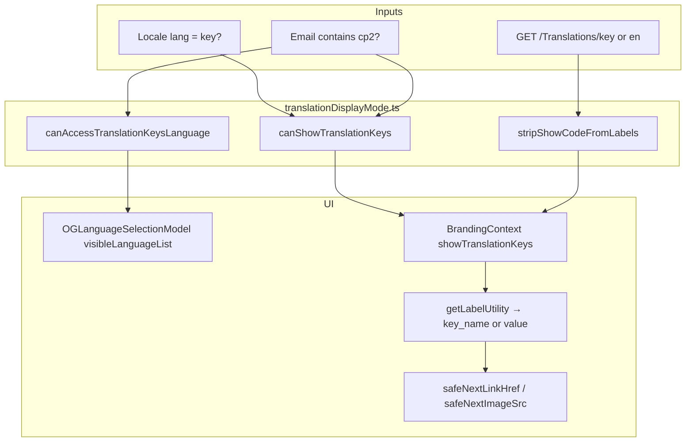

# Translation `show_code` removal & Key language mode

This document describes how the storefront **stopped using the translations API `show_code` flag** and **removed the in-app admin “show code” toggle**, and what replaced it for CP2 staff who need to see translation keys on the UI.

---

## Background (previous behavior)

The translations payload from the backend could include a special label:

| Field       | Typical meaning                                                                                                           |
| ----------- | ------------------------------------------------------------------------------------------------------------------------- |
| `show_code` | When present / truthy, the client treated labels as **translation keys** (e.g. `[footer_title]`) instead of resolved copy |

That flag was wired into client label resolution (e.g. reading `WhiteLabels["show_code"]` inside `getLabelUtility`). It effectively turned on “key mode” for **any** user whenever the API said so, without an explicit product rule.

A follow-up experiment added a **header “Show code” toggle** (`useShowTranslationKeysStore`, `ShowTranslationKeysToggle`) so admins could flip key mode in the UI. That approach was **reverted** (store + toggle removed). Relying on API `show_code` was also removed so behavior is predictable and staff-only.

---

## Current behavior (replacement)

Translation keys on the UI are shown **only when both** conditions are true:

1. **Locale language is `key`** — user chose **Key** in `OGLanguageSelectionModel` (URL/locale like `key-BE`, `key-NL`, …).
2. **Logged-in email contains `cp2`** (case-insensitive) — checked on profile email (`useAuthStore`) or Auth0 user email.

| Condition                      | UI labels                          | **Key** in language modal                               |
| ------------------------------ | ---------------------------------- | ------------------------------------------------------- |
| Language ≠ `key`               | Normal translated text             | Hidden (non-cp2) or visible but inactive for keys (cp2) |
| Language = `key`, cp2 email    | `[key_name]` via `getLabel`        | Visible                                                 |
| Language = `key`, no cp2 email | Normal text (keys not applied)     | Hidden; form resets to `en` if Key was selected         |
| API returns `show_code`        | **Ignored** — stripped from labels | N/A                                                     |

There is **no** global admin toggle and **no** client use of `show_code`.

---

## What was removed

| Removed                                         | Notes                                                                                                             |
| ----------------------------------------------- | ----------------------------------------------------------------------------------------------------------------- |
| API-driven `show_code`                          | `stripShowCodeFromLabels()` drops `show_code` before labels are used                                              |
| `WhiteLabels["show_code"]` in `getLabelUtility` | Replaced by explicit `showTranslationKeys` boolean from branding context                                          |
| Header **Show code** toggle                     | `useShowTranslationKeysStore`, `ShowTranslationKeysToggle` — deleted; do not reintroduce without product sign-off |
| “Admin mode” via translations alone             | Staff must use **Key** language + cp2 login                                                                       |

---

## Architecture



### Core module: `next/utils/translationDisplayMode.ts`

| Export                                              | Role                                                   |
| --------------------------------------------------- | ------------------------------------------------------ |
| `TRANSLATION_KEYS_LANG` (`"key"`)                   | Pseudo language code for Key mode                      |
| `LOCALE_PATH_SEGMENT_RE` / `parseLocalePathSegment` | Parse `key-BE`, `en-BE`, etc. in paths                 |
| `isTranslationKeysLang`                             | True when locale language segment is `key`             |
| `isCp2StaffEmail`                                   | `email.toLowerCase().includes("cp2")`                  |
| `canAccessTranslationKeysLanguage`                  | cp2 staff may see Key option in modal                  |
| `canShowTranslationKeys`                            | Key locale **and** cp2 staff → show `[key]` labels     |
| `stripShowCodeFromLabels`                           | Remove `show_code` from API object                     |
| `stripLocalePrefixFromPath`                         | Strip locale prefix when rewriting URLs                |
| `safeNextLinkHref`                                  | Avoid invalid `<Link href="/[label_key]">` in Key mode |
| `safeNextImageSrc`                                  | Fallback image when `src` is `[key]?query`             |
| `FALLBACK_NEXT_IMAGE_SRC`                           | Default `/assets/Frame.svg`                            |

Unit tests: `next/utils/translationDisplayMode.test.ts` (Vitest `unit` project).

---

## File map

| File                                                         | Role                                                                           |
| ------------------------------------------------------------ | ------------------------------------------------------------------------------ |
| `next/utils/translationDisplayMode.ts`                       | Gating, stripping, safe href/src helpers                                       |
| `next/utils/translationDisplayMode.test.ts`                  | Tests for cp2 gate, strip, safe helpers                                        |
| `next/contexts/BrandingContext.tsx`                          | Client provider; `showTranslationKeys` → `getLabelUtility`; strips `show_code` |
| `next/helpers/UtilityHelper.ts`                              | `getLabelUtility(..., showTranslationKeys)` returns `[keyName]` when true      |
| `next/components/og-components/OGLanguageSelectionModel.tsx` | Filters **Key** out of language list for non-cp2; resets Key → `en`            |
| `next/services/authService.ts`                               | Validates `key`; `GET /Translations/key` with fallback to `en`                 |
| `next/app/api/translation/[lang]/route.ts`                   | Allows `key` in valid lang codes for ISR route                                 |
| `next/config/locale-constants.ts`                            | `LANG_TO_DEFAULT_LOCALE.key` → `key-BE`                                        |
| `next/config/lang-country-combinations-env.ts`               | `key-BE`, `key-NL`, … in default combinations                                  |
| `next/constants.tsx`                                         | Default `key: "Key"` in languages map (overridden by env)                      |

### Key mode crash guards (Key locale + cp2)

When labels become `[key_name]`, values must not be passed raw to `next/link` or `next/image`:

| Area                       | Files using guards                                                                            |
| -------------------------- | --------------------------------------------------------------------------------------------- |
| Footer links               | `footerLinkUtils.ts`, `FooterContent.tsx`, `FooterContentMobile.tsx`, `InfoNLegalSection.tsx` |
| Social / careers           | `social-links.tsx`, footer components                                                         |
| Ribbon URLs                | `RibbonContent.tsx`                                                                           |
| Hero / saved cars carousel | `heroCard2.tsx`, `LandingSavedcarsContainer2.tsx`                                             |
| Reviews                    | `screens/landing/reviews/index.tsx`                                                           |
| About us images            | `about-us/OurStory.tsx`, `about-us/JoinTheCrew.tsx`                                           |

---

## Label resolution

```ts
// BrandingContext — only cp2 + key locale
showTranslationKeys = canShowTranslationKeys(langCode, authUser, auth0User?.email);

// getLabelUtility — fourth argument replaces old show_code check
if (showTranslationKeys) return `[${keyName}]`;
// else resolve WhiteLabels[keyName] as before
```

`BrandingProvider` is a **client** component so it can read `useAuthStore` and Auth0 for the cp2 check.

---

## Translations API

- **Normal langs:** `GET /Translations/{lang}` (unchanged).
- **Key lang:** `GET /Translations/key`; on failure, falls back to `GET /Translations/en` (no `show_code` appended client-side).
- **Next API route:** `/api/translation/[lang]` accepts `key` as a valid code alongside ISO 639-1 codes.

The client **never** enables key mode based on response fields; `show_code` is stripped if the backend still sends it.

---

## Configuration

### Environment

- `NEXT_PUBLIC_LANGUAGES` — JSON map of language codes; include `"key":"Key"` for staff (other users will not see it in the modal unless cp2).
- `NEXT_PUBLIC_LANG_COUNTRY_COMBINATIONS` — include `key-BE`, `key-NL`, etc., so middleware and locale routing accept Key URLs.

Defaults in repo config also list `key-*` combinations in `lang-country-combinations-env.ts` and `locale-constants.ts`.

### Who counts as CP2 staff

Any authenticated email where `email.toLowerCase().includes("cp2")` — profile from `useAuthStore` or Auth0 `user.email`.

---

## Language selector (`OGLanguageSelectionModel`)

- Builds `visibleLanguageList`: full `LanguageList` for cp2 users; filters out `code === "key"` for everyone else.
- IP-based first-visit locale detection uses `visibleLanguageList` so **Key** is never auto-selected for non-cp2.
- If locale is `key-*` but user is not cp2, form defaults language to `en`.
- `useEffect` resets form language from `key` → `en` when cp2 access is not available.

---

## Testing

```bash
cd next
npx vitest run utils/translationDisplayMode.test.ts
```

Covers: cp2 access, Key locale detection, `stripShowCodeFromLabels`, `safeNextLinkHref`, `safeNextImageSrc`.

Manual checks:

1. Log in with a **cp2** email → open language modal → **Key** appears; select Key → UI shows `[label_key]`.
2. Log out or use non-cp2 email → **Key** hidden; existing `key-BE` URL still loads but labels stay normal unless both gates pass.
3. Confirm footer/hero/reviews do not throw App Router errors on Key locale.

---

## Troubleshooting

| Symptom                                                     | Likely cause                                                              |
| ----------------------------------------------------------- | ------------------------------------------------------------------------- |
| Keys not showing on UI                                      | Locale not `key-*`, or email does not contain `cp2`, or not logged in     |
| **Key** missing in modal                                    | Expected for non-cp2 users                                                |
| `ENOENT` / missing `useShowTranslationKeysStore` after pull | Stale `.next` cache from reverted toggle — delete `.next` and restart dev |
| Dynamic href error `/[footer_link_1_url]`                   | Component not using `safeNextLinkHref`                                    |
| `next/image` invalid src `[landing_page_hero_image_1]?...`  | Use `safeNextImageSrc` for label-driven images                            |

---

## Summary

- **`show_code` from the API is dead on the client** — always stripped; never read for behavior.
- **Admin/header toggle for show code was removed** — not part of the supported product surface.
- **Key mode is staff-only and explicit:** **Key** language + **cp2** email, centralized in `translationDisplayMode.ts` and enforced in `BrandingContext` and `OGLanguageSelectionModel`.
