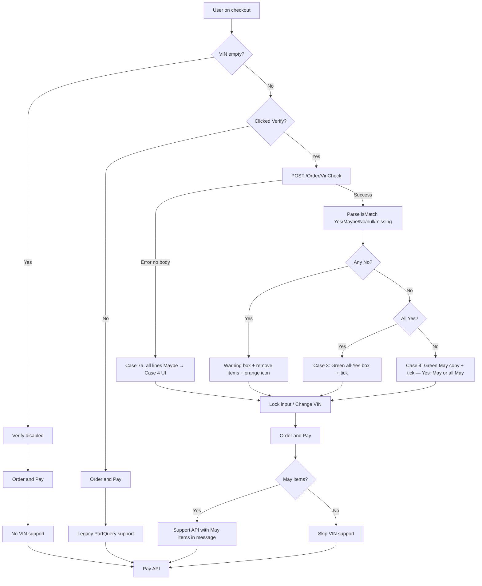

# Sprint 36 — VIN check on checkout (context & plan)

Checkout VIN compatibility check against the current order (cart items). **Order and Pay stays always enabled** — users can pay regardless of VIN check outcome.

Related docs: [`new-checkoutui-connecting-old-logic.md`](./new-checkoutui-connecting-old-logic.md), [`sharable-cart-link.md`](./sharable-cart-link.md), [`checkoutread.md`](./checkoutread.md).

---

## 1. Current flows (as implemented today)

### 1.1 Cart page — order ID creation

**Entry:** `(public)/[language-country]/shoppingcart` → `screens/shoppingcart/shoppingcartpage.tsx`

**State:** `useCartStore` (`cartid`, `cartitems`, prices, addresses, etc.) — persisted in sessionStorage.

**When Calculate runs:**

| Trigger                 | Condition                                                                                                   |
| ----------------------- | ----------------------------------------------------------------------------------------------------------- |
| Page load               | `items.length > 0` and (`iscartchanged` or language changed or first load)                                  |
| Qty change              | `OGcart-card` / `ConfirmationDelete` set `iscartchanged` → parent effect re-runs Calculate                  |
| Window focus            | `getCheckCartId()` → `GET /Order?IncludeStatus=New` syncs `orderId` + items if server differs               |
| Shared cart `?orderId=` | Hydrate sets `cartid` from URL; normal Calculate skipped once via `consumeSharedOrderCartPageCalculateSkip` |

**API:** `POST /api/Order/Calculate` via `useCalculatePriceMutation` → `services/cart.ts` → `saveCart`.

**Cart-page Calculate payload** (built inline in `shoppingcartpage.tsx`):

```ts
{
  id: cartid !== "" ? cartid : null,   // null on first call → backend creates order
  shipping: defaultShippingAddress | null,
  billing: defaultBillingAddress | null,
  items: items.map(({ id, quantity }) => ({ id, quantity })),
}
```

**On success:**

- `setcartid(cartid === "" ? data.data.id : cartid)` — **order ID is assigned on first Calculate when `cartid` is empty**
- Merge Calculate item fields into `cartitems` (unit/total prices, VAT, deposit lines)
- `setTotalPrice`, `setShippingFee`, `setVatPercentage`, `setShippingMethod`, `setdepositfee`
- `setcheckoutpending(true)`

**Key files:**

| File                                        | Role                                              |
| ------------------------------------------- | ------------------------------------------------- |
| `screens/shoppingcart/shoppingcartpage.tsx` | Cart Calculate trigger + payload                  |
| `hooks/cart.ts`                             | `useCalculatePriceMutation`                       |
| `services/cart.ts`                          | `saveCart` → `/Order/Calculate`                   |
| `stores/useCartStore.ts`                    | `cartid`, `setcartid`, cart items                 |
| `type.d.ts`                                 | `OrderCalculatePayload`, `OrderCalculateResponse` |

---

### 1.2 Checkout page — Calculate API

**Entry:** `screens/shoppingcart/checkout/page.tsx`

**Hook:** `useCheckoutCalculate` — single debounced path for all Calculate triggers.

**Payload builder:** `screens/shoppingcart/checkout/utils/calculatePayload.ts` → `buildCalculatePayload`.

**Rules (summary):**

| User                                   | Addresses        | Payload                                                                             |
| -------------------------------------- | ---------------- | ----------------------------------------------------------------------------------- |
| Guest or logged-in, no saved addresses | Form data        | `{ id: cartid, billing, shipping, items }`                                          |
| Guest, warehouse tab                   | —                | `{ ..., billing, shipping: null, shippingMethod: "PICKUP" }`                        |
| Logged-in, saved addresses             | Selected cards   | `{ id: cartid, billing: selectedBilling, shipping: selectedDelivery \| warehouse }` |
| Same-as-shipping                       | `isSameShipping` | Delivery address = billing                                                          |

**Calculate triggers on checkout:**

1. Initial load (after profile / guest ready)
2. `addresschanged` flag (country change, modal save, etc.)
3. Saved address card selection (debounced 80ms)
4. Delivery method tab switch (`homeDelivery` ↔ `warehousePickup`)

**On success:** Same store updates as cart page (prices, deposit, shipping, VAT, warehouse address from PICKUP response).

**Shared cart:** `pauseCalculate` while `?orderId=` hydrate incomplete; `consumeSharedOrderCalculateSkip(cartid)` avoids duplicate Calculate after hydrate.

---

### 1.3 Checkout page — VIN field (current)

**Components:**

| Component                    | Used in                                                                 |
| ---------------------------- | ----------------------------------------------------------------------- |
| `Vincompatibilitycheck.tsx`  | `HomeDeliveryTabContent`, `WarehouseTabContent`                         |
| `VinCompatibilitySimple.tsx` | Commented out in `HomeDeliveryTabContent` (NL-only variant was planned) |

**State wiring:**

```
Vincompatibilitycheck
  → onVinChange(vin)     → checkout/page.tsx setVinNumber
  → error(hasVinError)   → checkout/page.tsx setvinerror
```

**Current UI:**

- Info box + VIN text input only
- **No Verify button** yet
- Client validation: 17 chars, `/^[A-HJ-NPR-Z0-9]{17}$/` (same as PDP/support VIN rules)
- `vinerror` is computed but **Order and Pay `disabled` is commented out** — button is always clickable (matches sprint requirement)

**Labels:** `vin_verification_title`, `vin_verificationChcekout_subtitle`, `VIN_number_input`, `vin_length_error`, `vin_invalid_characters`.

---

### 1.4 Checkout page — Order and Pay + Support API (current)

**Handler:** `useCheckoutPayment` → `handleSaveAddress` → `proceedToPayment` → (1) support tickets, (2) payment.

**Support API:** `POST /api/Support` via `useSubmitSupportMutation` → `services/support.ts`.

**Two independent support paths today:**

| Path          | When                                                 | Payload highlights                                                 |
| ------------- | ---------------------------------------------------- | ------------------------------------------------------------------ |
| VAT pending   | Business + billing VAT status `PENDING_VERIFICATION` | `category: "Other"`, `orderId`, message about VAT                  |
| VIN PartQuery | Valid 17-char VIN in `vinNumber` state               | `category: "PartQuery"`, `vin`, `orderId: cartid`, `message: null` |

**VIN support trigger** (`submitCheckoutSupportTickets`):

```ts
const trimmedVin = (vinNumber || "").trim();
const hasValidVin = /^[A-HJ-NPR-Z0-9]{17}$/.test(trimmedVin);
if (hasValidVin) submitVinPartQuerySupport(contact, trimmedVin);
```

**Dedupe:** `utils/checkoutSupportDedupe.ts` — localStorage keys per `cartId` + normalized VIN/VAT; cleared when payment interrupted (`clearAllCheckoutSupportDedupeForCart`).

**Payment API:** `POST /api/Order/Pay` via `usePayOrderMutation` → `payOrder`.

**Pay payload** (`callPaymentAPI`) includes `vinNumber: vinNumber || ""` plus customer, billing, shipping, items, totals, `returnUrl`.

**Order and Pay validation:** `useCheckoutValidation` still computes `isConfirmDisabled` for address/contact, but the button does not use it (disabled prop commented out in tab content components).

---

## 2. Task description (Sprint 36)

### 2.0 `isMatch` API values vs checkout cases

The VinCheck API returns **`isMatch` per order line** as:

| API value (`isMatch`) | Meaning (internal) | Cases (unchanged)                                                        |
| --------------------- | ------------------ | ------------------------------------------------------------------------ |
| **`"Yes"`**           | Compatible (fit)   | **3** (all Yes); **4** (Yes + Maybe, no No)                              |
| **`"Maybe"`**         | May fit            | **4** (Maybe without No); **6** (Maybe + No → Support lists Maybe items) |
| **`"No"`**            | Does not fit       | **5** (all No); **6** (No in mix → warning UI lists **No** lines only)   |
| **`null` / missing**  | Unknown (Case 7)   | Treated as **`Maybe`** → **4** (or **6** if mixed with **No**)           |

**Cases 1–6 UI unchanged** — Case **7** is a **parsing + error-handling rule** (unknown → `MAY_FIT`), not a separate green/orange component. `normalizeVinMatchStatus()` maps `Yes`/`Maybe`/`No`; `resolveItemMatchStatus()` maps `null`/missing/empty → `MAY_FIT`.

### 2.1 Goal

Add **VIN check on checkout** relative to the order (cart / order items). Call **VinCheck API** (`POST /Order/VinCheck`). Interpret per-item `isMatch` from the API: **`"Yes"`**, **`"Maybe"`**, **`"No"`**.

**Hard rule:** Order and Pay is **always active** — user can always proceed to payment.

### 2.2 VinCheck API

**Endpoint:** `POST /api/Order/VinCheck`

**Payload:** Nearly identical to Calculate / full order body. Focus fields:

```ts
{
  id: "<orderId>",        // same as Calculate — use cartid from store
  vinNumber: "<vin>",     // VIN entered by user
  items: [ ... ],         // current order line items
  status: "New",
  // + everything else Calculate sends: customer, billing, shipping, etc.
}
```

**Response example** (live API shape):

```json
{
  "id": "OG002636",
  "vinNumber": "JTPAAAAA20R067972",
  "status": "New",
  "items": [
    { "id": "mfkblstvyz32oq", "quantity": 1, "name": "INSULATOR, HOOD", "isMatch": "No" },
    { "id": "m3he9s4ii2ng9q", "quantity": 1, "name": "LOCKRING (1 PC)", "isMatch": "Maybe" },
    { "id": "mfk5qn5huecwfk", "quantity": 1, "name": "MOULDING, RR BUMPER", "isMatch": "Yes" }
  ]
}
```

**`isMatch` values (API contract):**

| Value     | Meaning      | Case logic (unchanged)                                                        |
| --------- | ------------ | ----------------------------------------------------------------------------- |
| `"Yes"`   | Part fits    | Case **3** (all Yes) or **4** (Yes + Maybe, no No)                            |
| `"Maybe"` | May fit      | Case **4** green UI; Cases **4** & **6** Support (`Maybe` lines in `message`) |
| `"No"`    | Does not fit | Case **5** (all No) or **6** (warning box lists **No** lines only)            |

**Example above → Case 6:** one `No`, one `Maybe`, one `Yes` → warning box shows only the `No` line; Order and Pay → Support with the `Maybe` item in `message`.

**Parsing (`utils/vinCheck.ts`):**

- `normalizeVinMatchStatus`: `Yes`/`Maybe`/`No` (case-insensitive) + legacy `May`, `FIT`/`MAY_FIT`/`NO_FIT`/`NO-FIT`
- `resolveItemMatchStatus`: `isMatch` **missing**, **`null`**, or **empty** → **`MAY_FIT`** (Case 7)
- Cart line **absent** from API `items` → **`MAY_FIT`**
- VinCheck **error** (400, network, no usable body) → **Case 7a**: all cart lines `MAY_FIT`, **verified**, green Case **4** UI, **no error toast** (see §2.4)

**Headers:** All calls via `apiClient` include `x-api-key`, `X-API-Lang`, `x-api-ip` (see `lib/clientIp.ts`).

### 2.4 Case 7 — NULL / unknown compatibility (implemented)

Case **7** is **not** `VinCheckUiCase = 7`. Unknown lines map to internal **`MAY_FIT`** and reuse existing UI cases **3–6** via `deriveVinCheckUiCase()`.

**Golden rule:** `null` / missing `isMatch` / cart line not in response / total API failure → **Maybe**. Never block checkout. Never show VinCheck error toast for Case 7 fallback.

#### Test case 7a — API error, no usable response

**When:** `POST /Order/VinCheck` fails (e.g. **400 Bad Request** with no body, network error, any error without parseable success payload).

**Behaviour:**

- Do **not** show error toast; do **not** leave user unverified.
- Treat **every cart line** as **`MAY_FIT`** (`buildAllMayFitItems`).
- Set `phase: "verified"` → green **Case 4** box (`vinVerification_mayFit_message`), green tick, **Change VIN**.
- **Order and Pay** → Support API with **all order items** in `message` (`submitVinMayFitSupport`).
- Exception: **401** → existing auth redirect; no Case 7 fallback.

#### Test case 7b — All lines unknown in a 200 response

**When:** Response `items` where every line has `isMatch: null`, **no `isMatch` property**, or a mix of those (no explicit `Yes`/`Maybe`/`No`).

**Behaviour:** Same as **7a** visually and for support — all lines → **`MAY_FIT`** → **Case 4** + support listing all items.

#### Test case 7c — Mixed explicit + unknown (UI priority)

**Example response:**

```json
"items": [
  { "id": "1", "isMatch": null },
  { "id": "2" },
  { "id": "3", "isMatch": "Maybe" },
  { "id": "4", "isMatch": "Yes" },
  { "id": "5", "isMatch": "No" }
]
```

**Mapping:** ids 1–3 → `MAY_FIT`, 4 → `FIT`, 5 → `NO_FIT`.

**UI hierarchy (same as Cases 5/6):**

1. **First:** Any **`No`** → orange removal box (**Case 6** — list **`No` lines only**).
2. **After all `No` removed:** Any **`Maybe` / null / missing** left → green **Case 4** box.
3. **If only `Yes` remain** → green **Case 3** box.

**Support on Order and Pay:** `Maybe` lines only in `message` (includes ids mapped from `null`/missing). **`No`** lines never in message.

**Remove `No` item:** Existing `handleRemoveNoFitItem` prunes `result.items` and re-derives case — no full VIN reset.

#### Case 7 support summary

| Verified state                                          | Support on pay               |
| ------------------------------------------------------- | ---------------------------- |
| All lines `MAY_FIT` (7a, 7b)                            | Yes — all items in `message` |
| Mix with explicit `Maybe`/`null`/missing (7c, Case 4/6) | Yes — `MAY_FIT` lines only   |
| All `No` only (Case 5)                                  | No                           |
| All `Yes` only (Case 3)                                 | No                           |

### 2.3 UI flow & test cases

| Case  | VIN state                 | User action                                                                   | VinCheck   | UI after verify                                                                                                                    | Order and Pay → Support API                                               |
| ----- | ------------------------- | ----------------------------------------------------------------------------- | ---------- | ---------------------------------------------------------------------------------------------------------------------------------- | ------------------------------------------------------------------------- |
| **1** | Empty, Verify disabled    | Order and Pay                                                                 | —          | —                                                                                                                                  | **No** support                                                            |
| **2** | Entered, **not** verified | Order and Pay                                                                 | —          | —                                                                                                                                  | **Yes** — current PartQuery support (same as today)                       |
| **3** | Entered + Verify          | VinCheck → all **`Yes`**                                                      | ✓          | Green success box, green tick on input, input disabled, button → **Change VIN**                                                    | **No** support                                                            |
| **4** | Entered + Verify          | VinCheck → all **`Maybe`** **or** **`Yes`** + **`Maybe`** (no **`No`**)       | ✓          | Green box (may-fit message), green tick, disabled input, **Change VIN**                                                            | **Yes** — support with `orderId` + `message` listing **Maybe** items only |
| **5** | Entered + Verify          | VinCheck → all **`No`**                                                       | ✓          | Warning box listing **No** items + remove buttons (sync cart session), orange exclamation on input, disabled input, **Change VIN** | **No** support                                                            |
| **6** | Entered + Verify          | VinCheck → mix **`Yes`** + **`Maybe`** + **`No`**                             | ✓          | Same warning box + remove buttons + orange exclamation (**No** lines only in list)                                                 | **Yes** — support for **Maybe** items only in message                     |
| **7** | Entered + Verify          | VinCheck **error** (no response) **or** `isMatch` **null/missing** on line(s) | ✓/fallback | Maps unknown → **Maybe**; UI follows hierarchy: **No** box first → then **4** or **3** (see §2.4)                                  | **Yes** when any **Maybe**/unknown lines remain — items in `message`      |

**After verify (cases 3–6):**

- Input locked until user clicks **Change VIN**
- **Change VIN** re-enables input, clears check state, resets result UI

**Support API gist:**

- After Verify: call support **only when `Maybe` items exist** (including Case 7 unknown → `MAY_FIT`) and **`No` is absent** (Case 4), or when **`No` and `Maybe` both exist** (Case 6)
- **Never** call support for all-`Yes` (Case 3) or `No`-only (Case 5)
- Case 7a/7b (all unknown): support lists **all cart lines** in `message`
- Case 2 (unverified VIN + Order and Pay): **already live** — Support when valid VIN entered (no Verify); keep this behaviour

> **Note — Support on Order and Pay:** `POST /api/Support` is called in **cases 2, 4, 6, and 7** (when Maybe/unknown lines exist).
>
> - **Cases 4, 6, and 7** — same Support call: **`category: "PartQuery"`**; **`Maybe`** items (incl. null/missing mapped to `MAY_FIT`) in `message`. ✅ Implemented (`submitVinMayFitSupport`).
> - **Case 2** — Support is called too, but with a **different `category`** (unverified VIN / `PartQuery` flow). **Already implemented today:** on Order and Pay, if the user has entered a valid 17-character VIN and has **not** clicked Verify, `submitVinPartQuerySupport` runs (`category: "PartQuery"`, `orderId`, `vin`, `message: null`) — see `useCheckoutPayment.tsx`.

---

## 3. Requirements plan — what we have vs what to build

### 3.1 Already in place ✅

| Area                               | Status                                              | Location                                         |
| ---------------------------------- | --------------------------------------------------- | ------------------------------------------------ |
| Order ID on cart                   | ✅ First Calculate creates `cartid`                 | `shoppingcartpage.tsx`                           |
| Calculate on checkout              | ✅ `buildCalculatePayload` + `useCheckoutCalculate` | `calculatePayload.ts`, `useCheckoutCalculate.ts` |
| VIN input on checkout              | ✅ Both delivery tabs                               | `Vincompatibilitycheck.tsx`                      |
| VIN format validation              | ✅ 17-char regex                                    | VIN components + `useCheckoutPayment`            |
| VIN in Pay payload                 | ✅ `vinNumber` field                                | `useCheckoutPayment.callPaymentAPI`              |
| Support PartQuery (unverified VIN) | ✅ On Order and Pay when valid VIN, no verify       | `submitVinPartQuerySupport`                      |
| Support dedupe                     | ✅ localStorage per cart+VIN                        | `checkoutSupportDedupe.ts`                       |
| Order and Pay always enabled       | ✅ `disabled` commented out                         | `HomeDeliveryTabContent`, `WarehouseTabContent`  |
| Remove item from cart              | ✅ `removeItem` / `setupdatecart` + Calculate       | `useCartStore`, cart cards                       |
| Pay flow                           | ✅ Validate forms → support → `POST /Order/Pay`     | `useCheckoutPayment`                             |

### 3.2 To implement 🔨

#### A. API layer

| Task                           | Details                                                                                                                                                                                |
| ------------------------------ | -------------------------------------------------------------------------------------------------------------------------------------------------------------------------------------- |
| Add `vinCheckOrder` service    | `POST /Order/VinCheck` in `services/cart.ts` (or new `services/orderVinCheck.ts`)                                                                                                      |
| Add `useVinCheckMutation` hook | Mirror `useCalculatePriceMutation` in `hooks/cart.ts`                                                                                                                                  |
| Add types                      | `OrderVinCheckPayload` (extend/reuse `OrderCalculatePayload` + `vinNumber`), response items with `isMatch?: "FIT" \| "MAY_FIT" \| "NO_FIT"` — update `type.d.ts` + `OrderItem.isMatch` |
| Payload builder                | Reuse `buildCalculatePayload` + merge checkout customer/contact/addresses at call time (same shape as Pay payload, or shared `buildOrderPayload` helper)                               |
| Frontend fallback              | If API errors or `items` missing `isMatch`, apply dev/mock mapping OR show generic “pending manual check” state until API ready (per product decision)                                 |

#### B. Checkout VIN state machine

Introduce explicit state (Zustand checkout slice or React state in checkout page — prefer colocated hook `useCheckoutVinCheck`):

```ts
type VinCheckPhase =
  | "idle" // no VIN or editing
  | "verified" // VinCheck completed, input locked
  | "editing"; // user clicked Change VIN

type VinCheckResult = {
  vin: string;
  items: Array<{ id: string; isMatch: "FIT" | "MAY_FIT" | "NO_FIT" }>;
  checkedAt: number;
};
```

Derived flags:

- `hasMayFit` — any item `MAY_FIT`
- `hasNoFit` — any item `NO_FIT`
- `allFit` — every item `FIT` → **Case 3**
- `hasMayFit && !hasNoFit` — **Case 4** (all `MAY_FIT`, or `FIT` + `MAY_FIT`, no `NO_FIT`)
- `allMayFit` — every item `MAY_FIT` (subset of Case 4)
- `allNoFit` — every item `NO_FIT`

#### C. `Vincompatibilitycheck` UI upgrades

| Element               | Behaviour                                                                                                  |
| --------------------- | ---------------------------------------------------------------------------------------------------------- |
| **Verify** button     | Enabled when VIN passes format validation; disabled when empty/invalid                                     |
| **Change VIN** button | Shown after successful verify; resets phase to `editing` / `idle`                                          |
| Input adornment       | Green tick when **no `NO_FIT`** (Cases 3 & 4) or orange exclamation when any `NO_FIT` (Cases 5 & 6)        |
| Green result box      | **Case 3** — all `FIT` copy; **Case 4** — `MAY_FIT` copy (`FIT` + `MAY_FIT` or all `MAY_FIT`, no `NO_FIT`) |
| Reddish result box    | Cases 5 & 6 — list NO_FIT items with name/image/qty + **Remove** (calls `removeItem` + triggers Calculate) |
| Loading               | Disable Verify while VinCheck mutation pending                                                             |

#### D. Support API logic changes (`useCheckoutPayment`)

Replace simple `hasValidVin → PartQuery` with decision tree:

```
on Order and Pay:
  if vinCheckPhase === "verified":
    if hasMayFit && !hasNoFit:
      // Case 4 — all MAY_FIT, or FIT + MAY_FIT (no NO_FIT)
      submitSupport({ category: "...", orderId, vin, message: <MAY_FIT items only> })
    else if hasMayFit && hasNoFit:
      // Case 6 — NO_FIT present; same Support payload as Case 4
      submitSupport({ category: "...", orderId, vin, message: <MAY_FIT items only> })
    // Case 3 (all FIT) and Case 5 (all NO_FIT, no MAY_FIT) → no VIN verify support
  else if hasValidVin && vinCheckPhase !== "verified":
    // Case 2 — unchanged legacy behaviour
    submitVinPartQuerySupport(...)
  // Case 1: empty VIN → no VIN support
```

Update dedupe keys if message content differs (may need key suffix `may_fit` vs legacy `partquery`).

Consider new label keys for MAY_FIT support message template.

#### E. Labels & i18n

New keys (defaults in `data/branding/labels.ts`):

- Verify button, Change VIN button
- Green box — all FIT message
- Green box — Case 3: `vinVerification_fit_message`; Case 4: `vinVerification_mayFit_message` (same component, different key)
- Red box — NO_FIT heading / per-item remove CTA
- VinCheck loading / error fallback messages

#### F. Cart sync after removing NO_FIT items

1. `removeItem(id)` in store
2. Set `iscartchanged(true)` or call Calculate directly
3. Clear or re-run VinCheck if items changed while in `verified` state (product rule: **reset to idle** when cart items change post-verify)

#### G. GTM / analytics (optional, confirm with team)

- Event on VinCheck success/failure
- Distinguish verified vs unverified support ticket

### 3.3 Implementation order (suggested)

1. Types + `vinCheckOrder` service + mutation hook
2. `buildVinCheckPayload` (wrap `buildCalculatePayload`)
3. `useCheckoutVinCheck` hook + state machine
4. Upgrade `Vincompatibilitycheck.tsx` (Verify / Change VIN / result boxes)
5. Wire support decision tree in `useCheckoutPayment`
6. Remove-item + Calculate recalc from NO_FIT box
7. Labels + fallback for unfinished API
8. Manual QA against cases 1–6

### 3.4 Files likely touched

| File                                             | Change                                      |
| ------------------------------------------------ | ------------------------------------------- |
| `services/cart.ts`                               | `vinCheckOrder`                             |
| `hooks/cart.ts`                                  | `useVinCheckMutation`                       |
| `type.d.ts`                                      | `OrderItem.isMatch`, VinCheck types         |
| `checkout/utils/calculatePayload.ts`             | Optional shared `buildOrderPayload`         |
| `checkout/hooks/useCheckoutVinCheck.ts`          | **New** — VinCheck state + mutation         |
| `checkout/Vincompatibilitycheck.tsx`             | Verify UI, result boxes, Change VIN         |
| `checkout/hooks/useCheckoutPayment.tsx`          | Support branching                           |
| `checkout/page.tsx`                              | Wire VinCheck hook, pass props to tabs      |
| `checkout/components/HomeDeliveryTabContent.tsx` | Pass new VIN props                          |
| `checkout/components/WarehouseTabContent.tsx`    | Same                                        |
| `data/branding/labels.ts`                        | New copy                                    |
| `utils/checkoutSupportDedupe.ts`                 | Optional new dedupe key for MAY_FIT message |

### 3.5 Open questions / backend dependencies

1. **`isMatch` API values:** `"Yes"` | `"Maybe"` | `"No"` (confirmed). Legacy `"May"` and `FIT`/`MAY_FIT`/`NO_FIT` still accepted in `normalizeVinMatchStatus` during transition.
2. Does VinCheck require the same address fields as Calculate when guest has not filled addresses yet?
3. Should Verify be allowed before `cartid` exists? (Calculate on checkout should have run — confirm edge case for empty `cartid`)
4. Mock response strategy while API unstable — env flag vs hardcoded dev fallback
5. Support `message` HTML format for MAY_FIT items (align with existing `finalMessage.replace(/\n/g, "<br />")` pattern)

---

## 4. Flow diagram (target state)



---

## 5. Test checklist (cases 1–7)

- [ ] **Case 1:** Empty VIN → Verify disabled → Order and Pay → no Support, Pay proceeds
- [ ] **Case 2:** Valid VIN, no Verify → Order and Pay → PartQuery Support (current behaviour), Pay proceeds
- [ ] **Case 3:** Verify → all **`Yes`** → green UI, tick, locked input, Change VIN works → Order and Pay → no Support
- [ ] **Case 4:** Verify → all **`Maybe`** **or** **`Yes`** + **`Maybe`** (no **`No`**) → green UI (may-fit copy) + tick → Order and Pay → Support with **Maybe** items in message
- [ ] **Case 5:** Verify → all **`No`** → warning box lists all items, orange `!` on input, Remove item clears full line from cart session → Order and Pay → no Support; **last Remove** → redirect to `/{locale}/shoppingcart` (empty cart view)
- [ ] **Case 6:** Verify → mix with **`No`** → warning box lists **`No`** items only, orange `!` → Remove item → Order and Pay → Support for **Maybe** only (if any)
- [ ] **Case 7a:** Verify → API error (400 / no response) → **no toast**, green Case 4 UI, all lines Maybe → Order and Pay → Support with **all items** in message
- [ ] **Case 7b:** Verify → 200 with all `isMatch: null` or missing property → Case 4 + Support with all items
- [ ] **Case 7c:** Verify → mix `null`/missing/`Maybe`/`Yes`/`No` → Case 6 (No box first) → remove all `No` → Case 4 if Maybe/null remain, else Case 3
- [ ] Order and Pay never disabled by VIN state
- [ ] Remove **No**-match item recalculates cart / order totals; warning box stays until all **No** removed
- [ ] Change VIN clears verify state and re-enables editing

---

## 6. UI / theme CSS

Design reference: Figma `vin-card` component (checkout, below delivery address, above Order and Pay).

---

### Case 1 — Empty VIN, Verify disabled

**Behaviour:** No VIN entered (or invalid VIN) → **Verify VIN** button **disabled**. Order and Pay stays active. No Support API on pay.

**Implementation status:** Most of this UI **already exists** in `Vincompatibilitycheck.tsx`. **Missing:** Verify VIN button (disabled by default until valid 17-char VIN).

#### Layout — card container (Image 1)

| Design token                        | Tailwind / code class                  | Status                   |
| ----------------------------------- | -------------------------------------- | ------------------------ |
| `color/background/info-muted`       | `bg-color-background-info-muted`       | ✅ Already on root `Box` |
| `spacing/lg` (top + bottom padding) | `gtsm:py-space-lg` / `base:p-space-md` | ✅ Already applied       |
| `spacing/xl` (left + right padding) | `gtsm:px-space-xl`                     | ✅ Already applied       |
| Card radius                         | `rounded-[4px]`                        | ✅ Already applied       |
| Full width                          | `w-full`                               | ✅ Already applied       |

**Current root classes** (`Vincompatibilitycheck.tsx`):

```
w-full gap-space-xl rounded-[4px] bg-color-background-info-muted base:p-space-md gtsm:px-space-xl gtsm:py-space-lg
```

#### Typography & copy

| Element     | Design copy                                                                               | Label key                                                                                                                                       | Status                                            |
| ----------- | ----------------------------------------------------------------------------------------- | ----------------------------------------------------------------------------------------------------------------------------------------------- | ------------------------------------------------- |
| Title       | “Guaranteed VIN Verification”                                                             | `vin_verification_title` today → _“Don't See Your Vehicle?…”_ — confirm with design if title should switch to `guaranteed_vin_check` or new key | ⚠️ Verify copy vs Figma                           |
| Subtitle    | “Enter your VIN and we'll automatically verify compatibility before shipping your order.” | `vin_verificationChcekout_subtitle`                                                                                                             | ✅ Wired                                          |
| Input label | “VIN Number”                                                                              | `VIN_number_input` / placeholder `enter_car_vin_number`                                                                                         | ✅ Wired via `OGTextInput`                        |
| Helper text | “Use 17 capital letters and numbers (excluding I, O, Q)”                                  | `VIN_information_message`                                                                                                                       | ✅ `typography-caption` + `text-color-text-muted` |

| Element  | Typography classes (existing)                        |
| -------- | ---------------------------------------------------- |
| Title    | `typography-heading-03` + `text-color-text-emphasis` |
| Subtitle | `typography-body-02` + `text-color-text-default`     |
| Helper   | `typography-caption` + `text-color-text-muted`       |

#### VIN input row (Image 2)

| Spec        | Value                                                                                                                                             | Notes                  |
| ----------- | ------------------------------------------------------------------------------------------------------------------------------------------------- | ---------------------- |
| Input       | `OGTextInput`, `className="bg-white"`                                                                                                             | ✅ Already implemented |
| Input width | Design: input + button inline; code today: `gtsm:w-1/2` column — **may need layout update** to match Figma (input left, button right on same row) | 🔨 Layout TBD          |

#### Verify VIN button — Case 1 disabled state (Image 2)

| Spec             | Value                                                                                                                                                                   |
| ---------------- | ----------------------------------------------------------------------------------------------------------------------------------------------------------------------- |
| Label            | **From `next/data/branding/labels.ts`** — use `vin_verify` → `"Verify VIN"` (or add dedicated checkout key e.g. `checkout_verify_vin` if design wants different casing) |
| State            | **Disabled** when VIN empty or fails validation (Case 1)                                                                                                                |
| Size (Figma)     | `H Fixed 44px`, width hug (~85px) — map to `OGButton` `size` prop (e.g. `small` / `medium`)                                                                             |
| Disabled styling | Default `OGButton` `disabled` / `type="primary"` muted state (grey per design)                                                                                          |

**To implement:**

```tsx
<OGButton
  type="primary"
  size="small" // confirm against 44px spec
  disabled={!isValidVin} // empty or invalid → Case 1
>
  {getLabel("vin_verify")}
</OGButton>
```

**Not in codebase yet:** Verify button component beside VIN input.

#### Placement in checkout

- Below **Delivery address** block (`DeliverySection`)
- Above **Order and Pay** (`OGButton` full width `w-full`)
- Legal footer (`Termsandconditioncom`) unchanged below Order and Pay

---

### Case 2 — VIN entered, Verify enabled (not clicked)

**Behaviour:** User has typed a **valid** VIN (17 chars, valid charset) but has **not** clicked **Verify VIN**. Only UI change vs Case 1: **Verify VIN** button becomes **active/enabled**. No VinCheck API call yet. Card, input, and copy stay the same.

**If user clicks Order and Pay without Verify:** Support API runs (Case 2 flow — `PartQuery`, already implemented). No extra UI in this case beyond the enabled button.

**Implementation status:** Same `vin-card` as Case 1 + enabled button state. **Not in codebase yet.**

#### What changes vs Case 1 (Figma)

| Element               | Case 1          | Case 2                                                                   |
| --------------------- | --------------- | ------------------------------------------------------------------------ |
| VIN input             | Empty           | Filled (e.g. `12345678901234567`)                                        |
| **Verify VIN** button | Disabled (grey) | **Enabled** — `OGButton` `type="primary"`, green background, white label |
| Result boxes / icons  | —               | None (verify not run)                                                    |
| Input locked          | No              | No                                                                       |

#### Verify VIN button — Case 2 enabled state

| Spec            | Value                                                                                              |
| --------------- | -------------------------------------------------------------------------------------------------- |
| Label           | Same as Case 1 — `getLabel("vin_verify")` → `"Verify VIN"`                                         |
| Enabled when    | `VALID_VIN_REGEX.test(trimmedVin)` — same rule as `useCheckoutPayment` (`/^[A-HJ-NPR-Z0-9]{17}$/`) |
| Styling         | `OGButton` `type="primary"` enabled (dark green per Figma); `disabled={false}`                     |
| Size            | Same as Case 1 — `H Fixed 44px`, inline right of input                                             |
| Action on click | **Case 3+** — triggers VinCheck API (out of scope for this UI state)                               |

```tsx
const isValidVin = /^[A-HJ-NPR-Z0-9]{17}$/.test((vinNumber || "").trim());

<OGButton
  type="primary"
  size="small"
  disabled={!isValidVin} // Case 1: false → disabled; Case 2: true → enabled
  onClick={handleVerifyVin}
>
  {getLabel("vin_verify")}
</OGButton>;
```

#### Unchanged from Case 1

- Card: `bg-color-background-info-muted`, padding, title, subtitle, helper text
- `OGTextInput` editable, `bg-white`
- **Order and Pay** — always active, full width below card (no change)

---

### Loading state — VinCheck in progress

**When:** User clicked **Verify VIN** (from Case 2) and `POST /api/Order/VinCheck` is in flight (`isPending` on VinCheck mutation).

**UI-only:** Replace the enabled **Verify VIN** button with a **loading spinner** in the same slot (same size/position inline right of input). No result box yet.

**Implementation status:** **Not in codebase yet.** Reuse existing `OGButton` loading pattern where possible.

#### Layout (Figma)

| Element                   | State while loading                                                                                                               |
| ------------------------- | --------------------------------------------------------------------------------------------------------------------------------- |
| `vin-card` container      | Unchanged — `bg-color-background-info-muted`                                                                                      |
| Title / subtitle / helper | Unchanged                                                                                                                         |
| VIN input                 | Still shows entered VIN (e.g. `12345678901234567`); Figma shows **focus/active border** on input (`input-content` — blue outline) |
| **Verify VIN** button     | **Hidden label** → **spinner only** in button footprint (`H Fixed 44px`, same width as enabled button)                            |
| **Order and Pay**         | **Still enabled** — user can pay during/after check (no blocking loader on checkout)                                              |

#### Verify button → loading (Figma detail)

| Spec       | Value                                                                                                                                                              |
| ---------- | ------------------------------------------------------------------------------------------------------------------------------------------------------------------ |
| Container  | Same dimensions as Case 2 enabled button — fixed height **44px**, inline right of input                                                                            |
| Background | Light / white box with spinner (Figma: white square with grey ring spinner; alternate: beige/tan button shell with thicker spinner — **match final Figma export**) |
| Spinner    | Circular indeterminate loader, centred in button area                                                                                                              |
| Label      | `"Verify VIN"` text **not shown** while loading                                                                                                                    |

**Code reference — existing pattern** (`OGButton.tsx`):

When `isLoading={true}` on primary button, component renders white background + `Spinner size="small" color="#0a4932"`:

```tsx
const { mutate: vinCheck, isPending: isVinCheckPending } = useVinCheckMutation();

<OGButton
  type="primary"
  size="small"
  isLoading={isVinCheckPending}
  disabled={!isValidVin || isVinCheckPending}
  onClick={() => vinCheck(payload)}
>
  {getLabel("vin_verify")}
</OGButton>;
```

> Confirm with design whether checkout Verify uses `OGButton` `isLoading` as-is or a custom spinner wrapper to match Figma beige variant.

#### Behaviour while loading

| Action             | Allowed?                                                                                                                                |
| ------------------ | --------------------------------------------------------------------------------------------------------------------------------------- |
| Click Verify again | **No** — disable button / ignore duplicate clicks while `isPending`                                                                     |
| Edit VIN           | **TBD** — recommend **disable input** during check to avoid stale payload; reset to Case 2 if user clears via Change VIN after complete |
| Order and Pay      | **Yes** — always active (per sprint rule)                                                                                               |
| VinCheck completes | Transition to **Case 3, 4, 5, or 6** result UI (post-verify section)                                                                    |

---

### Case 3 — VinCheck complete, all items `FIT`

**When:** User clicked **Verify VIN** → VinCheck response has **only** `FIT` items (no `MAY_FIT`, no `NO_FIT`).

**Behaviour:** Input locked. **Change VIN** resets to Case 2. Order and Pay → **no** Support API.

**Implementation status:** **Not in codebase yet.**

#### VIN row (Image 1 — post-verify)

| Element               | Spec                                                                                              | Code / tokens                                                                                                                                                                        |
| --------------------- | ------------------------------------------------------------------------------------------------- | ------------------------------------------------------------------------------------------------------------------------------------------------------------------------------------ |
| VIN input             | Shows verified VIN; **not editable**                                                              | `OGTextInput` `state="disabled"` or `isReadOnly={true}` + `disabled` on field                                                                                                        |
| Tick icon             | Green circle checkmark **inside input, right**                                                    | `OGTextInput` `icon={<GreenCircleTick />}` `iconPosition="right"` — reuse `screens/productdetails/GreenCircleTick.tsx` with `className="… text-color-icon-positive"`                 |
| **Verify VIN** button | Replaced by **Change VIN**                                                                        | `OGButton` `type="outlined"` — Figma: **white bg, green border, green text** (confirm token mapping; may need `border-color-border-positive` + `text-color-icon-positive` overrides) |
| Change VIN label      | **New label key** — e.g. `checkout_change_vin` → `"Change VIN"` in `next/data/branding/labels.ts` | 🔨 Add to labels                                                                                                                                                                     |
| Change VIN action     | Re-enable input, clear verify result, return to **Case 2**                                        | —                                                                                                                                                                                    |

```tsx
<OGTextInput
  value={vinNumber}
  state="disabled"
  isReadOnly
  icon={<GreenCircleTick className="h-5 w-5 text-color-icon-positive" />}
  iconPosition="right"
  className="bg-white"
/>
<OGButton type="outlined" size="small" onClick={handleChangeVin}>
  {getLabel("checkout_change_vin")}
</OGButton>
```

#### Success info box — below `vin-card` (Image 2)

Shown **between** the blue VIN card and **Order and Pay**.

| Design token                                 | Tailwind class                                                |
| -------------------------------------------- | ------------------------------------------------------------- |
| Background `color/background/positive-muted` | `bg-color-background-positive-muted`                          |
| Border `color/border/positive`               | `border border-color-border-positive`                         |
| Border radius small                          | `rounded-[4px]` (project “small” radius — same as `vin-card`) |
| Padding (Figma `spacing/md`)                 | `p-space-md` (or `px-space-md py-space-md`)                   |

| Content     | Spec                                                                                           |
| ----------- | ---------------------------------------------------------------------------------------------- | --------------------------------------------------------------- | ------ |
| Icon        | Green checkmark left — `GreenCircleTick` or `color/icon/positive` → `text-color-icon-positive` |
| Message     | **“Your parts are compatible with this vehicle.”**                                             | `vinVerification_fit_message` in `next/data/branding/labels.ts` | 🔨 Add |
| Text colour | Dark green body text (align with `text-color-text-emphasis` or positive text token per Figma)  |

```tsx
<Box className="flex flex-row items-center gap-space-sm rounded-[4px] border border-color-border-positive bg-color-background-positive-muted p-space-md">
  <GreenCircleTick className="h-5 w-5 flex-shrink-0 text-color-icon-positive" />
  <Typography className="text-color-text-default typography-body-02">
    {getLabel("vinVerification_fit_message")}
  </Typography>
</Box>
```

**Existing usage reference:** same positive muted + border pattern in `SearchContainer.tsx`, category banners (`border-color-border-positive` + `bg-color-background-positive-muted`).

#### Unchanged

- `vin-card` blue container, title, subtitle, helper text
- **Order and Pay** — full width, always enabled below success box
- Legal footer unchanged

#### vs Case 4

Same layout and tokens — **only** the green info-box copy differs. See [Case 4](#case-4--vincheck-complete-may_fit-present-no-no_fit) below.

---

### Case 4 — VinCheck complete, `MAY_FIT` present, **no `NO_FIT`**

**When:** User clicked **Verify VIN** → VinCheck response matches **either**:

- **All items `MAY_FIT`**, or
- **Mix of `FIT` + `MAY_FIT`** (at least one `MAY_FIT`, zero `NO_FIT`)

**Not Case 4:** all `FIT` only → **Case 3**; any `NO_FIT` → **Cases 5 or 6**.

**Behaviour:** Input locked. **Change VIN** resets to Case 2. Order and Pay → **Support API** with **MAY_FIT items only** in `message` (same Support `category`/payload as Case 6).

**Implementation status:** **Not in codebase yet.** UI is **identical to Case 3** — reuse the same component; switch copy via label key.

#### VIN row — same as Case 3

| Element    | Spec                                                                                               |
| ---------- | -------------------------------------------------------------------------------------------------- |
| VIN input  | Not editable; shows verified VIN                                                                   |
| Tick icon  | Green circle checkmark inside input (right) — `GreenCircleTick` + `text-color-icon-positive`       |
| Button     | **Change VIN** (outlined — white bg, green border, green text) — `getLabel("checkout_change_vin")` |
| `vin-card` | Unchanged — `bg-color-background-info-muted`, title, subtitle, helper                              |

> Same markup as [Case 3 VIN row](#vin-row-image-1--post-verify). No visual difference between Case 3 and Case 4 at this level.

#### Success info box — same styling as Case 3, **different text** (Figma Case 4)

| Design token                                 | Tailwind class                        |
| -------------------------------------------- | ------------------------------------- |
| Background `color/background/positive-muted` | `bg-color-background-positive-muted`  |
| Border `color/border/positive`               | `border border-color-border-positive` |
| Border radius small                          | `rounded-[4px]`                       |
| Padding `spacing/md`                         | `p-space-md`                          |

| Content | Spec                                                                                  |
| ------- | ------------------------------------------------------------------------------------- | ------------------------------------------------------------------ | ------ |
| Icon    | Green checkmark left — `GreenCircleTick`, `text-color-icon-positive`                  |
| Message | **“We've received your VIN, we'll contact you if any issues arise before shipping.”** | `vinVerification_mayFit_message` in `next/data/branding/labels.ts` | 🔨 Add |
| Layout  | Same row as Case 3 — icon + `typography-body-02` text                                 |

```tsx
// Shared green result box — pass label key by case
const messageKey =
  vinCheckCase === "allFit"
    ? "vinVerification_fit_message" // Case 3
    : "vinVerification_mayFit_message"; // Case 4

<Box className="flex flex-row items-center gap-space-sm rounded-[4px] border border-color-border-positive bg-color-background-positive-muted p-space-md">
  <GreenCircleTick className="h-5 w-5 flex-shrink-0 text-color-icon-positive" />
  <Typography className="text-color-text-default typography-body-02">
    {getLabel(messageKey)}
  </Typography>
</Box>;
```

#### Labels to add (`next/data/branding/labels.ts`)

| Key                              | Default (EN)                                                                        | Used in          |
| -------------------------------- | ----------------------------------------------------------------------------------- | ---------------- |
| `vinVerification_fit_message`    | `"Your parts are compatible with this vehicle."`                                    | **Case 3**       |
| `vinVerification_mayFit_message` | `"We've received your VIN, we'll contact you if any issues arise before shipping."` | **Case 4**       |
| `checkout_change_vin`            | `"Change VIN"`                                                                      | Cases 3, 4, 5, 6 |

#### Case 3 vs Case 4 — UI diff summary

|                          | Case 3                                 | Case 4                                           |
| ------------------------ | -------------------------------------- | ------------------------------------------------ |
| VinCheck result          | All `FIT` only                         | All `MAY_FIT` or `FIT` + `MAY_FIT` (no `NO_FIT`) |
| VIN row                  | Locked input + green tick + Change VIN | **Same**                                         |
| Green info box styling   | `positive-muted` + `border-positive`   | **Same**                                         |
| Green info box **text**  | `vinVerification_fit_message`          | `vinVerification_mayFit_message`                 |
| Support on Order and Pay | **No**                                 | **Yes** (MAY_FIT items in `message`)             |

#### Unchanged

- `vin-card` blue container, title, subtitle, helper text
- **Order and Pay** — full width, always enabled below green box
- Legal footer unchanged

---

### Cases 5 & 6 — `NO_FIT` present (warning box + item list)

**Shared UI:** When VinCheck returns **any `NO_FIT` items**, show the **same warning box** below `vin-card` (Cases **5** and **6**). Difference is only **logic / Support** — not the NO_FIT UI.

| Case  | VinCheck result                                   | Warning box                          | Support on Order and Pay                                    |
| ----- | ------------------------------------------------- | ------------------------------------ | ----------------------------------------------------------- |
| **5** | **All** items `NO_FIT`                            | Shows all cart lines as incompatible | **No**                                                      |
| **6** | Mix incl. `NO_FIT` (+ optional `FIT` / `MAY_FIT`) | Shows **only `NO_FIT`** lines in box | **Yes** — **MAY_FIT** items in `message` (if any `MAY_FIT`) |

**Implementation status:** **Not in codebase yet.**

#### VIN row — differs from Cases 3 & 4

| Element    | Spec                                                                                 |
| ---------- | ------------------------------------------------------------------------------------ |
| VIN input  | Not editable; shows verified VIN                                                     |
| Input icon | **Orange circle exclamation** inside input (right) — **not** green tick (Figma)      |
| Button     | **Change VIN** — same outlined style as Case 3/4 — `getLabel("checkout_change_vin")` |
| `vin-card` | Unchanged blue container                                                             |

```tsx
<OGTextInput
  value={vinNumber}
  state="disabled"
  isReadOnly
  icon={<VinWarningIcon className="text-color-icon-warning h-5 w-5" />} // confirm icon component from Figma
  iconPosition="right"
/>
```

> Icon token: confirm `color/icon/warning` mapping in theme (may reuse `exclamicon` pattern from checkout/overview until dedicated asset exists).

#### Warning box — below `vin-card` (Figma Cases 5 & 6)

Shown **between** blue `vin-card` and **Order and Pay**. Spacing from card: `grid-gap-listing` (Figma `spacing/structure/grid-gap-listing`).

##### Container

| Design token                     | Tailwind class (expected)            |
| -------------------------------- | ------------------------------------ |
| `color/background/warning-muted` | `bg-color-background-warning-muted`  |
| `color/border/warning`           | `border border-color-border-warning` |
| Border radius small              | `rounded-[4px]`                      |
| Padding                          | `p-space-md` (align with green box)  |

##### Header row (inside box)

| Element     | Spec                                                    |
| ----------- | ------------------------------------------------------- | ------------------------------------------------------------------ | ------ |
| Icon        | Orange exclamation (left)                               |
| Title text  | **“These parts are not compatible with this vehicle.”** | `vinVerification_notFit_message` in `next/data/branding/labels.ts` | 🔨 Add |
| Text colour | `color/text/warning` → `text-color-text-warning`        |

```tsx
<Box className="border-color-border-warning bg-color-background-warning-muted flex flex-col gap-space-md rounded-[4px] border p-space-md">
  <Box className="flex flex-row items-start gap-space-sm">
    <VinWarningIcon className="text-color-icon-warning h-5 w-5 flex-shrink-0" />
    <Typography className="text-color-text-warning typography-body-strong-02">
      {getLabel("vinVerification_notFit_message")}
    </Typography>
  </Box>
  {/* item rows — only NO_FIT lines from VinCheck response */}
</Box>
```

> **Theme note:** `warning-muted` / `text-warning` tokens are specified in Figma; verify they exist in `ColorProvider` / `tailwind.config.js` (positive-muted pattern). Add if missing.

##### Item row (repeat per `NO_FIT` item)

Each row = one incompatible cart line from VinCheck (`isMatch === "No"`), mapped to `cartitems` by `id`.

| Element         | Spec                              | Token / class                                                                                                                                         |
| --------------- | --------------------------------- | ----------------------------------------------------------------------------------------------------------------------------------------------------- |
| Product image   | Thumbnail left                    | Border: `border border-color-border-warning`                                                                                                          |
| Quantity bubble | Circle overlay top-right of image | `bg-color-background-neutral-emphasis` + `text-color-text-inverse` + `typography-caption` (reuse pattern from `overviewcard.tsx` cart item qty badge) |
| Product name    | Bold line                         | `typography-body-strong-02` or per Figma                                                                                                              |
| Subtitle        | e.g. L4 / part description        | `typography-caption` + `text-color-text-muted`                                                                                                        |
| Price           | Right-aligned                     | `currencyFormat` + `typography-mono-body-02`                                                                                                          |
| **Remove item** | Link-style button, underlined     | `text-button-ghost-text underline` — `OGButton type="ghost"` or `Pressable`                                                                           |

**Remove item label:** No exact `"Remove item"` in `labels.ts` today. **Add** e.g. `remove_item` → `"Remove item"` (check product copy; closest existing: `item_remove` is a toast message, not button text).

**Remove behaviour:**

1. `removeItem(item.id)` on `useCartStore` — removes **entire line** (all quantity) from session cart
2. Trigger cart recalc — `setiscartchanged(true)` and/or `POST /Order/Calculate`
3. Update VinCheck UI — remove row from list; if no `NO_FIT` left, re-evaluate case (may collapse to Case 3/4)
4. If cart becomes empty after **Remove item**, redirect to `/{locale}/shoppingcart` (empty cart page)

```tsx
const handleRemoveNoFitItem = (id: string) => {
  removeItem(id);
  setiscartchanged(true);
  // optional: clear vin verify state or re-run VinCheck when items change
};
```

**Reference — quantity bubble** (`overviewcard.tsx`):

```tsx
<Box className="absolute flex h-6 w-6 rounded-full bg-color-background-neutral-emphasis text-color-text-inverse typography-caption … …">
  {item.quantity}
</Box>
```

##### Footer inside warning box (Figma)

| Copy                                                            | Label                                                                                                            |
| --------------------------------------------------------------- | ---------------------------------------------------------------------------------------------------------------- | -------------------------------- |
| “Need help finding parts that fit your vehicle? **Contact us**” | Body + link — `contact_us` exists (`"Contact Us"`); may need `vinVerification_notFit_helpText` for full sentence | 🔨 Add composite or split string |

Link style: `text-button-ghost-text underline` (same as Remove item).

#### Case 5 — summary

- **When:** All items `NO_FIT`, no `MAY_FIT`
- **Warning box:** Lists **all** cart items
- **VIN row:** Orange exclamation + Change VIN
- **Order and Pay:** **No** Support API
- **Empty cart:** Removing the **last** line via **Remove item** redirects to `/{locale}/shoppingcart` (`NoResultShoppingcart` empty view). Implemented in `handleRemoveNoFitItem` (`useCheckoutVinCheck.tsx`).

#### Case 6 — summary

- **When:** At least one `NO_FIT` **and** (optionally) `FIT` / `MAY_FIT`
- **Warning box:** **Same UI as Case 5** — list **only `NO_FIT`** items (not FIT or MAY_FIT lines)
- **VIN row:** **Same** orange exclamation + Change VIN
- **Order and Pay:** **Yes** Support — **MAY_FIT items only** in `message` (same payload as Case 4), **if** any `MAY_FIT` in response

#### Labels to add (`next/data/branding/labels.ts`)

| Key                               | Default (EN)                                          | Used in                                           |
| --------------------------------- | ----------------------------------------------------- | ------------------------------------------------- |
| `vinVerification_notFit_message`  | `"These parts are not compatible with this vehicle."` | Cases 5 & 6 warning box title                     |
| `remove_item`                     | `"Remove item"`                                       | Cases 5 & 6 per-row action                        |
| `vinVerification_notFit_helpText` | `"Need help finding parts that fit your vehicle?"`    | Cases 5 & 6 footer (link `contact_us` separately) |
| `checkout_change_vin`             | `"Change VIN"`                                        | Cases 3–6                                         |

#### Unchanged

- `vin-card` title, subtitle, helper
- **Order and Pay** — always enabled below warning box
- Legal footer unchanged

#### Case comparison — post-verify UI

|                | Case 3         | Case 4         | Case 5                     | Case 6                                     |
| -------------- | -------------- | -------------- | -------------------------- | ------------------------------------------ |
| Input icon     | Green tick     | Green tick     | Orange `!`                 | Orange `!`                                 |
| Box below card | Green positive | Green positive | Orange warning + item list | Orange warning + **NO_FIT** item list only |
| Support on pay | No             | Yes (MAY_FIT)  | No                         | Yes (MAY_FIT, if any)                      |
